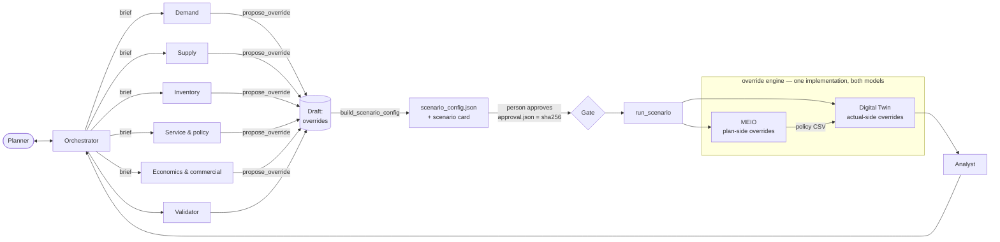

# Agentic scenario layer — implementation plan

**Goal.** A planner describes a what-if in plain English. A small team of agents turns it into an auditable set of **overrides** to service levels, demand, supply, on-hand inventory and economics, and writes the scenario config. After a person approves it, **MEIO re-plans** and the **Digital Twin simulates** the scenario from the same overrides. An analyst agent then explains the result against the baseline.

**Status (9 Oct 2026).** Both halves are built.
- **Agents.** This folder holds the instructions, the tools, the approval gate and a **LangGraph** runtime. The runtime was live-tested end to end through Claude Desktop (see [examples/live_test_2026-10-09.md](examples/live_test_2026-10-09.md)).
- **Engine.** `models/overrides/` covers Phases 0–2 and all 19 measures. `policy.pooling_alpha` is accepted only when the config's MEIO is Clark-Scarf v2. The engine is wired into both MEIO models (single-week and rolling) and into the Digital Twin.
- **MEIO model and tuning (9 Oct).** The shared config's `meio.parameters` now names the model, which is Clark-Scarf v2. `final_submission/meio_parameters.py` takes alpha and netting from `run_all.py`'s multi-seed evidence by a validated rule; today that gives alpha 0.2 and netting 0.0. A config without that section, such as SCENARIO_0003, keeps MEIO Weekly.
- **Strictness.** An override the engine cannot apply exactly stops the run, and every application leaves a receipt.
- **Regression.** With no overrides, the Twin's outputs and the MEIO rolling policy are byte-identical to the committed SCENARIO_0002 run.

**Status update (23 Oct 2026), checked against the code.**
- **Pipeline.** The root `scenario_config.json` now points at the optimized port in `models/MEIO/MEIO_Weekly/final_submission_optimized/`: `run_weekly_tools.py` (runner), `meio_optimizer_weekly.py`, `roll_forward_policy.py` and the Twin `digital_twin_fast.py`. The engine hooks live there. `models/twin/digital_twin.py` in this tree does not import `models/overrides`: it applies only the legacy `demand_surge_pct` and saves any other `changes` key without effect.
- **MEIO tuning.** `meio_parameters.py` is now in `final_submission_optimized/` (11 tests in its `tests/test_meio_parameters.py`). SCENARIO_0002's `meio_parameters.json` resolves to alpha 0.6, netting 0.0, DDLT quadrature and per-cluster alphas of 0.6–1.0 (`alpha_by_cluster`). MEIO's z now comes from the segmentation cluster ladder (`output datasets/segmentation/sku_clusters.csv`, `safety_factor_z`), with the old segment ladder only as the fallback for a SKU with no cluster.
- **Third evaluation arm.** `reactive` (`reactive_twin.py`) and its no-scenario control were added; see §3.4.
- **Models.** `runtime/llm.py` gained an `nvidia` provider (NVIDIA Build API through `langchain-openai`), and `profiles.yaml` now defaults to it (`z-ai/glm-5.3-flash`). The Anthropic profiles were renamed (`claude`, `anthropic-test`, `anthropic-production`); see §4.
- **Front end.** `App/streamlit_app.py` hosts an in-process agent chat with the approval interrupt (Simulation centre).
- **Scenarios on disk.** The 9 Oct heatwave scenario's folders are gone. `SCENARIO_0003_` and `SCENARIO_0004_Veganism_Dairy_Decline_Protest_Shipping_Delays` (built 21 and 23 Oct, both on Clark-Scarf v2) are the scenarios now in `output datasets/overrides/`, and both ran.
- **Tests.** 30 agent tests (21 tools, 9 runtime). The 13 engine tests no longer collect: they import `meio_weekly_lib` from `final_submission/`, which no longer holds it, and call `models/twin/digital_twin.run_twin(..., overrides=...)`, which no longer takes overrides (§8).

§5 is kept as the design record, and §5.6 notes where the build differs from it.

**Decisions taken (9 Oct).**
- **MEIO.** Scenarios run the MEIO that `scenario_config.json` defines; agents never choose a model.
- **Runtime.** The agents run on LangGraph.
- **Test models.** The orchestrator runs on Sonnet 4.6 and the workers on Haiku 4.5, configured in `runtime/profiles.yaml`. *Changed since:* that pairing is now the `anthropic-test` profile, and the default profile is `nvidia` (GLM 5.3 Flash for every agent).
- **Output location.** Everything the override layer and engine write goes to `output datasets/overrides/SCENARIO_####_Name/`, with the root taken from the config's `overrides.output_root`.

---

## 1. Where the project stands today

| # | Finding | Evidence | Consequence |
|---|---|---|---|
| G1 | The MEIO runner ignores any config but the root one | `run_weekly_tools.py:30` hardcodes `scenario_config.json`; `run_meio_then_twin.py:62-66` starts MEIO with no `--scenario-config` (only the Twin gets it, at :71-88) | An agent-written config builds MEIO under the *root* scenario's folder, and `latest_policy()` then fails |
| G2 | Relative paths resolve from the config's own folder | `models/scenario.py:47-54` (`config_path.parent / path`) | A config saved outside the repo root points at the wrong data |
| G3 | The production MEIO path applies no scenario at all | `roll_forward_policy.py:68-124` never reads `changes`; only `clark_scarf_v2.solve` (:128-130) does, and only the research script `scenario_test.py` calls it | Even `demand_surge_pct` is simulated by the Twin but never planned for |
| G4 | The Twin applies one change type and silently keeps the rest | `digital_twin.py:356-360`; documented at :1617-1624 ("any other key… has no simulation effect") | Silent no-ops |
| G5 | Two scenario-config loaders | `digital_twin.load_scenario_config` (:1656-1688) duplicates `models/scenario.load_config` | Validation rules drift |
| G6 | Overrides live in module globals | `meio_weekly_lib.Z_OVERRIDE_BY_SKU` (:231), `clark_scarf_v2.ALPHA_OVERRIDE_BY_SKU` (:62) | Usable seams, but process-global state |
| G7 | Shared files written per run | `meio_optimizer_weekly.py:140-170` appends to `meio_weekly_history.csv` and overwrites `chart_ss_trend.png` next to the script | Scenario runs pollute each other |
| G8 | Model naming is ambiguous | The root scenario is `MEIO_CLARK_SCARF_V2` and `final_submission/README.md` recommends Clark-Scarf v2, but `roll_forward_policy.py` sizes with `meio_weekly_lib.solve_policy` | **Resolved:** `meio.parameters.model` names the model (Clark-Scarf v2 since 9 Oct), and both code paths carry the engine hooks. Scenarios copy the section, so they run the same model with the same tuned parameters. |
| G10 | The baseline on disk predates the current config's paths | `SCENARIO_0002`'s saved config points at `MEIO_Weekly/Archive/...`, while the root config points at `final_submission/...`. The rolling-policy code is identical, so this is not a real difference. | `validate_draft` compares the policy script's *content*, seed and opening state, and warns only on a real difference. Regenerate the baseline after Phase 0 as the regression reference. |
| G9 | 4 of 6 library demand surges target pairs that don't exist | SCN0001/0003/0005/0006 name a (CDC, SKU) with no forecast, history or stock | Any surge mechanism multiplies zero; the tools now refuse and suggest alternatives |

**Where these stand (23 Oct).** The line numbers above refer to the 9 Oct code, not the current tree.
- **Resolved:** G1 (`run_weekly_tools.py --scenario-config`, passed by `run_meio_then_twin.py`), G2 (`models/scenario.resolve_path` resolves from the repository root), G3 (the rolling and single-week MEIO apply plan-side overrides), G7 (`meio_optimizer_weekly.py` skips the shared history CSV and chart for any non-root config) and G8.
- **Resolved for the configured Twin only:** G4. `digital_twin_fast.py` and `reactive_twin.py` apply every measure and refuse unknown keys; `models/twin/digital_twin.py` still applies only `demand_surge_pct`.
- **Partly:** G5. `digital_twin_fast.py` loads through `models/scenario.load_config`, but it still borrows `load_scenario_config` from `models/twin/digital_twin.py`, which validates on its own.
- **Kept:** G6. The module globals remain for the research scripts; the pipeline passes overrides explicitly.
- **Open:** G9 (the tools still refuse the four rows). G10 applied to the 9 Oct baseline; SCENARIO_0002 has since been regenerated on the current config.

What already works in our favour:
- One shared config drives both models.
- Folder naming is consistent (`SCENARIO_####_Name`).
- The Twin has independent RNG streams, so changing one thing doesn't shift the demand draws.
- Time-varying policies are already supported (`_policy_at`).
- `scenario_engine.py` is a working prototype of exactly the pattern needed: one function per model seam, a no-op by default.

---

## 2. Target architecture



Design principles:

1. **One contract, two consumers.** Overrides live in `changes.overrides` of the existing scenario config. A single engine package (`models/overrides/`) applies them at named seams in MEIO and the Twin, so the plan and the physics can never disagree about what a scope or window means.
2. **Visibility is explicit.** Each override says whether MEIO *plans* for it, the Twin *experiences* it, or both. That one field covers anticipated events, surprises and forecast errors, and it produces the evaluation arms automatically (§3.4).
3. **No silent no-ops.**
   - The engine rejects unknown measures.
   - It records an **application receipt** (matched rows and magnitude) for every override and side.
   - The run tool refuses measures the installed engine does not declare.
   - The analyst refuses to report results without receipts.
4. **Least privilege in code, not prompts.**
   - Specialists can write only their own measure domains.
   - No agent tool can approve.
   - Approval is a file holding the hash of the exact config a person read.
5. **Additive and reversible.** Every model hook is a no-op when there are no overrides, matching the codebase's existing `scenario_changes` idiom. A regression test pins byte-identical outputs for the baseline.
6. **One folder per scenario, as per config.** Everything about a scenario's overrides lives in `<overrides.output_root>/SCENARIO_####_Name/`, which is `output datasets/overrides/...` in the shared config. The folder holds:
   - the generated `scenario_config.json`, its card and the approval;
   - the run status and log;
   - the engine's `overrides_resolved.json` and `receipts/`.

   The MEIO policy and Twin projections stay in their existing folders, under the same `SCENARIO_####_Name`.

---

## 3. The override contract

Full schema: [`models/overrides/override.schema.json`](../models/overrides/override.schema.json). Semantics per measure: [`models/overrides/catalog.py`](../models/overrides/catalog.py), which `tools/catalog.py` re-exports. Worked example: [`examples/southeast_heatwave.scenario_config.json`](examples/southeast_heatwave.scenario_config.json).

### 3.1 Shape

```json
"changes": {
  "override_schema_version": "1.0",
  "overrides": [{
    "id": "OVR-0001",
    "measure": "demand.volume",
    "scope": {"region": ["Southeast"], "category": ["Beverages"]},
    "window": {"start_period": "2026-W28", "end_period": "2026-W31"},
    "operation": "scale", "value": 1.25, "unit": "multiplier",
    "applies_to": ["plan", "actual"],
    "rationale": "Heatwave lifts Southeast beverage demand 25% through July",
    "provenance": {"agent": "demand_agent", "created_at": "2026-10-09T08:39:50Z"}
  }]
}
```

- **Scope.** Keys AND together and values within a key OR together. `{"all": true}` is the only way to say portfolio-wide. Keys:
  - SKU attributes: `sku_id`, `category`, `subcategory`, `brand`, `segment`, `price_tier`, `production_family`, `cluster`, `archetype`;
  - nodes: `dc_id`, `region`, `echelon`;
  - customers: `b2b_customer_id`;
  - plants: `plant_id`;
  - lanes: `lane_id`, `origin_node_id`, `destination_node_id`, `transport_mode`.

  For lane measures, node keys filter on the lane's destination. A plant DC's region is derived from its state.
- **Window.** Inclusive ISO weeks inside 2026-W01..W52. Omit it for the whole horizon. Opening-position and economics measures take none.
- **Operations.** `scale`, `add`, `set`, `floor`, `cap`, `block`. Bounds, units and soft "unusual" ranges are per measure in the catalog.
- **Composition.** Overrides apply in list order on overlapping rows: scales multiply, adds add, a later `set` overwrites. The tools flag every overlap.

### 3.2 Measures (v1 catalog)

| Measure | MEIO seam (plan) | Twin seam (actual) | Phase |
|---|---|---|---|
| `demand.volume` | `target_week_demand` output: target_mean, target_std (CV held) | forward forecast rows before the error draw (`_build_demand`) | 1 |
| `demand.volatility` | target_std | error ratio r → 1 + k(r − 1) | 1 |
| `inventory.on_hand`, `inventory.in_transit` | — (MEIO never reads the position) | opening state (`_load_policy`) | 1 |
| `service.target_csl` | `assign_z`: z = Φ⁻¹(CSL) per (sku, dc, period) | — (through the policy) | 1 |
| `policy.safety_stock` / `reorder_point` / `order_up_to_level` | post-solve, per period; S ≥ s re-imposed | — (through the policy) | 1 |
| `economics.unit_cost` / `margin` / `holding_rate` / `storage_cost` / `logistics_cost` | — (sizing is service-level driven) | `build_inputs` cost arrays | 1 |
| `supply.lead_time_mean`, `supply.lead_time_std` | lead-time graph per target period | lane parameters by dispatch week | 2 |
| `supply.plant_capacity` | `clip_to_plant_capacity` per period | `_produce` capacity by week | 2 |
| `supply.schedule_adherence` | — | `_produce`: executed × multiplier | 2 |
| `policy.pooling_alpha` | `clark_scarf_v2` alpha per SKU | — | 2 |
| `supply.lane_outage` | — (pair with a plan-side lead time for foresight) | `_ship`: hold until reopen (v1), failover (v2) | 3 |

These cover the levers the brief names (service level, demand, supply, on-hand inventory) plus the ones CPG planners routinely ask about:
- forecast error and volatility;
- customer wins and losses (customer scope);
- promotions and everyday price changes, as a macro using the dataset's own elasticities and post-promo dip;
- line and plant capacity and schedule attainment;
- lead-time shocks and lane outages;
- the disruption library;
- the segmentation service ladder;
- peak-season protection (windowed CSL and policy floors in weeks of cover);
- COGS inflation with and without price pass-through;
- cost of capital, warehouse and freight inflation.

### 3.3 Visibility (`applies_to`)

| Planner's situation | applies_to | Effect |
|---|---|---|
| Known or anticipated event (announced strike, planned promo, forecast heatwave) | plan + actual | MEIO re-plans; the Twin lives through it |
| Surprise | actual | Policy unchanged; the Twin lives through it |
| Forecast error (plan expects something that doesn't happen) | plan *or* actual only | Over- or under-planning |
| Service target or policy rule | plan | Inputs to MEIO only |
| Opening stock, costs | actual | Physics or valuation only |

### 3.4 Evaluation arms

This is the protocol of `final_submission/scenario_test.py`, made automatic by `scenario.arms_for()`:

- **baseline**: the root-config run already on disk. Same seed, same opening position, same MEIO model.
- **unprepared**: the baseline policy, with the Twin applying the actual side. Costs one Twin run, since there is no MEIO rebuild.
- **prepared**: MEIO re-plans with the plan side, then the Twin applies the actual side.

The analyst reports **impact if unprepared** (unprepared − baseline), **value of re-planning** (prepared − unprepared) and **cost of preparing** (the prepared − baseline inventory investment).

**Added after the design (built by 23 Oct):**
- **reactive**: `final_submission_optimized/reactive_twin.py`. Week 1 runs today's policy; before each later week's review, MEIO re-sizes that week as of the previous one, after appending the simulated demand to its history and rescaling lane lead times where arrived shipments moved beyond a ±5% deadband and 3 standard errors. MEIO is told none of the plan-side overrides; the Twin applies the actual side at the same seed. `arms_for()` adds it whenever the Twin simulates something.
- **reactive control**: `counterfactual_reactive_no_scenario` under the baseline scenario, the same weekly re-planning on the root config with no overrides. `run_job` builds it once per baseline and seed.
- `compare_runs` reports **value of reacting** (reactive − unprepared, `react_value`) and splits it into the normal-year effect (control − baseline) and the reaction to this scenario.
- `arms_for()` now returns prepared, unprepared and reactive for plan + actual scenarios, unprepared and reactive for actual-only ones, and prepared alone for plan-only ones.

### 3.5 Config shape

`build_scenario_config` copies the root config's `digital_twin`, `meio`, `artifacts` and `overrides` sections. The `meio` section is copied **verbatim**: a scenario runs the MEIO the config defines and never picks its own. Entrypoints, seed and opening state therefore match the baseline. It then adds:

- `changes.overrides`;
- `artifacts.scenario`, ending in the scenario folder as `models/scenario.resolve_scenario_path` requires (`build_config` checks it);
- `overrides {engine: "models/overrides", output_root: "output datasets/overrides"}`, inherited from the root config. The engine derives `<output_root>/SCENARIO_####_Name` the same way MEIO derives its own folder;
- `digital_twin.run_name = "prepared"` and the draft's seed;
- `evaluation {baseline_scenario, baseline_run, arms}`;
- `details {owner, hypothesis, request, created_by, created_at, notes}`;
- `schema_version: "1.1"`.

The file is written to `output datasets/overrides/SCENARIO_####_Name/scenario_config.json`, beside its card and approval. It is loaded through `models/scenario.load_config` before it is final, so both models are guaranteed to accept it.

---

## 4. The agents and tools (built — this folder)

| Agent | Writes | Notable tools |
|---|---|---|
| `orchestrator` | nothing directly | `create_draft`, `delegate`, `apply_library_scenario`, `validate_draft`, `build_scenario_config`, `request_human_approval`, `run_scenario`, `get_run_status` |
| `demand_agent` | `demand.*` | `propose_override`, `resolve_scope`, `resolve_window`, library |
| `supply_agent` | `supply.*` | the same, plus lane and plant profiles |
| `inventory_agent` | `inventory.*` | `propose_override` with weeks-of-cover units |
| `service_policy_agent` | `service.*`, `policy.*` | `apply_service_ladder` |
| `economics_agent` | `economics.*` (+ demand via the price macro) | `add_price_event` |
| `validator_agent` | read-only | `validate_draft`, `preview_impact`, independent faithfulness review |
| `analyst_agent` | read-only | `compare_runs`, `service_breakdown`, `scope_service`, `policy_diff`, `get_application_receipts` |

- **Instructions.** [`instructions/`](instructions/) holds `_shared_context.md` (network, horizon, contract, KPIs, honesty rules and limitations, prepended to every agent) plus one file per agent.
- **Tools.** [`tools/`](tools/), with the Claude tool specs and allowlists in `registry.py`. People use the same tools through `python -m Agents.tools`.
- **Validation layers**, cheapest first:
  1. catalog (operation, bounds, units, sides, window);
  2. master data (every value exists, with did-you-mean hints; the scope must match rows);
  3. JSON Schema;
  4. set level (overlaps that compound, plan/actual coverage, whether the baseline on disk still matches the config, engine support);
  5. the validator agent's semantic review;
  6. the scenario card a person reads;
  7. the engine's own strict checks and receipts at run time.
- **Previews.** Every proposal returns an instant input-size preview: units and dollars, lanes and the share of demand moving over them, capacity against load, weeks of cover, CSL moves with a safety-stock dollar estimate. That puts magnitude errors in front of the planner before compute is spent.
- **The gate.**
  - `build_scenario_config` writes `scenario_card.md`.
  - `request_human_approval` pauses the LangGraph run with `interrupt()`. A person resumes it at the terminal, or through the Claude Desktop bridge, or in the Streamlit app's agent chat, or later with `python -m Agents.tools approve <scenario> --by <name>` (the app's Approve button runs the same command with `--yes`). That writes `approval.json` with the config's SHA-256.
  - `run_scenario` refuses if the hash changed, if outputs would be overwritten without `--allow-overwrite`, or if the engine doesn't declare every measure used.
- **Runtime: LangGraph** ([`runtime/graph.py`](runtime/graph.py)).
  - **Agent graphs.** Each agent is a `model ⇄ tools` graph bound to its allowlisted tools.
  - **Delegation.** `delegate` runs a specialist's graph, compiled with `checkpointer=False`, on a self-contained brief.
  - **Approval.** The approval tool is routed to its own node, so resuming never re-runs earlier tools.
  - **Validator evidence.** The validator's graph starts with an `evidence` node that runs `list_overrides` and `validate_draft`. The live test showed a small model reviewing from the brief alone; this makes that impossible.
  - **Checkpointing.** The orchestrator graph is checkpointed (`InMemorySaver`).
- **Models** come from [`runtime/profiles.yaml`](runtime/profiles.yaml). As planned (9 Oct):
  - `test`: `claude-sonnet-4-6` orchestrator (effort medium, adaptive thinking) and `claude-haiku-4-5` workers;
  - `desktop`: the same roles on Claude Desktop's `sonnet` and `haiku`, through the no-key bridge ([`runtime/bridge.py`](runtime/bridge.py));
  - `production`: an Opus 5.5 candidate with server-side refusal fallback.

  *Changed since (23 Oct):* `runtime/llm.py` has three providers, `nvidia`, `anthropic` and `desktop`. The default profile is `nvidia` (`z-ai/glm-5.3-flash` for every agent, `NVIDIA_API_KEY`), and `test`, `nvidia-fast` (`google/gemma-4-31b-it`) and `production` are NVIDIA profiles too. `desktop` is unchanged. The Anthropic profiles are `claude` (`claude-opus-5` orchestrator with effort high and refusal fallback, `claude-haiku-4-5` workers; the app's "Claude" option), `anthropic-test` (the former `test`) and `anthropic-production` (the former Opus 5.5 `production`).

  Each agent's tools + shared context + instructions prefix is byte-stable, with a cache breakpoint on the system prompt (a `cache_control` block in `graph.system_message`).

---

## 5. Model-side work, phase by phase

Line numbers refer to the current `main` (commit `6bca22d`). They are the 9 Oct design record; the hooks now live in `final_submission_optimized/` (§5.6), so they no longer match the current tree.

### 5.0 Phase 0 — pipeline plumbing (½ day)

**Status (23 Oct): done**, except the single loader (partly; see G5 in §1). `readiness` reports `phase0_pipeline: true`.

| Change | Where |
|---|---|
| `run_weekly_tools.py` accepts `--scenario-config` (default root) and forwards it to both tools; it also takes `as_of_week` from `meio.as_of_week` when no CLI value is given | `run_weekly_tools.py:30-46` |
| `run_meio_then_twin.py` passes `--scenario-config` to the MEIO runner | `run_meio_then_twin.py:62-66` |
| `resolve_path` resolves relative paths from the **repository root** (identical for the root config, and it also makes the audit copies in output folders re-runnable) | `models/scenario.py:47-54` |
| One loader: `digital_twin.load_scenario_config` delegates validation to `models/scenario.load_config` and keeps only the folder logic | `digital_twin.py:1656-1688` |
| Scenario-scope the weekly history and chart, or skip them for non-root scenarios | `meio_optimizer_weekly.py:140-170` |
| Capability marker: `PIPELINE_CAPABILITIES = {"scenario_config_passthrough": True, "repo_root_paths": True}` | `models/scenario.py` |
| `overrides_dir(config_path, config)` = `resolve_path(…, "overrides", "output_root") / scenario_folder_name(config)`, the one place the engine and the runners find a scenario's override folder. The root config already carries `"overrides": {"engine": "models/overrides", "output_root": "output datasets/overrides"}`. | `models/scenario.py` |

**Acceptance.**
- The root config reproduces today's `SCENARIO_0002` outputs byte-for-byte.
- An agent config in `output datasets/overrides/SCENARIO_####_Name/` with an empty override list runs into its own `SCENARIO_####` MEIO and projection folders.
- `python -m Agents.tools readiness` shows `phase0_pipeline: true`.

### 5.1 Phase 1 — override engine and v1 measures (2 days)

**Status (23 Oct): done**, with the layout changes in §5.6. The Twin hooks below were planned for `models/twin/digital_twin.py`; in the current tree they are in `final_submission_optimized/digital_twin_fast.py` (and reused by `reactive_twin.py`), and `models/twin/digital_twin.py` has none. The MEIO hooks are in the `final_submission_optimized/` copies of `roll_forward_policy.py`, `meio_optimizer_weekly.py`, `meio_weekly_lib.py` and `clark_scarf_v2.py`. The single-week MEIO writes its own receipt, `receipts/meio_weekly.json`.

Create `models/overrides/`, generalising `models/twin/scenario_engine.py`:

```
models/overrides/
  __init__.py   ENGINE_VERSION = "1.0"; SUPPORTED_MEASURES; load(config) -> OverrideSet
  catalog.py    <- moved from Agents/tools/catalog.py (Agents/tools then imports it)
  scope.py      <- universe / match / canonicalize moved from Agents/tools/context.py
  compile.py    OverrideSet: side("plan"|"actual"), active(measure, period); legacy translation
                (demand_surge_pct & co. -> demand.volume); unknown keys raise
  demand.py     forecast_rows(df, side) [Twin]; target_demand(df, period) [MEIO]
  inventory.py  opening_state(df)
  service.py    z_for(df, period)
  policy.py     apply(policy_df, period)
  economics.py  sku_master(df), cost_parameters(df), lanes(df)
  receipts.py   per override x side: matched rows, weeks, magnitude
```

**What the engine writes, and where.** Code lives in `models/overrides/`. Every file it generates goes into the scenario's override folder, `<overrides.output_root>/SCENARIO_####_Name/`, which is `output datasets/overrides/...`:

```
output datasets/overrides/SCENARIO_0003_Southeast_Heatwave/
  scenario_config.json      the approved input (written by the agent layer)
  scenario_card.md          what the person read
  approval.json             who approved which SHA-256
  status.json, run.log      the gated run, per arm
  overrides_resolved.json   engine: each override compiled against master data -- matched rows per side
  receipts/meio.json        engine: what MEIO applied, per override and target period
  receipts/twin_prepared.json, receipts/twin_unprepared.json
                            engine: what the Twin applied, per override and run
```

The engine never writes into the code tree or into `input datasets/`. The MEIO policy and Twin projections stay in their existing `output datasets/MEIO/` and `output datasets/projections/` folders, under the same scenario name. *As built:* `digital_twin_fast.py` writes each Twin run to `output datasets/SCENARIO_####_Name/<run>/`, with no `projections/` segment, and the reactive arm adds `receipts/twin_reactive.json`.

Moving `catalog.py` and the scope logic is what guarantees that what an agent previews is exactly what the engine applies. After the move, `Agents/tools/paths.SCHEMA_PATH` and the two imports point at `models/overrides`. That is a two-line change.

**Twin hooks** (`models/twin/digital_twin.py`):
1. `build_inputs(…, overrides=None)` (:205). Keep `scenario_changes` as a deprecated alias compiled through the same engine.
2. Economics, right after the tables load (:225-235): `unit_cost`, `margin` (with `hold_list_price`), `storage_cost`, `inventory_carrying_pct_annual`, `logistics_cost_per_unit_usd`. These feed the holding and logistics arrays at :368-386.
3. Demand (`_build_demand`, :575): apply `demand.volume` to the **forward forecast rows before the (period, dc, sku) groupby** at :612-614, so customer scope is honoured. Apply `demand.volatility` to `ratios` (:645) before `weekly` (:647). No extra RNG draws, so common random numbers are preserved.
4. Opening state (`_load_policy`): apply `inventory.*` right after `pd.read_csv(state_csv)` (:544).
5. Receipts go to `receipts/twin_<run>.json` in the scenario's override folder, with a summary in `notes["overrides_applied"]` (and so in `run_manifest.json`, :1248-1263). Update the generated doc's limitations (:1617-1624) and `ASSUMPTIONS` (:1191).

**MEIO hooks** (`models/MEIO/MEIO_Weekly/final_submission/`):
1. `roll_forward_policy.run` (:68) loads `overrides.load(config).side("plan")` and threads it through the weekly loop (:89-107).
2. `meio_weekly_lib.target_week_demand(…, overrides=None)` (:426) applies `demand.*` to **its output**, after the blend at :484, not to the raw forecast. Because target_mean = 0.6 × forecast × bias + 0.4 × seasonal level, scaling only the forecast would plan a +25% event as about +15%. Customer-scoped changes use a forecast-weighted multiplier per (period, dc, sku), precomputed from the raw forecast rows. `smoothed_rdc_demand_for_pdc` (:631) passes the overrides through so PDC sizing sees the same demand.
3. `assign_z(df, overrides=None, period=None)` (:234): CSL overrides become z per (sku, dc, period). Keep `Z_OVERRIDE_BY_SKU` for the legacy research scripts.
4. Policy overrides apply post-solve per period, before the append at :103; weeks-of-cover uses that period's `target_mean`, then S ≥ s is re-imposed.
5. Receipts go to `receipts/meio.json` in the scenario's override folder; `overrides_resolved.json` is written once per run, by whichever model loads the overrides first.
6. `meio_optimizer_weekly.run` (single week) gets the same three hooks.

Set `SUPPORTED_MEASURES` to the Phase 1 set.

**Tests** (`models/overrides/tests/`, short horizon via `--horizon-weeks 8` for speed):

| Test | Pass condition |
|---|---|
| Empty overrides | Twin and MEIO outputs byte-identical to the current code |
| `demand.volume` ×1.0 | identical outputs |
| ×1.25 on Southeast beverages, W2–W4 | Twin realised demand in scope ×1.25 (± rounding); out-of-scope cells identical (CRN); MEIO target_mean ×1.25 only in the window |
| Plan-only demand | Twin demand unchanged, policy changed |
| Actual-only demand | policy byte-identical to baseline |
| Inventory set / scale | opening stock in scope as specified; everything else untouched |
| CSL 0.985 for Fast-Moving | z = 2.17 for those pairs only, in-window |
| Policy floor (weeks of cover) | floor respected; S ≥ s everywhere |
| Economics | holding / transport cost recomputed by the expected factor |
| Receipts vs previews | receipt units match `Agents` impact previews for the same override |

### 5.2 Phase 2 — time-varying supply physics (1½ days)

**Status (23 Oct): done**, except the anticipation option (`plan_lead_weeks` does not exist in the code).

- **Twin.**
  - Lane parameters by week: `TwinInputs.lane_by_week` holds only overridden (week, lane) pairs. `_lead_times(origin, dest, n)` (:735) and the promise lookup in `_ship` (:895) take the dispatch week.
  - Capacity by week: `_produce` uses week-indexed `cap_plant` / `cap_family` (:955-969).
  - Adherence multiplier per (plant, family, week): executed = floor(planned × adh × mult) (:971-972). It uses the same draw, so CRN is preserved.
- **MEIO.**
  - `build_leadtime_graph(…, lanes=None)` (:338) and `build_pdc_leadtime` (:551) are recomputed per target period while a lead-time override is active (cached by active-set signature).
  - `clip_to_plant_capacity(…, overrides, period)` (:590).
- **Clark-Scarf v2 path.** There is no per-scenario model selector, because the config's MEIO entrypoints decide. Put the same hooks into `clark_scarf_v2.solve` / `build_rolling_policy` (:105-258), replacing the `scenario_engine` call at :128-130, so that pointing the config's `rolling_entrypoint` at a Clark-Scarf runner moves every scenario onto it. That runner (`roll_forward_clark_scarf.py`, taking alpha 0.2, netting 0.0 and n_sims from the `meio` section) is a team decision. `policy.pooling_alpha` fills `ALPHA_OVERRIDE_BY_SKU` per run when it is the configured MEIO.
- **Anticipation option** (`plan_lead_weeks`, default 0): shifts plan-side windows earlier by the protection interval, so a prepared policy has stock arriving for a surge's first week. The validator warns when a surge starts inside the lead time and anticipation is 0.

### 5.3 Phase 3 — stretch

**Status (23 Oct):** only lane-outage v1 is built (`twin.lane_blocks`: dispatches wait for the lane to reopen). Everything else in this list is not done.

- **Lane outage**: v1 holds dispatches until reopen; v2 adds failover to the second inbound lane (time-varying `supplier_of`).
- **Mid-horizon inventory events** (a fire in week 22).
- **New distribution**: create forecast rows and a policy line for a (dc, sku) not carried today. This is also the honest fix for the four library surges.
- **Windowed economics**: promo margin.
- **Economic CSL**: a newsvendor ratio from overridden costs, so "carrying cost up" can move stocking.
- **Replicates**: N seeds per arm with confidence intervals, making the analyst's "is this noise?" quantitative.

### 5.4 Phase 4 — agent runtime and evaluation (1–1½ days, parallel with Phases 1–2)

The LangGraph runtime is built. It was live-tested through Claude Desktop on 9 Oct ([examples/live_test_2026-10-09.md](examples/live_test_2026-10-09.md)), and two fixes came out of that run (§8). Remaining:

- **First API run** with `--profile test` (`claude-sonnet-4-6` / `claude-haiku-4-5`) once credentials exist. Check:
  - that the gateway in `ANTHROPIC_BASE_URL` accepts these model IDs;
  - that `usage.cache_read_input_tokens` grows across an agent's turns.

  *Changed (23 Oct):* that pairing is now `--profile anthropic-test`; `test` is an NVIDIA profile. The repository records no Anthropic API run. The NVIDIA provider was exercised far enough to tune its settings (the `max_tokens` and timeout notes in `profiles.yaml` and `llm.py`), and its offline profile tests pass.
- **Validator model.** Haiku authored overrides reliably, but as validator it made reasoning slips even with the evidence node. Measure Sonnet as validator on the eval set (one line in `profiles.yaml`). *Status:* not done; no profile sets the validator to Sonnet.
- **Eval set.** About 20 planner requests with golden override sets, covering each measure, each visibility case, the library, promotions, multi-lever scenarios and deliberately ambiguous asks. Score exact match on (measure, scope, operation, value, window, sides), plus a rubric-graded check of the scenario card and the clarifying questions. Gate prompt changes on it. The live-test request and its four overrides are the first golden case. *Status:* not done; there is no eval set in the repository.
- **Persistent checkpointer.** Swap `InMemorySaver` for a SQLite or Postgres saver so a session paused at the approval gate survives a restart. *Status:* not done; `graph.Team` still uses `InMemorySaver`.
- Turn on `strict: true` tool schemas once they are verified against the API. *Status:* not done.
- **Optional front ends:** an MCP server over the same `registry` (no new logic), LangGraph Studio for tracing, or a thin Streamlit page for the scenario card and approval. *Status:* the Streamlit front end is built (`App/streamlit_app.py`, Simulation centre: agent chat on the `desktop` or `claude` profile with the approval interrupt answered in the chat, scenario cards and approval state, an Approve button, and the arms' results). No MCP server or LangGraph Studio configuration exists.

### 5.5 Phase 5 — demo and documentation (½ day)

Three showcase scenarios, each with two seeds:
1. Southeast heatwave with a PLANT01 line cut (the example in `examples/`).
2. Holiday-peak protection via the segmentation service ladder and CDC floors.
3. A rail-lane lead-time spike from the library.

Update the root `README.md` (the agentic layer, readiness) and the generated `OUTPUT_DOCUMENTATION.md`.

*Status (23 Oct):* none of the three showcase scenarios is on disk. The scenarios that ran are SCENARIO_0003 and SCENARIO_0004 (a dairy demand decline with protest-driven lead-time increases), each on one seed. The root `README.md` does not describe the agent layer.

### 5.6 As built (9 Oct)

Phases 0–2 are done. Where the build departs from the design above:

- **Layout.** The engine is `catalog.py`, `master.py` (master data and scope), `compile.py` (strict loader, `OverrideSet`, receipts), `meio.py` (`PlanHooks`) and `twin.py` (actual-side functions). The planned per-measure modules were folded into these. `Agents/schemas/` was removed, because the schema now lives in `models/overrides/`.
- **Legacy keys.** `demand_surge_pct` and its companions are not translated. A config that uses only legacy keys keeps the `scenario_engine.py` path unchanged, and mixing legacy keys with `overrides` is refused.
- **MEIO demand** is a pair-level affine map applied to the `target_week_demand` output: `M × target_mean + A`. M and A are derived from the line-level rules and weighted by forecast, with equal weights in weeks where the forecast is zero. The CV is held, and `demand.volatility` scales σ.
- **Policy shape.** A safety-stock change moves the reorder point (ROP) and the order-up-to level (OUL) by the same amount. A ROP change moves the OUL. `weeks_of_cover` is converted with that period's planning demand: own demand at a CDC or RDC, throughput at a plant DC.
- **Lanes and capacity** are applied per week in both models. The Twin keys lead times and outages by dispatch week, and capacity and adherence by production week. MEIO rebuilds the lead-time graph and the PDC lead times for each target period.
- **Clark-Scarf.** `clark_scarf_v2.solve` carries the same hooks, plus `PlanHooks.alpha` for `policy.pooling_alpha`. There is no separate runner: `roll_forward_policy.py` and `meio_optimizer_weekly.py` call whichever model `meio.parameters` names (`size_rdc_cdc`). In the pipeline it runs with deterministic DDLT quadrature. Monte Carlo's shared random stream moved about 75% of rows when 20 rows' demand changed, which would have buried prepared-vs-unprepared deltas in noise.
- **Not done:** the anticipation option (`plan_lead_weeks`) and all of Phase 3.

### 5.7 As built, later changes (to 23 Oct)

- **Optimized pipeline.** The root config's entrypoints moved to `final_submission_optimized/`, a polars port of the MEIO and Twin code. `run_weekly_tools.py` always runs the `meio_optimizer_weekly.py` and `roll_forward_policy.py` next to it, whatever `meio.weekly_entrypoint` / `rolling_entrypoint` say. The Twin is `digital_twin_fast.py`, which applies the actual side through `models/overrides/twin.py` and writes runs to `output datasets/SCENARIO_####_Name/<run>/`. `Agents/tools/paths.PROJECTIONS_DIR` was changed to match (`output datasets`).
- **Reactive arm** (§3.4): `reactive_twin.py`, the reactive control, `arms_for()`, `compare_runs` and `scope_service` support for it, and the analyst instructions.
- **MEIO service level.** z now comes from the segmentation cluster ladder in `sku_clusters.csv`; `service.target_csl` replaces or shifts it.
- **Lane outage v1** is built and tested (§5.3; the 9 Oct engine tests in §8 already covered it, so "all of Phase 3" above overstates what was missing), and all 19 measures are in `SUPPORTED_MEASURES`.
- **Models.** NVIDIA provider and profiles (§4).
- **Front end.** The Streamlit agent chat and approval (§5.4).
- **Still not done:** `plan_lead_weeks`, the rest of Phase 3, the eval set, the persistent checkpointer and strict schemas.

---

## 6. Timeline: charter Phase 5 window (10–16 Oct 2026)

| Day | Engine — Twin | Engine — MEIO | Agents / QA |
|---|---|---|---|
| Sat 10 | Phase 0 plumbing; package skeleton; move catalog and scope; `overrides_dir` | Phase 0 runner passthrough | eval set v1 (golden overrides), seeded with the live-test case |
| Sun 11 | Twin hooks 1–4; receipts into the override folder | `target_week_demand`, `assign_z`, policy hooks | first API run on `--profile test` (if credentials are available); validator-model comparison |
| Mon 12 | regression and CRN tests | receipts; regression | first end-to-end approved run (demand + inventory + CSL) |
| Tue 13 | Phase 2 lanes, capacity, adherence | lead-time graph per period; capacity clip | evals on supply scenarios |
| Wed 14 | lane-outage v1 (stretch) | Clark-Scarf path hooks (used if the config points there) | prompt fixes from evals; persistent checkpointer; strict schemas |
| Thu 15 | showcase runs (two seeds) | showcase runs | analyst readouts; slides |
| Fri 16 | buffer | buffer | docs; demo rehearsal |

The **minimum demoable slice** is Phases 0 and 1 by Monday: demand, inventory, service, policy and economics, end to end with arms and receipts. Supply-side measures can already be drafted and approved, and they run once Phase 2 lands.

---

## 7. Risks and mitigations

| Risk | Mitigation |
|---|---|
| A planned demand change is diluted by MEIO's forecast blend | Apply at the `target_week_demand` output (§5.1), not to the raw forecast |
| A prepared policy still misses the first days of an event (lead time) | Phase 2 anticipation option; disclosed in the instructions and analyst caveats |
| Scenario deltas contaminated by RNG drift | Overrides apply after the draws; a CRN regression test pins out-of-scope cells |
| Silent no-op | Strict engine, `SUPPORTED_MEASURES` gate, receipts, analyst receipt check |
| LLM misreads the request (magnitude, window, scope) | Typed contract, domain specialists, `resolve_window` / `resolve_scope`, previews, validator agent, scenario card, human gate, eval set |
| Double counting (promo on a planned promo; surge plus promo) | Overlap detection with the compounded multiplier; the promo macro warns about planned lift already in the forecast |
| Compute time (minutes per arm) | The unprepared arm reuses the baseline policy (Twin only); runs are async; run scenarios serially until G7 is fixed |
| Single-seed noise mistaken for signal | Analyst caveat below about 0.3 pp; Phase 3 replicates |
| Process-global overrides in MEIO | The engine passes overrides explicitly; globals stay only for the legacy research scripts |
| Unsupported request quietly approximated | The instructions require stating what can't be expressed; the limitations list is in every prompt |

---

## 8. Verification done so far

**Re-checked 23 Oct.**
- `python -m pytest Agents/tests` now collects **30 tests** (21 tools, 9 runtime). 29 passed; `test_nvidia_profile_uses_openai` failed only because `langchain-openai` was not installed in the test environment.
- The runtime's profile tests now check the `nvidia` profile (a `ChatOpenAI` on the NVIDIA base URL with `z-ai/glm-5.3-flash`, 4096 max tokens, temperature 0.5), the NVIDIA `production` profile and the `desktop` bridge. The Sonnet 4.6, Haiku 4.5 and Opus 5.5 payload checks listed below were removed.
- `test_compare_reproduces_known_result` now checks that `compare_runs` reproduces the deltas computed from the two `run_kpis.json` files, and their direction (MEIO above the static policy on customer fill, below it on internal fill). It no longer pins +1.7 / −7.9 pp; today's SCENARIO_0002 vs SCENARIO_0001 files give +13.86 pp customer fill and −10.81 pp internal fill.
- `python -m pytest models/overrides/tests` **fails at collection**. `test_engine.py` puts `final_submission/` on the path for `meio_weekly_lib`, which now exists only in `final_submission_optimized/` and `MEIO_Weekly/`, and it calls `models/twin/digital_twin.run_twin(..., overrides=...)`, which takes no `overrides` argument in this tree. The engine's 9 Oct results below therefore cannot be re-run as written.
- The 9 Oct regression and SCENARIO_0003 results below refer to runs whose outputs are no longer in the repository.

**As recorded on 9 Oct:**

- `python -m pytest Agents/tests` passes **28 tests** on the real datasets.
  - **Tools (20):**
    - schema ↔ catalog ↔ registry sync;
    - window and scope resolution;
    - every rejection path, with nothing saved;
    - overlap compounding;
    - weeks-of-cover, including plant DCs on a throughput basis;
    - all 30 library rows (26 translate; the 4 in G9 are refused with alternatives);
    - promo lift and dip equal to the generator's formulas;
    - the config build: written under the overrides root, MEIO copied verbatim, accepted by `models/scenario.load_config`;
    - approval hash and staleness;
    - the run gate: it refuses without a valid approval and launches `run-job` once approved (the launch is mocked in tests);
    - `compare_runs` reproducing the known MEIO-vs-static result (+1.7 pp customer fill, −7.9 pp internal fill).
  - **LangGraph runtime (8):**
    - the full flow with the approval interrupt, both approve and decline, with no tool re-run on resume;
    - allowlists and prompt layout;
    - the validator evidence node;
    - model profiles, checked as offline request payloads: Sonnet 4.6 with adaptive thinking and medium effort, Haiku 4.5 with neither, Opus 5.5 with the refusal fallback;
    - a full round trip through the Claude Desktop bridge mailbox.
- **Live test (9 Oct).** The LangGraph runtime ran end to end on the `desktop` profile: 21 model calls answered by Claude Desktop (`claude-sonnet-5-5` orchestrator, `claude-haiku-4-5-20251001` workers). Four correct overrides came out, then validation, the scenario card, a human approval through the LangGraph interrupt, and a correct run refusal. Three findings changed the code or prompts:
  1. Haiku carried "July" from the heatwave into the flood, so the shared context now says each change keeps to what was said about it.
  2. The validator reviewed without its tools, so the graph now gathers its evidence first. On re-test it flagged the non-binding capacity cut.
  3. A role-play operator prompt was blocked by the gateway's Model Armor filter, so the documented operator prompt uses plain task wording.
- **Engine (`python -m pytest models/overrides/tests`, 13 tests).** These run on the real data: the Twin over 8 weeks at seed 2026, and MEIO on single target weeks.
  - **Twin:**
    - demand ×1.25, scoped and windowed, with out-of-scope cells unchanged (common random numbers held);
    - opening stock ×0.7;
    - a capacity cut that clips production;
    - lead time +10 days;
    - a lane outage that holds dispatches;
    - a doubled holding rate.
  - **MEIO:**
    - `target_mean` ×1.25 exactly, in scope;
    - z = Φ⁻¹(0.985);
    - a weeks-of-cover floor, with OUL ≥ ROP kept;
    - +7 days in the lead-time graph;
    - plant capacity ×0.5.
  - **Engine itself:** strict rejection of unknown measures, unsupported measures and empty scopes.
- **Regression with no overrides.** The full MEIO rolling run (258 s) and the full Twin run (32 s) are byte-identical to the committed SCENARIO_0002 run. The one exception is `cost_summary.csv`, which differs by float noise of 3e-11.
- **First real scenario run (9 Oct).** SCENARIO_0003 ran through the gated path. The orchestrator called `run_scenario`, both arms succeeded in 6 minutes, and the analyst reported back. Every override is confirmed by its receipt and by the outputs themselves. See [examples/SCENARIO_0003_walkthrough.md](examples/SCENARIO_0003_walkthrough.md). The run also exposed weaknesses in the analyst's tools and prompt, and these are fixed:
  - `policy_diff` now takes a window;
  - the new `scope_service` tool reports fill inside an override's own scope;
  - receipts are checked per side;
  - an applied override is no longer treated as a binding one.
- **Not yet verified:**
  - the API path itself, which needs credentials;
  - Sonnet 4.6 specifically, which Desktop cannot select.
- **Later scenario runs (21 and 23 Oct).** SCENARIO_0003 and SCENARIO_0004 (Veganism_Dairy_Decline_Protest_Shipping_Delays) ran through `run_scenario` on Clark-Scarf v2, with every arm succeeding (`status.json`). SCENARIO_0003's approved arms were prepared and unprepared; a reactive run and `receipts/twin_reactive.json` also exist for it, made outside `run_job`. SCENARIO_0004 ran prepared, unprepared and reactive.

---

## 9. Decisions

**Taken (9 Oct):**
- **MEIO.** Scenarios run the MEIO defined in `scenario_config.json`.
- **Runtime.** The agents run on LangGraph.
- **Test models.** Sonnet 4.6 for the orchestrator and Haiku for the workers, in `profiles.yaml`. *Changed since:* now the `anthropic-test` profile; the default profile is `nvidia`.
- **Output location.** Override files go to `output datasets/overrides/SCENARIO_####_Name/`, from the config's `overrides.output_root`.

**Still open (status 23 Oct in italics):**
1. **Validator model.** Haiku workers authored overrides well. The Haiku validator needed the code-level evidence node and still made reasoning slips. Recommend `validator_agent: {model: claude-sonnet-4-6}`, to confirm on the eval set. *Not decided; no profile sets it, and there is no eval set.*
2. **Production models.** `production` in `profiles.yaml` is an Opus 5.5 candidate, to be decided on the eval set. *Changed: `production` is now an NVIDIA GLM 5.3 Flash profile, and the Opus 5.5 candidate is `anthropic-production`. Not decided.*
3. **Library fix (G9).** Correct SCN0001/0003/0005/0006 in the generator, or keep the refusal.
4. **Committing drafts.** Scenario folders under `output datasets/overrides/` are tracked like the other outputs. Pre-scenario drafts and transcripts stay in the git-ignored `Agents/workspace/`.
