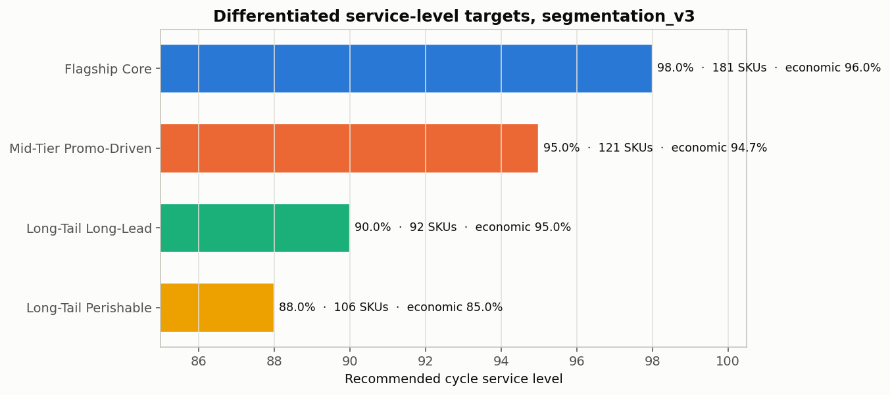
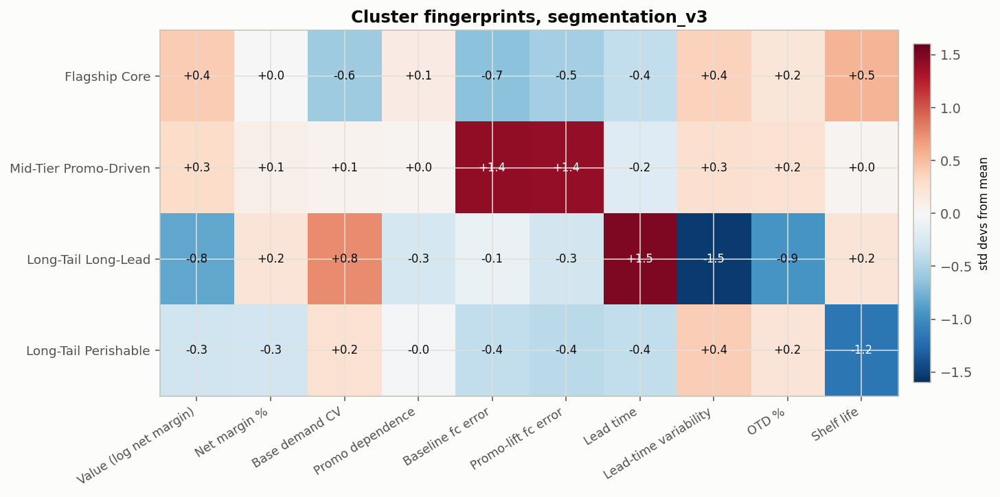
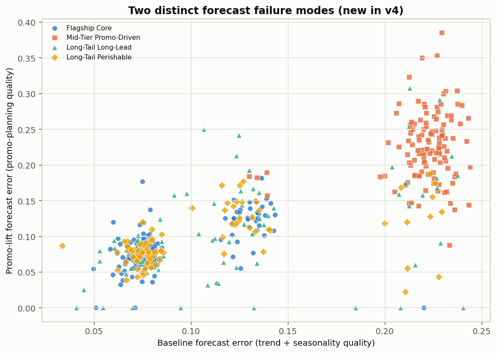

# Supply Brain — SKU Segmentation on the Shared Input Dataset (v3)

**Differentiated service-level targets with perishability switched off**

> **Note (2026-10-23): this report does not match the shipped code or outputs.** It records an
> earlier run (generator v4, `SHELF_LIFE_PROFILE="relaxed"`, and an earlier version of
> `segmentation_v3.py`). The outputs of that run are no longer in the repo, and the figures below
> (k=5, 8 features in 4 blocks, fill 79–93%, $11.43M lost margin, OTD ≈ 90%, cross-dataset ARI 0.829)
> cannot be reproduced from it. Treat them as historical.
>
> - **What is actually in `Output/` came from a different run and dataset vintage.** That run used
>   a realistic-shelf-life dataset: shelf life 5–538 days in `sku_clusters.csv`, and an
>   `sku_master` that still had `seasonal_flag`. `run_meta.json` records **k=4** (auto-selected),
>   **10 features in 5 blocks**, all 10 ANOVA-significant, and PCA 40.9%. Only `write_off_rate` was
>   dropped; shelf life was kept. `cluster_k_diagnostics.csv` gives silhouette 0.165 and stability
>   ARI 0.838 at k=4. `cluster_service_levels.csv` lists four archetypes:
>   - Flagship Core: 181 SKUs, CSL 98%
>   - Mid-Tier Promo-Driven: 121 SKUs, 95%
>   - Long-Tail Long-Lead: 92 SKUs, 90%
>   - Long-Tail Perishable: 106 SKUs, 88%
>
>   In that output, fill rate is 100% and lost margin is $0 for every SKU. Cluster-average OTD is
>   58–67%, and the per-SKU economic service level runs 85.0–97.3%.
> - **The current script cannot run on the current `input datasets/`.** It merges `cost_parameters`
>   on `category` (L209), but `cost_parameters.csv` is now keyed by `dc_id × subcategory`.
> - **Where the current code differs from the methods described below:**
>   - `net_revenue_usd = revenue_usd` (L128), so trade spend is **not** deducted. `trade_rate_pct`
>     is 0 for every SKU in the shipped output.
>   - "Lead time" is customer order `delivery_date − order_date` from `orders.csv` (L174–183), about
>     3 days. It is not taken from `replenishment_receipts.csv`.
>   - `otd_pct` is the share of a SKU's orders delivered at or below **its own median** lead time
>     (L177). It is not measured against a p90 promise.
>   - Fill rate compares demand with inventory shipments summed across **all** echelons (L186–193),
>     so it is 100% by construction and lost margin is 0.
>   - Write-offs are hard-coded to 0 (L198–200).
>   - `DATASETS` (L88) configures only one dataset, so the cross-dataset ARI block (L570–574) never
>     runs.

| | |
|---|---|
| Dataset | `input datasets` — shared project input data |
| Why this dataset | Shelf life **exceeds the 156-week (1,092-day) simulated span**, so nothing can expire and write-offs are exactly **zero**. Algorithms can be built and debugged without perishability confounding results. |
| Scope | 500 SKUs · 25 subcategories · 27 stocking nodes · 156 weeks actuals (2023–2025) + 52 forward |
| Method | **8 features in 4 block-balanced blocks** · k-means, **k=5 auto-selected** · newsvendor service-level ladder |
| Reproduce | `python segmentation_v3.py` → `Output/segmentation_v3/`. This does **not** reproduce the figures in this report; see the note above. |
| Script | `segmentation_v3.py` — self-contained, reads the shared input dataset |

---

## 1. Executive summary

The portfolio resolves into **five archetypes on a three-tier service ladder**. All eight
clustering features are statistically significant.

| Archetype | SKUs | % catalog | % net revenue | % net margin | Conc. | Baseline fc err | Promo-lift fc err | Promo share | Fill rate | **Target CSL** |
|---|---|---|---|---|---|---|---|---|---|---|
| **Flagship Promo-Driven** | 127 | 25.4% | **55.7%** | 49.6% | 2.19× | 0.350 | 0.377 | **36.1%** | 92.7% | **99.0%** |
| **Mid-Tier Core** | 129 | 25.8% | 35.6% | **40.7%** | 1.38× | **0.314** | **0.352** | **21.2%** | **93.0%** | **99.0%** |
| Long-Tail Erratic | 126 | 25.2% | 5.4% | 6.0% | 0.21× | 0.509 | 0.564 | 27.7% | 90.0% | **90.0%** |
| Long-Tail Forecast-Challenged | 90 | 18.0% | 3.0% | 3.4% | 0.17× | **0.960** | **0.986** | 24.6% | 87.1% | **90.0%** |
| Long-Tail Supply-Risk | 28 | 5.6% | 0.3% | 0.4% | 0.05× | 0.899 | 0.929 | 26.7% | **79.3%** | **88.0%** |

**Concentration.** Two segments — **51.2% of the catalogue — carry 91.3% of net revenue** and 90.3%
of net margin. The tail (244 SKUs, 48.8%) returns **8.7%** of net revenue while carrying **$2.52M**
of lost margin.

**The largest revenue block is also the least profitable per dollar.** `Flagship Promo-Driven` is
**55.7% of net revenue** but only 49.6% of net margin, on a **27.1% net margin rate versus
Mid-Tier Core's 37.7%**. It runs a **36.1% promo volume share** — 1.7× Mid-Tier Core's 21.2%. It
buys its revenue with discount, and it carries the largest absolute lost margin at **$11.43M**.

**The economic service level cannot differentiate on this dataset — by construction.** Every
cluster's median newsvendor critical ratio is **99.0%** (range 98.99–99.00%). With no obsolescence
cost the understock cost dominates the overstock cost by orders of magnitude, so the economics say
"protect everything". The ladder below is therefore driven **entirely by strategic value floors and
caps**. See §5 — this is the single most important caveat in this report.

---

## 2. Why this dataset uses 8 features, not 11

The pipeline's full feature set is 11 features in 5 blocks. Three are **pruned automatically** here,
for two different reasons:

| Dropped | Block | Reason |
|---|---|---|
| `write_off_rate` | PERISHABILITY | **Statistical** — exactly 0.0 for all 500 SKUs. Zero variance. |
| `shelf_life_days` | PERISHABILITY | **Semantic** — spans 1,095–1,459 days. Statistically variable, but a 3-year and a 4-year shelf life are operationally identical over a 3-year simulation, so it is not a perishability signal. |
| `otd_pct` | SUPPLY_RISK | **Statistical** — 90.0% ± 1.1 (CV 0.013). The dataset sets each node's promised lead time to its own p90, which makes OTD ≈ 90% everywhere by construction. *(This was the earlier run. The current code (L177) defines OTD as the share of orders at or below the SKU's own median lead time, which gives 58–67% at cluster level in the shipped output.)* |

The `PERISHABILITY` block empties entirely and is removed.

**This is not cosmetic.** Under block-balanced scaling an inert block still claims its full share of
the distance metric, so retaining perishability would have handed **20% of the clustering signal to
two dead columns** and diluted the four live blocks. After pruning every block carries exactly 25%:

| Block | Features | Balanced variance share |
|---|---|---|
| VALUE | log annual net margin, net margin % | 25.0% |
| VARIABILITY | base demand CV, promo depth share | 25.0% |
| FORECASTABILITY | baseline WMAPE, promo-lift WMAPE | 25.0% |
| SUPPLY_RISK | lead time, lead-time CV | 25.0% |

Drops and reasons are written to `Output/segmentation_v3/dropped_features.csv` on every run.

**On `otd_pct`** — this is a defect in the *data generator*, not in the segmentation. Real OTD varies
because the *commitment* is a standardised contractual figure (e.g. "5 days inbound") while
*performance* is not. Replacing the per-node p90 promise with a small set of contractual standards
by transport mode would make OTD a live feature in both datasets.

---

## 3. Statistical validation

**All 8 features significant at p<0.05.** PCA captures **57.5%** of variance in two components.

| Feature | Block | F |
|---|---|---|
| forecast_baseline_wmape | FORECASTABILITY | **397.4** |
| forecast_lift_wmape | FORECASTABILITY | **380.9** |
| demand_cv_base | VARIABILITY | 131.1 |
| lead_time_cv | SUPPLY_RISK | 101.0 |
| lead_time_mean_days | SUPPLY_RISK | 87.0 |
| log_annual_net_margin | VALUE | 80.9 |
| promo_depth_share | VARIABILITY | 75.9 |
| net_margin_pct | VALUE | 33.1 |

### Choosing k

k is selected from this run's own diagnostics: inside a business range of 4–8, take the **most
reproducible** partition (highest mean adjusted Rand index over resamples), tie-broken on
silhouette. In the code (L239–251) the "bootstrap" is 10 subsamples of 80% of SKUs, drawn without
replacement.

| k | Inertia | Silhouette | Stability (ARI) |
|---|---|---|---|
| 2 | 1454 | **0.269** | 0.964 |
| 3 | 1275 | 0.224 | 0.844 |
| 4 | 1137 | 0.180 | 0.692 |
| **5** | **1030** | **0.165** | **0.801** ← selected |
| 6 | 963 | 0.166 | 0.748 |
| 7 | 908 | 0.164 | 0.719 |
| 8 | 863 | 0.161 | 0.613 |

Stability is higher at k=2 (0.964) and k=3 (0.844), but both sit below the four-segment floor — a
two- or three-way split is too coarse to hang differentiated policy on. Within the usable range,
k=5 is the clear pick at 0.801.

**Why stability rather than silhouette:** a CPG catalogue is archetypes on a continuum, not
well-separated islands, so silhouette is low (0.165) regardless of k. What matters operationally is
that the same SKU lands in the same segment when the data shifts slightly — that is stability.

---

## 4. The five segments

### 4.1 Flagship Promo-Driven — target CSL 99.0%
**127 SKUs (25.4%) · 55.7% of net revenue · 49.6% of net margin · concentration 2.19×**

The commercial engine, and the most commercially fragile segment in the portfolio. It carries the
**highest promo volume share (36.1%)** and the **lowest net margin rate (27.1%)** — 10.6 points
below Mid-Tier Core. Margin share (49.6%) trails revenue share (55.7%) as a direct result. Forecast
error is low on both axes, so demand is well understood; the issue is commercial, not operational.
Largest absolute lost margin in the portfolio: **$11.43M**.

*Policy:* weekly (R,S) tied to the trade calendar with promo-aware pre-build, on a continuous-review
cadence given its value.

*Strategic note:* the question here is not how much buffer to hold, it is **whether the promotional
intensity is earning its keep**. This is the natural first candidate for the charter's
price-buffer-versus-inventory-buffer exchange-rate analysis.

### 4.2 Mid-Tier Core — target CSL 99.0%
**129 SKUs (25.8%) · 35.6% of net revenue · 40.7% of net margin · concentration 1.38×**

The best-behaved segment on every axis: **lowest forecast error** (baseline 0.314, lift 0.352),
**lowest demand variability** (0.332), **lowest promo dependence** (21.2%), **highest net margin
rate** (37.7%) and **highest fill rate** (93.0%). Margin share exceeds revenue share — it earns more
per dollar than it sells.

*Policy:* weekly (R,S) with EOQ. Low error means holding 99% costs little; this is the cheapest
service in the portfolio to buy, and the least likely to be over-bought.

### 4.3 Long-Tail Erratic — target CSL 90.0%
**126 SKUs (25.2%) · 5.4% of net revenue · concentration 0.21×**

A quarter of the catalogue for 5% of revenue, with **2.3× Mid-Tier Core's demand variability**
(0.770 vs 0.332) but only moderately worse forecast error. The newsvendor ratio says 99.0%;
strategic value caps it at 90%. Buffering variable demand on low-value SKUs is the least productive
inventory in the portfolio.

*Policy:* min-max / make-to-order, no statistical safety stock, monthly review. Rationalisation
candidate.

### 4.4 Long-Tail Forecast-Challenged — target CSL 90.0%
**90 SKUs (18.0%) · 3.0% of net revenue · concentration 0.17×**

Forecast failure on both axes — **baseline 0.960, lift 0.986, roughly 3× Mid-Tier Core** — while
demand variability (0.703) is only moderately above average. That gap *is* the diagnosis: the
problem is the **model**, not the demand. Fill rate is already down at 87.1%.

*Policy:* rebuild the seasonal profile before adding any buffer. A biased forecast is not fixable
with safety stock. Hold at 90% while forecast quality improves, then revisit.

### 4.5 Long-Tail Supply-Risk — target CSL 88.0%
**28 SKUs (5.6%) · 0.3% of net revenue · concentration 0.05×**

The **highest realised lead-time variability (CV 0.993)** and the **worst fill rate in the portfolio
(79.3%)**, on the **shortest mean lead time (2.27 days)** — fast but unreliable. Negligible value, so
the answer is supplier consolidation, not buffer.

*Policy:* dual-source review; expedite lane only if a SKU here proves strategically necessary.
Otherwise delist.

---

## 5. The ladder is value-driven here, not economics-driven

| Archetype | Economic (newsvendor) SL | Recommended CSL | What actually set the target |
|---|---|---|---|
| Flagship Promo-Driven | 99.00% | 99.0% | economics, confirmed by value floor |
| Mid-Tier Core | 99.00% | 99.0% | economics |
| Long-Tail Erratic | 98.99% | **90.0%** | **value cap + erratic floor** |
| Long-Tail Forecast-Challenged | 99.00% | **90.0%** | **value cap** |
| Long-Tail Supply-Risk | 99.00% | **88.0%** | **value cap** |

With shelf life far beyond the cycle, `overstock_cost` is tiny next to `understock_cost` (list-price
unit margin × category stockout multiplier). The critical ratio therefore pins at the 99% clip for
every SKU. In the code (L213–214), `overstock_cost` is prorated holding plus
`unit_cost × min(cycle_days / shelf_life_days, 1)`. The obsolescence term is not removed; with a
3–4-year shelf life it is simply under 1% of unit cost.

**Implication for the charter's Service Level Optimization layer:** a service-level model built
without a waste cost will recommend protecting everything, because understock cost dominates by
orders of magnitude. **Waste is not a reporting KPI bolted on at the end — it is the economic force
that creates the trade-off the optimizer exists to resolve.** On the realistic-shelf-life dataset the
same calculation produces a genuine 85.0%–99.0% spread.

**Practical guidance:** use this dataset to **build and debug** the MEIO / safety-stock / buffer
machinery, then switch to the realistic-shelf-life dataset to **tune and evaluate** service-level
targets — it is the only one of the two where the economics can differentiate at all.

### A note on cross-dataset agreement

Cluster agreement with the realistic-shelf-life partition is **ARI 0.829**. That is high, and it
matters: the two datasets differ *only* in `shelf_life_days`, and when each is allowed to select its
own k the underlying SKU behaviour is recognised almost identically. An earlier run that forced both
datasets to the same k reported ARI 0.397 — most of that apparent disagreement was an artifact of
the imposed k, not a real difference in structure.

*(Note (2026-10-23): the current script configures only one dataset (`DATASETS`, L88), so it does
not compute this ARI. Neither 0.829 nor 0.397 can be reproduced from the repo.)*

---

## 6. Recommended policy

| Archetype | CSL | Case fill | Safety z | Replenishment policy |
|---|---|---|---|---|
| Flagship Promo-Driven | 99.0% | 97.0% | 2.33 | Weekly (R,S) tied to the trade calendar; promo-aware pre-build; continuous review |
| Mid-Tier Core | 99.0% | 97.0% | 2.33 | Weekly (R,S) with EOQ |
| Long-Tail Erratic | 90.0% | 88.0% | 1.28 | Min-max / make-to-order; no statistical safety stock |
| Long-Tail Forecast-Challenged | 90.0% | 88.0% | 1.28 | Weekly (R,S) + S&OP; rebuild the seasonal profile first |
| Long-Tail Supply-Risk | 88.0% | 86.0% | 1.18 | Dual-source review; expedite lane |

Size safety stock as `z × sqrt(L·σ_demand² + demand²·σ_L²)` using the **realised** replenishment lead
time and its variability, not a static lane parameter. Lead-time CV is the fourth strongest feature
in this model (F=101.0) — it earns its place in the formula. *(Caveat: the current
`segmentation_v3.py` does not read `replenishment_receipts.csv`. Its `lead_time_mean_days` and
`lead_time_cv` come from customer order `delivery_date − order_date` (L174–183), so they measure
customer delivery time, not replenishment lead time.)*

The cost of service is non-linear (95%→98% adds roughly a quarter to safety stock; 98%→99.5% another
quarter), which is why the ladder concentrates spend on the 51.2% of SKUs carrying 91.3% of net
revenue.

---

## 7. Actions

1. **Load `Output/segmentation_v3/sku_clusters.csv` into MEIO** — it carries `recommended_csl`,
   `target_case_fill_rate` and `safety_factor_z` per SKU.
2. **Run the price-buffer analysis on Flagship Promo-Driven first.** 55.7% of net revenue at a
   27.1% margin rate with 36.1% promo dependence is the clearest case in the portfolio for testing
   "$1 of trade flexibility = $Y of safety stock."
3. **Fix the forecast for Long-Tail Forecast-Challenged before buying stock** — 3× Mid-Tier Core's
   baseline error on comparable demand variability means the model is wrong, not the demand.
4. **Delist review on the 244-SKU tail**: 48.8% of the catalogue, 8.7% of net revenue, $2.52M of
   lost margin.
5. **Investigate Long-Tail Supply-Risk's 79.3% fill rate** — 28 SKUs with the worst service in the
   portfolio despite the shortest lead time.
6. **Fix `otd_pct` in the generator** (§2) so supply reliability becomes a live feature.
7. **Switch to the realistic-shelf-life dataset before committing service-level targets** (§5).

## 8. Caveats

- **The economic service level does not differentiate on this dataset by construction** (§5). Do not
  read the uniform 99% newsvendor ratio as evidence that every SKU deserves 99% service.
- **Silhouette is 0.165.** These are archetypes on a continuum, not well-separated islands.
  Subsample stability (0.801) and ANOVA are the stronger validation; boundary SKUs need planner
  judgement. ANOVA runs on the same features used to cluster, so it confirms separation but does not
  validate it independently.
- **k=5 is selected on stability within a 4–8 business range.** Stability is higher at k=2 and k=3,
  both rejected as too coarse for differentiated policy — a documented judgement, not a diagnostic
  optimum.
- **`otd_pct` was excluded**, so genuine supply-reliability differences may be under-represented;
  `lead_time_cv` carries that signal alone.
- **`Long-Tail Supply-Risk` has n=28.** Small enough that its statistics are indicative rather than
  robust.
- **The data is synthetic.** The pipeline, not the specific figures, is the transferable asset.
  Re-derive on live sell-through before committing targets.
- **Service levels are a starting rubric.** Newsvendor inputs use category-level stockout
  multipliers; refine with SKU-level penalties (contractual fines, customer OTIF terms) where they
  exist.

---

## Appendix — outputs

*The files currently at these paths come from the later k=4, realistic-shelf-life run described in
the note at the top, not from the run this report describes.*

| File | Contents |
|---|---|
| `Output/segmentation_v3/sku_clusters.csv` | Per-SKU features, cluster, archetype, service-level targets |
| `Output/segmentation_v3/cluster_service_levels.csv` | Policy table — archetype → CSL, fill, z, review cadence |
| `Output/segmentation_v3/cluster_anova.csv` | Significance of every clustering feature |
| `Output/segmentation_v3/dropped_features.csv` | Which features were pruned for this dataset, and why |
| `Output/segmentation_v3/cluster_feature_block_balance.csv` | Evidence no block dominates the distance metric |
| `Output/segmentation_v3/cluster_k_diagnostics.csv` | Inertia, silhouette, bootstrap stability by k |
| `Output/segmentation_v3/chart_pca.png` | Cluster separation in PCA space (57.5% of variance) |
| `Output/segmentation_v3/chart_fingerprints.png` | Standardised feature centroids per archetype |
| `Output/segmentation_v3/chart_service_ladder.png` | Recommended vs economically-implied service level |
| `Output/segmentation_v3/chart_failure_modes.png` | Baseline vs promo-lift forecast error |

Data provenance: `supply_brain_generator_v4.py` with `SHELF_LIFE_PROFILE="relaxed"`, seeds fixed.
Segmentation: `segmentation_v3.py` — self-contained, reads the shared input dataset directory.
