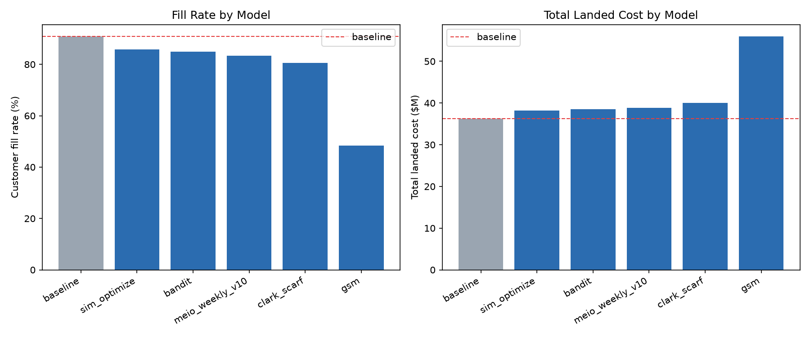
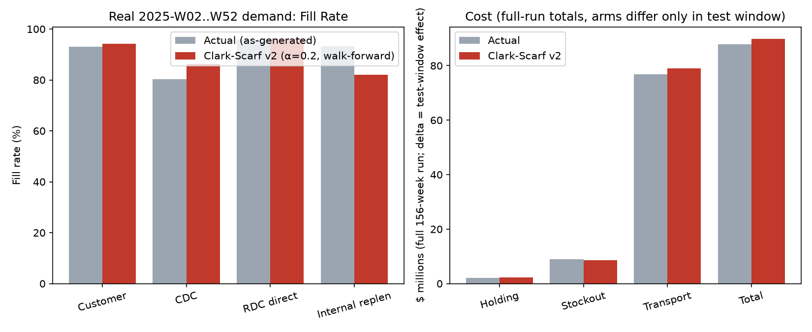

# Clark-Scarf v1 (Echelon Stock Decomposition)

**Status: superseded by Clark-Scarf v2** (see `Clark Scarf v2.md`). Built as "Alt MEIO
Model 1" in the project's model bake-off, this is the classical two-echelon academic
model, extended to this project's three-level network. It directly motivated v2, which
generalizes its hard pooling choice into a continuous, twin-validated parameter.

Source: `models/MEIO/MEIO_Weekly/alt_models/clark_scarf_model.py`.

## Definition

The classical **Clark & Scarf (1960)** two-echelon inventory model, extended here across
three network levels (RDC → CDC, with PDC left to `meio_weekly_lib.solve_pdc_policy`'s
existing logic). Where the project's main tool (MEIO Weekly) deliberately does **not**
pool RDC demand with its downstream CDCs — it couldn't confirm from `demand_forecast.csv`
alone whether RDC demand rows already include downstream pull, and pooling risked
double-counting — this model tests the *other* answer to that same open question: pool
correctly, using the echelon machinery Clark-Scarf built specifically to prevent
double-counting.

## Method

1. **CDC (base echelon)**: ordinary local newsvendor, identical to MEIO Weekly's
   `solve_policy()` — Clark-Scarf's decomposition only changes the level above the base.
2. **RDC (echelon)**: its *echelon* inventory position is defined as everything in the
   RDC–CDC subsystem — the RDC's own stock plus every downstream CDC's stock. Demand is
   pooled via King's formula (sum of variances, then square root):
   `mu_echelon = mu_RDC_own + sum(mu_CDC)`, `sigma_echelon = sqrt(sigma_RDC_own² + sum(sigma_CDC²))`,
   sized against the RDC's *own* replenishment lead time from the PDC — the subsystem is
   protected as a single newsvendor over that lead time.
3. **RDC's local target** (what it physically holds) is the echelon target *minus* what's
   already downstream at the CDCs: `local_safety_stock = max(0, echelon_SS − sum(CDC SS))`,
   `local_order_up_to = max(local_reorder_point, echelon_OUT − sum(CDC OUT))`. This is
   the double-counting fix: the RDC only carries the *incremental* buffer the CDCs don't
   already provide for themselves.

**Honest scope note, stated directly in the source**: full Clark-Scarf also charges each
echelon only its *incremental* holding cost rate (echelon holding cost = local rate minus
the downstream rate, since downstream units are already costed once at the CDC's own
rate), via a nested newsvendor recursion with induced penalty functions. That exact
cost-minimizing recursion is **not** implemented here — this script does the echelon
*stock* decomposition (the double-counting fix) without the full cost-minimizing
recursion.

## Features

- Three-level echelon stock accounting (PDC → RDC → CDC), vs. MEIO Weekly's independent
  per-DC sizing.
- King's-formula demand pooling across an RDC and its downstream CDCs.
- An explicit, documented double-counting-prevention mechanism (netting the RDC's local
  target against downstream stock already held).

## Advantages

- Directly answers the pooling question MEIO Weekly left open, with the actual academic
  machinery designed for it, not an ad hoc heuristic.
- Clean, auditable three-step construction (CDC → RDC echelon → RDC local), each step
  independently checkable.
- Became the conceptual foundation Clark-Scarf v2 generalizes, rather than being thrown
  away outright — v2's `alpha=1` endpoint reproduces v1's full-pooling answer exactly, and
  v2's `alpha=0` endpoint reproduces MEIO Weekly's no-pooling answer exactly, so v1's own
  result remains inside v2's search space as a validated reference point.

## Disadvantages

- **All-or-nothing pooling.** The only two options this model structurally offers are
  "pool fully" (this model) or "don't pool at all" (MEIO Weekly) — no way to ask "pool
  60% of the way." That rigidity is exactly what motivated v2's continuous alpha.
- **Closed-form z·σ sizing**, not Monte Carlo — same Normal-distribution assumption at
  high service-level percentiles that MEIO Weekly has, later identified as a weak fit
  for right-skewed demand and replaced in v2.
- **Scored worst of all 6 models in the single-week bake-off** (see table below) —
  10.43pp fill-rate *below* baseline, the second-worst total landed cost delta
  (+$3.86M) of any model tried.
- The incomplete-recursion scope note means this model's holding-cost accounting is not
  truly cost-optimal even on its own terms — it fixes the double-counting of *stock*,
  not of *cost*.

## Real comparison snapshot: single-week bake-off (`compare_models.py`)

All six policies — the dataset's own baseline, MEIO Weekly (v10), Clark-Scarf (v1), GSM,
Sim-Optimize, and Bandit — built on the *same* frozen single-week basis (as-of
2025-W52, target 2026-W01) and scored through the *same* shared physics engine
(`models/twin/digital_twin.py`) from the same opening state, across the full 2026
forward horizon:

| model | customer fill rate | internal replen fill | holding cost | stockout cost | total landed cost | fill vs. baseline | cost vs. baseline |
|---|---|---|---|---|---|---|---|
| baseline | 90.97% | 89.05% | $740,518 | $4,685,043 | $36,215,502 | — | — |
| sim_optimize | 85.78% | 85.99% | $796,688 | $7,118,558 | $38,190,521 | −5.19pp | +$1.98M |
| bandit | 84.86% | 85.42% | $798,797 | $7,376,527 | $38,479,425 | −6.11pp | +$2.26M |
| meio_weekly_v10 | 83.43% | 86.26% | $746,280 | $8,045,544 | $38,889,776 | −7.54pp | +$2.67M |
| **clark_scarf (v1)** | **80.54%** | **78.85%** | **$717,325** | **$9,519,535** | **$40,072,092** | **−10.43pp** | **+$3.86M** |
| gsm | 48.43% | 80.84% | $367,941 | $35,170,432 | $56,033,564 | −42.54pp | +$19.82M |

On this particular single-week synthetic basis, **every** model underperformed the
dataset's own baseline policy — including this one, clearly. Clark-Scarf v1 placed 5th
of 6, ahead of only GSM.

## Real comparison snapshot: 52-week rolling walk-forward backtest, real 2025 demand

A separate, more realistic test (`backtest_rolling_real_clark_scarf.py`) replayed real
order history week by week (no lookahead) across the full 2025 test window:

| arm | customer fill rate | CDC fill | RDC fill | internal replen fill | holding cost (window) |
|---|---|---|---|---|---|
| actual (what happened) | 93.08% | 80.21% | 95.99% | 93.21% | $696,561 |
| clark_scarf_v2_weekly (at this stage, pre-alpha-generalization) | 94.27% | 86.32% | 96.07% | 81.99% | $952,969 |

Total landed cost delta attributable to the test window: **+$2,006,007** (higher cost
than actual). This rolling backtest already reflects the early alpha-parameterized
version of the model (the direct predecessor to what became Clark-Scarf v2's fixed
alpha=0.2 operating point) — it beat real-demand fill rate, but at materially higher
cost and a real internal-replenishment-fill regression (81.99% vs. actual's 93.21%),
the same internal-fill weakness that persisted into v2 and was only partially addressed
by the later netting-discount fix (see `Clark Scarf v2.md`).

## Why it was phased out

Two independent findings pushed past v1's hard pooling choice:
1. The single-week bake-off showed it performing worse than four of the five other
   candidates on fill rate, with the second-worst cost delta.
2. Comparing it against the Accenture "FY27 Brainstorm" reference slide surfaced two
   specific gaps: v1's all-or-nothing pooling (vs. a continuous blend) and its
   closed-form demand-during-lead-time sizing (vs. a distribution that actually fits
   real, right-skewed demand). Both gaps became the two defining upgrades of Clark-Scarf
   v2 — see `Clark Scarf v2.md`.

## Comparison snapshots

*Fill rate and total landed cost for all six candidates on the same frozen basis.
Clark-Scarf (v1) placed 5th of 6.*

*52-week walk-forward, real order history, no lookahead.*

## Files referenced

- `models/MEIO/MEIO_Weekly/alt_models/clark_scarf_model.py`
- `models/MEIO/MEIO_Weekly/alt_models/compare_models.py`,
  `alt_output/model_comparison_summary.csv`, `alt_output/model_comparison_report.md`
- `models/MEIO/MEIO_Weekly/alt_models/backtest_rolling_real_clark_scarf.py`,
  `backtest_rolling_real_clark_scarf_report.md`, `backtest_rolling_real_clark_scarf_summary.csv`
