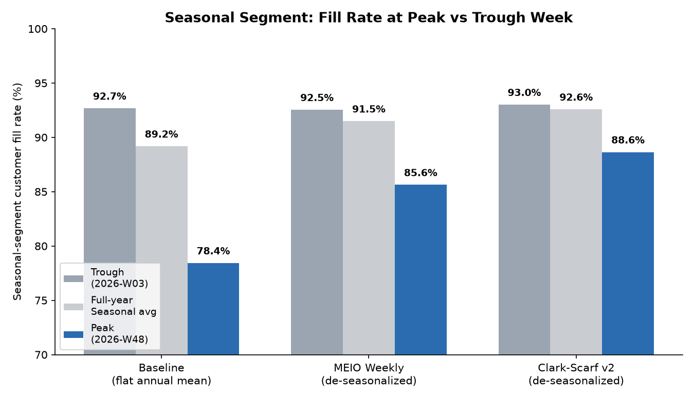
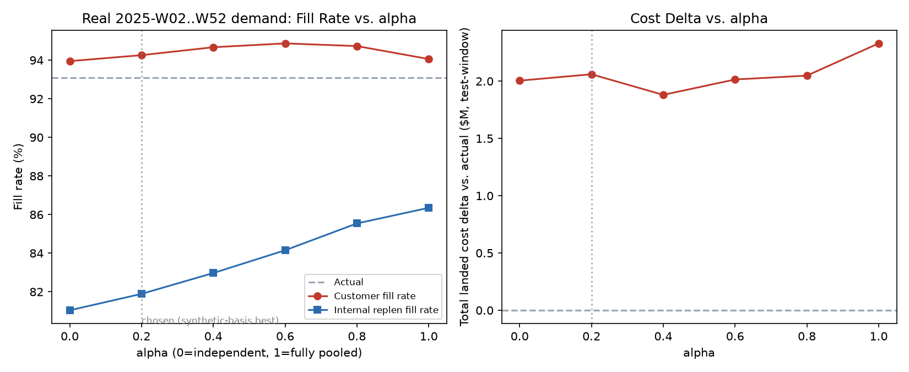
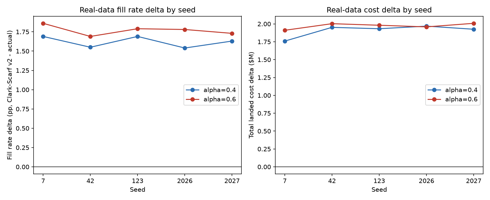
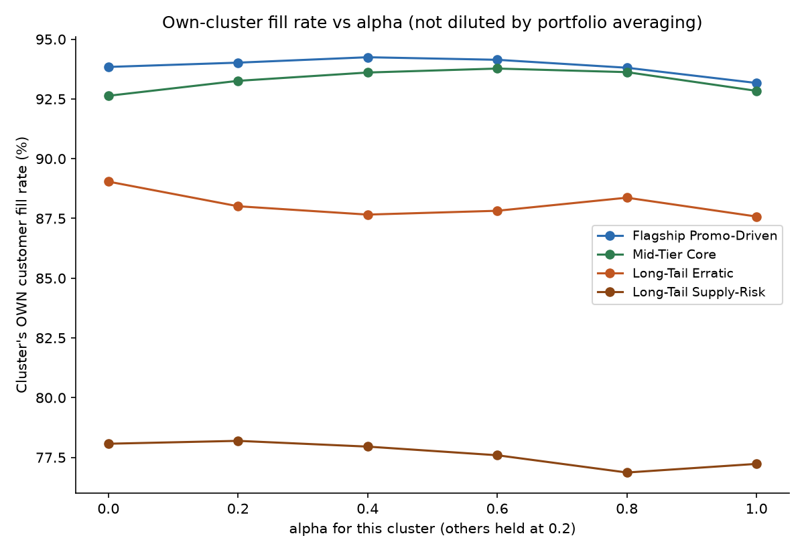
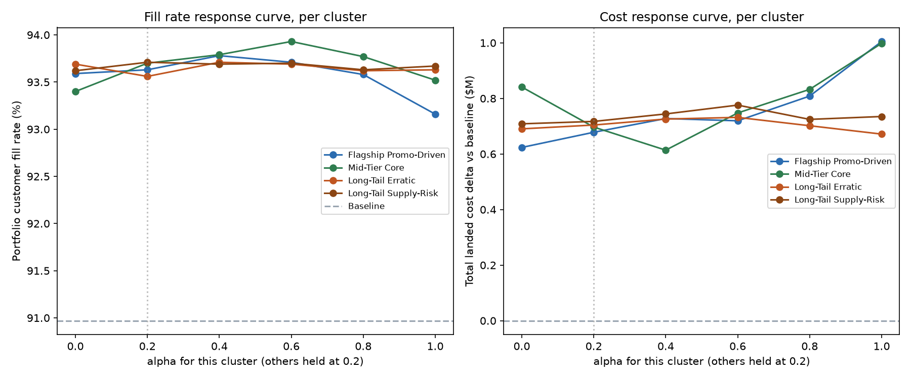
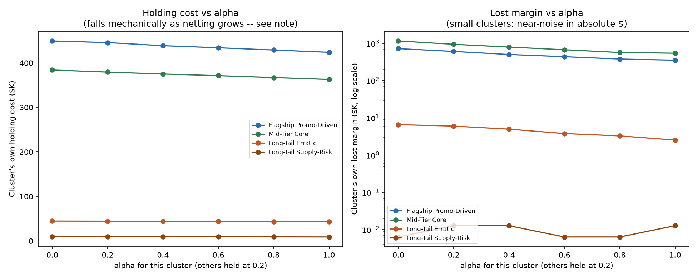

# Clark-Scarf v2 (Continuous Pooling + Monte Carlo DDLT)

**Status: ADOPTED — the project's current production MEIO model**, chosen over the
hand-tuned MEIO Weekly tool and every other alternative tried. Still under active
tuning as of the end of this project (the per-cluster alpha and v5-segmentation
validation work was ongoing, not closed out).

**Live configuration (2026-10-23).** The pipeline (`run_meio_then_twin.py` with the root
`scenario_config.json`) resolves its parameters with `meio_parameters.resolve()`. It
currently selects **alpha=0.6, netting_discount=0.0, `ddlt="quadrature"`, and per-cluster
alpha on 367 SKUs**: Flagship Core 1.0, Mid-Tier Core 0.6, Long-Tail Erratic 1.0,
Long-Tail Erratic 2 1.0, Long-Tail Erratic 3 0.8, Long-Tail Supply-Risk 1.0. The cluster
CSL ladder is not adopted. Receipt: `output datasets/MEIO/SCENARIO_0002_MEIO_CLARK_SCARF_V2/
rolling_2026/meio_parameters.json`. The alpha=0.2 configuration described in much of this
document is the one the project originally validated. Its headline has **not** been re-run
at the live configuration, and no headline or multi-seed run of the live combination
exists.

Source: `models/MEIO/MEIO_Weekly/final_submission/clark_scarf_v2.py` (research version)
and `models/MEIO/MEIO_Weekly/final_submission_optimized/clark_scarf_v2.py` (a faster
polars/vectorized port used for production. Its equivalence tests check it is
bit-identical to the original on small slices, and `OPTIMIZATION.md` estimates `run_all` at
roughly 30-50 minutes vs ~10 hours. See `Digital Twin.md` for the engineering story).
READMEs: `models/MEIO/MEIO_Weekly/final_submission/README.md` and
`.../final_submission_optimized/README.md`.

## Definition

Clark-Scarf v1 generalized into a continuous model: instead of choosing all-or-nothing
pooling (v1) or no pooling at all (MEIO Weekly), an RDC's local safety stock is a
**continuous blend**, controlled by a pooling factor **alpha**, between those two
previously-validated endpoints:

```
RDC_local_SS(alpha) = alpha * pooled_netted_SS + (1 - alpha) * independent_SS
  alpha = 0  ->  no pooling at all (MEIO Weekly's answer: RDC sized independently)
  alpha = 1  ->  full Clark-Scarf pooling (v1's answer: RDC's local SS = echelon-pooled
                 SS netted against what CDCs already hold)
```

Two upgrades over v1 motivated this version, both found by comparing the project's work
against an external reference slide ("Accenture FY27 Brainstorm"):

1. **Continuous alpha**, not v1's hard either/or choice (and not GSM's binary
   stock/no-stock heuristic either). Because the safety-stock blend is linear in alpha by
   construction, a closed-form cost-formula optimization would degenerate to a corner (0
   or 1) — not useful. Alpha is instead found the same way the Sim-Optimize alt model
   finds its own parameters: grid search, with the digital twin as the reward oracle. The
   twin's own stockout-cost/fill-rate response to alpha is genuinely nonlinear even
   though the safety-stock formula itself blends linearly — searched honestly, not
   shortcut.
2. **Monte Carlo demand-during-lead-time (DDLT)**, replacing the closed-form `z·sigma`
   calculation **for CDC and RDC rows**. PDC rows are still sized by MEIO Weekly's closed
   form (`meio_weekly_lib.solve_pdc_policy`: SS = z·√L·μ·1.45·0.5, s = SS + μL,
   S = 4.5·μ + SS, with μ a centred 5-week average of RDC target demand). Demand is drawn
   from a **Gamma** distribution fit to (target_mean,
   target_std) by moment matching — Gamma is defined only for x ≥ 0 and right-skewed,
   which fits actual demand shape far better than a Normal (whose symmetric tails
   mis-price the high percentiles, 95–99% CSL, this project's service levels live at; a
   Normal also technically allows negative demand, silently clipped to 0 elsewhere).
   Lead time is *also* drawn from a Gamma fit to (lt_mean_wk, lt_std_wk), so each trial
   samples a genuinely different protection interval, not a fixed mean with a bolted-on
   variance correction. Reorder point = the target-CSL percentile of the simulated DDLT
   distribution; safety stock = max(0, that percentile minus the simulated mean). The
   target CSL is Φ(z), with z clipped to [0.84, 3.10] and taken from the SKU's cluster
   (see Features).

A second parameter, **netting_discount**, was added later (see "Netting-discount fix"
below) to control how much credit an RDC gets for stock its downstream CDCs already
hold: `ss_p = max(0, pooled_SS − netting_discount * downstream_CDC_SS)`.
`netting_discount=1.0` reproduces the original full-credit assumption exactly;
`netting_discount=0.0` removes it entirely.

**As coded** (`clark_scarf_v2.py::WeekPlan.finish`). Demand estimates (target_mean,
target_std) and lead times come from `meio_weekly_lib`; see `MEIO Weekly Baseline.md` for
the 0.6/0.4 blend, bias and CV rules. The CDC and RDC lead times are cumulative from the
plant along the fastest lane, with variances summed.
- CDC: σ uplift 1.00. S_CDC = max(rop + 1.5·μ, 1.2·rop).
- RDC, three DDLT endpoints:
  - independent: own demand, σ × 1.25 uplift;
  - pooled: μ_echelon = μ_own + Σμ_CDC, σ_echelon = √((1.25·σ_own)² + Σσ_CDC²), with no
    correlation term. Adding RDC own demand to CDC demand is the double-counting risk
    MEIO Weekly deliberately avoided (see `MEIO Weekly Baseline.md`).
- RDC blend: SS_r = α·max(0, SS_pooled − nd·ΣSS_CDC) + (1−α)·SS_ind; cycle stock is
  blended the same way; rop_r = cycle + SS_r.
- S_RDC = α·max(rop_r + 1.5·μ_echelon − ΣS_CDC, rop_r) + (1−α)·max(rop_r + 1.5·μ_own,
  1.2·rop_r). **The netting discount applies to safety stock only.** The pooled S term
  always nets the full ΣS_CDC, whatever netting_discount is set to.

**Quadrature mode.** The optimized port also offers `ddlt="quadrature"`, the pipeline's
setting. It computes the same Gamma-mixture percentile deterministically: bisection on
the mixture CDF over 64 equiprobable lead-time nodes, with cycle stock = μ·(R + L̄). It is a
different estimate from Monte Carlo, not an identical one.
`test_meio_parameters.QuadratureTests` checks that its median relative error against a
400,000-draw Monte Carlo is below 0.5% (safety stock) and 0.3% (reorder point). The
research evidence was built with Monte Carlo (n_sims=1,200 in `validate_real_data.py`).

## Features

- Continuous pooling factor alpha ∈ [0, 1], twin-validated by grid search rather than
  closed-form optimization.
- Monte Carlo (Gamma-distributed) demand-during-lead-time for CDC/RDC rows, later
  supplemented with a deterministic **quadrature** DDLT mode in the optimized port
  (the production tools' default). Quadrature is a close approximation of the Monte Carlo
  percentile, not bit-identical to it. What is bit-identical is the optimized quadrature
  vs. the original quadrature (`tests/test_equivalence.py`).
- Netting-discount parameter controlling how much of a downstream CDC's own stock
  offsets an RDC's pooled credit.
- Per-SKU override seams (`alpha_by_sku`, `z_by_sku`) wired directly into the live
  weekly optimizer — the mechanism that lets per-cluster alpha and per-cluster service
  level actually change production policy, not just research sweeps. `alpha_by_sku` is
  in live use (367 SKUs, see "Live configuration"). `z_by_sku` is currently empty because
  the cluster CSL sweep was not adopted.
- Service level (z) sourced from the **live, canonical** SKU segmentation output
  (`output datasets/segmentation/sku_clusters.csv`, currently v5's 6 archetypes:
  z = 1.881 for CSL 0.97, 1.717 for 0.957, 1.282 for 0.90), not the dataset's baked-in
  3-way segment label (2.05 / 1.64 / 1.28, now only a fallback).
- Scenario-aware: `target_week_demand()`'s output can be scaled for an affected
  region/window (demand-surge scenarios), so a scenario-aware policy build genuinely
  recommends different stocking, not just a differently-scored fixed one.

## Advantages

- **The only model that beat real 2025 demand by a wide margin, not just synthetic
  noise.** See "Headline result" below.
- Directly answers the capstone charter's own framing: not just *how much* buffer to
  hold, but *where* in the network it should sit.
- Every adopted parameter value is backed by a named, dated validation pass with real
  numbers attached (not "we picked something reasonable") — alpha, netting_discount, and
  service level each have their own documented evidence trail below, and each policy
  build writes a receipt (`meio_parameters.json`) with every decision and the SHA-256 of
  each evidence file.
- Recovers most of the dataset's seasonal-peak blind spot (see "Where the win comes
  from"), the single biggest driver of the project's headline advantage over the static
  baseline.
- Per-SKU override seams mean the tuning this project validated in research scripts
  (per-cluster alpha, per-cluster service level) can actually reach the live weekly
  policy, not just a one-off analysis notebook.

## Disadvantages / open gaps — stated directly, not glossed over

- **Internal replenishment fill is still badly degraded relative to actual**, even after
  the netting-discount fix. In the current 5-seed runs it is 82.32% at alpha=0.2 and
  84.64% at alpha=0.6, vs. actual's 93.21% (`netting_discount_multiseed.csv`,
  `netting_discount_multiseed_alpha0_6.csv` in `output datasets/MEIO artifacts/
  SCENARIO_0002_MEIO_CLARK_SCARF_V2/results/`). An earlier vintage read 82.11% vs. the
  original 81.99%. The fix is a real improvement, not a resolution, and internal fill is
  not a guard in the parameter-selection rule.
- **Alpha=0.2 (the originally chosen operating point) is not the best setting on real
  data.** In the original netting 1.0-era sweep it was second-worst of the six values
  tested, with fill peaking near alpha=0.6 and cost lowest near alpha=0.4. The netting
  0.0 re-run is monotonic: fill and cost both improve all the way to alpha=1.0 (see
  "Real-data alpha sensitivity"). The project's README chose *not* to adopt 0.6 over 0.2
  on this basis alone, since both were chosen and tested on the same single real year
  (2025), and a fresh-holdout confirmation was never completed. The pipeline's
  `meio_parameters.py` has since adopted 0.6 by its paired 5-seed rule, on that same 2025
  window. It beats 0.2 by +1.17pp fill at −$236K cost, so the overfitting concern the
  README raised still applies to the live value.
- **Per-cluster alpha: the synthetic "long-tail wants less pooling" direction did not
  survive real-data testing.** The original diagnostic (v4's 4 clusters, one seed,
  synthetic 2026 basis) found core clusters wanting more pooling (α≈0.4–0.6) and
  long-tail clusters wanting less (α≈0.0–0.2). The real-demand, 5-seed sweeps contradict
  the long-tail half:
  - v4 at netting 0.0: `segment_alpha_real_data_summary.csv`;
  - v5, others held at 0.6: `segment_alpha_v5_real_data_summary.csv`.

  Every long-tail cluster's own fill rises with alpha. The live per-cluster values are
  1.0 / 1.0 / 0.8 / 1.0 for the four v5 long-tail clusters and 1.0 for Flagship Core.
  Caveats: clusters were still swept one at a time and adopted together (never run
  jointly), four of six winners sit on the 1.0 grid boundary, and `run_all.py` does not
  regenerate the v5 sweep.
- **Lower holding cost from higher alpha is not a free efficiency gain** — it's the
  direct accounting mirror of the same netting mechanism that degrades internal
  replenishment fill. An RDC holding less of its own stock shows up simultaneously as
  lower holding cost *and* as internal-fill risk.
- **Long-Tail Erratic 2 (one of v5's 6 clusters) does not hit its own service-level
  target at any tested CSL in the alpha=0.2 CSL sweep**, even the most aggressive
  candidate (99%). Own-fill tops out at 89.9%, a 7.6pp shortfall at its recommended
  95.7% CSL, and it is not a seed artifact (std ≈0.0019 across 5 seeds at that CSL).
  The project read this as the newsvendor z-formula being a poor fit for this
  archetype. The later v5 alpha sweep complicates that reading: with its own alpha at
  1.0 (the live value), its own fill reaches 95.55% (`segment_alpha_v5_real_data_summary.csv`),
  so much of the shortfall is a pooling effect. Flagged, not yet acted on.
- **Validation currency gap.** Canonical segmentation moved from v4 (4 clusters) to v5
  (6 clusters) partway through the project. The portfolio netting and alpha evidence the
  resolver now reads was re-run with the v5 cluster z. CSL and per-cluster alpha each
  have their own v5 5-seed sweep. What has **not** been run, multi-seed or otherwise, is
  the live configuration as a single unit: alpha 0.6, the per-cluster alpha overrides,
  netting 0.0 and the v5 z, under the pipeline's quadrature DDLT and 52-week
  roll-forward.
- In the legacy `scenario_test.py` path, only demand-surge scenarios are wired, and only
  CDC/RDC policy is scenario-aware. PDC sizing showed exactly 0.00% stocking change in a
  real test run. The pipeline's override engine (`models/overrides`, 19 measures) now
  passes demand, lead-time, capacity and service changes into MEIO, PDC sizing
  included.

## Headline result: real 2025 demand vs. the dataset's own baseline tool

At the originally validated configuration (alpha=0.2, netting_discount=0.0, v5 cluster
service level). All current figures are from `output datasets/MEIO artifacts/
SCENARIO_0002_MEIO_CLARK_SCARF_V2/results/`:

| | Actual (twin, baseline policy) | MEIO Weekly | **Clark-Scarf v2, alpha=0.2** |
|---|---|---|---|
| Customer fill rate, real 2025 demand | 93.08% | 93.00% (−0.08pp, single seed) | **94.51% (+1.43pp) single seed; +1.52pp 5-seed mean** |
| Internal replenishment fill | 93.21% | 88.86% (−4.35pp) | **82.38% single seed; 82.32% 5-seed mean** (still degraded) |
| Total landed cost delta | — | — | **+$1.67M** single seed and 5-seed mean (vs. +$1.79M at netting 1.0) |

Sources: `headline_clark_scarf_v2_vs_actual.csv` and `headline_cost_summary.csv` (single
seed; identical copies in `final_submission/results/`), `netting_discount_multiseed.csv`
(5 seeds), and `meio_weekly_vs_actual.csv`. "Actual" is the twin replaying 2025 orders
under the dataset's `baseline_policy`, not observed outcomes. An earlier vintage, from
before the cluster service-level default, read +1.75pp / 82.11% / +$1.83M for
Clark-Scarf v2 and +0.15pp / −4.60pp for MEIO Weekly
(`final_submission/results/netting_discount_multiseed.csv`, `meio_weekly_vs_actual.csv`).

**The live configuration has no headline of its own.** Alpha 0.6 plus per-cluster alpha
has not been run. The closest evidence is the portfolio-only alpha=0.6 / netting 0.0
5-seed run the resolver used: +2.69pp customer fill, 84.64% internal fill, +$1.43M cost
(`netting_discount_multiseed_alpha0_6.csv`, Monte Carlo walk-forward builds). It includes
neither the per-cluster overrides nor quadrature.

## Netting-discount fix (validated)

The original pooled RDC formula credited the RDC with 100% of what its downstream CDCs
already hold — assuming stock can move to wherever it's needed on no notice, which the
twin's real weekly-review-plus-lead-time physics don't support. `netting_discount`
dials that credit down. Tested at alpha=0.2 against real 2025 demand, two methodology
passes:

- **First pass** found a genuine RNG bug: internal replenishment fill turned out far
  more sensitive to RNG-stream position (a 4pp swing from stream position alone) than to
  netting_discount itself — fixed by giving every tested value its own fresh seed
  instead of one shared sequential stream.
- **Multi-seed confirmation** (5 seeds): `netting_discount=0.0` beat `netting_discount=1.0`
  on every axis, 5/5 seeds, tight standard deviations — customer-fill delta vs. actual
  +1.75pp (σ=0.07) vs. +1.22pp (σ=0.05); internal replen fill 82.11% (σ=0.0007) vs.
  81.94% (σ=0.001); cost delta +$1.83M (σ=$51K) vs. +$1.95M (σ=$42K)
  (`final_submission/results/netting_discount_multiseed.csv`, the vintage before the
  cluster service level). The current re-run, which `meio_parameters` reads, still wins
  on every axis in 5/5 seeds: +1.52pp vs. +1.05pp, 82.32% vs. 82.24%, +$1.67M vs.
  +$1.79M. The paired gain is +0.47pp fill at −$128K cost. At alpha=0.6, netting 0.0
  also wins 5/5: +2.69pp vs. +1.54pp, +$1.43M vs. +$1.85M (artifacts
  `netting_discount_multiseed.csv`, `netting_discount_multiseed_alpha0_6.csv`). **No
  tradeoff found at either alpha — adopted as part of the live configuration.**
- Separately found and fixed: the adopted value (0.0) had never actually been wired into
  the pipeline's own *defaults* — several build functions still defaulted to the
  original 1.0, so multiple evidence-generating stages had silently been running at the
  stale default since the "fix" was first adopted in prose. Fixed by changing the
  defaults themselves.

## Real-data alpha sensitivity (walk-forward, 2025-W02..W52)

"No lookahead" applies to the weekly refit. The seasonal index is built from all
2023–2025 orders, the test year included. The table below is the original netting
1.0-era sweep (`final_submission/results/alpha_sweep_real_data.csv`,
`alpha_sweep_report.md`):

| alpha | customer fill rate | CDC fill | RDC fill | internal replen fill | % weeks at zero stock |
|---|---|---|---|---|---|
| actual | 93.08% | 80.21% | 95.99% | 93.21% | 11.08% |
| 0.0 | 93.95% | 83.23% | 96.38% | 81.04% | 15.79% |
| 0.2 (synthetic-basis choice) | 94.26% | 86.49% | 96.02% | 81.89% | 13.28% |
| 0.4 | 94.67% | 89.49% | 95.85% | 82.97% | 12.45% |
| **0.6 (best real-data fill)** | **94.87%** | 92.12% | 95.49% | 84.15% | 11.71% |
| 0.8 | 94.73% | 93.72% | 94.95% | 85.54% | 11.18% |
| 1.0 (full v1 pooling) | 94.06% | 94.33% | 94.00% | 86.35% | 11.17% |

Lowest real-data cost delta: **alpha=0.4** at +$1,880,573; alpha=0.2 (the original
choice) scored +$2,060,252. This is a sensitivity check against a single held-out year,
explicitly **not** treated as a re-optimization — picking a new alpha off the back of
this same window would just relocate the overfitting risk it was designed to test for.

The netting 0.0 re-run (artifacts `alpha_sweep_real_data.csv`) no longer has an interior
optimum:

| alpha | 0.0 | 0.2 | 0.4 | 0.6 | 0.8 | 1.0 |
|---|---|---|---|---|---|---|
| customer fill | 93.68% | 94.56% | 95.23% | 95.70% | 96.02% | 96.04% |
| internal replen fill | 81.43% | 82.34% | 83.47% | 84.74% | 85.78% | 86.36% |
| cost delta | +$1.84M | +$1.63M | +$1.58M | +$1.47M | +$1.44M | +$1.35M |

Both sweeps are single seed and chain one RNG through all six alphas, so each alpha sees
a different Monte Carlo stream position. The pipeline now does pick alpha off this same
window. `meio_parameters.py`'s paired 5-seed rule selects 0.6, because only 0.4 and 0.6
have multi-seed evidence. Alpha 0.8 and 1.0 look better in this single-seed sweep but
cannot be selected.

## Cluster-based service level (adopted as default, v5 segmentation)

Service level previously defaulted to the dataset's baked-in 3-way segment label
(Fast-Moving/Seasonal/Intermediate), not the project's own segmentation deliverable.
Adopted the live canonical segmentation output as the default regardless of whether it
statistically beat the old ladder, on the reasoning that sizing off the team's own
segmentation analysis — not a label the dataset happened to ship with — was the bigger
problem to fix. v5's 6-cluster CSL, validated against real demand, 5 seeds, at
alpha=0.2 / netting 0.0 (`service_level_v5_real_data_summary.csv`). Because that sweep
was run at alpha 0.2, the resolver does not adopt its alternative CSLs while alpha is 0.6.
The recommended-CSL ladder (z 1.881 / 1.717 / 1.282) is still the base z for every SKU.

| Cluster | Recommended CSL | Own-fill at recommended CSL | Gap vs. target |
|---|---|---|---|
| Flagship Core | 97.0% | 94.3% | 2.7pp short |
| Mid-Tier Core | 97.0% | 95.7% | 1.3pp short |
| Long-Tail Erratic | 90.0% | 93.6% | beats target |
| **Long-Tail Erratic 2** | **95.7%** | **88.1%** | **7.6pp short** |
| Long-Tail Erratic 3 | 90.0% | 90.9% | beats target |
| Long-Tail Supply-Risk | 90.0% | 91.9% | beats target |

(Mid-Tier Core corrected 2026-10-23: 95.68% at its recommended 97% CSL. The earlier
95.2% was its value at the 95.7% candidate.)

Five of six clusters hold up within a few points of target; Long-Tail Erratic 2 does
not, and the project found its shortfall doesn't close even at the most aggressive CSL
tested (99% → 89.9% own-fill). At its live alpha of 1.0 it reaches 95.55%; see
"Disadvantages" above.

## Why every alternative model was passed over in its favor

Clark-Scarf v2 is the only model in the project's bake-off validated on **real, replayed
2025 demand**, not just the synthetic 2026 basis every other model (including MEIO
Weekly and the four alt models) was scored on. See `Clark Scarf v1.md`,
`GSM (Guaranteed Service Model).md`, `Sim-Optimize.md`, `Bandit (Service-Level Tiers).md`
and `Cluster Bandit.md` for each alternative's own single-week synthetic score, all of
which underperformed the dataset's own baseline on that basis — a comparison this model
was never subjected to in isolation, since its real-data validation came from a
dedicated, later-built pipeline (`final_submission/validate_real_data.py`) rather than
`compare_models.py`'s shared bake-off harness.

## Comparison snapshots


*Customer fill rate and cost, Clark-Scarf v2 vs. the dataset's own baseline, synthetic
2026 basis.*


*Baseline hits only 78.4% fill at the Seasonal segment's real peak week — worse than its
own trough week (92.7%). Both MEIO Weekly and Clark-Scarf v2 recover most, not all, of
this gap.*


*Fill rate and cost vs. alpha, real 2025-W02..W52 walk-forward — the table above,
visualized.*


*The original grid search that picked alpha=0.2, on the synthetic 2026 basis.*


*5-seed confirmation of the headline result.*


*5-seed real-demand walk-forward robustness.*


*Core clusters want more pooling, long-tail clusters want less — the reversal described
above, per v4's 4 clusters. Single seed, synthetic basis. The real-data 5-seed sweeps did
not reproduce the long-tail half (see "Disadvantages").*




*The netting-discount accounting mirror: lower holding cost at higher alpha is not a
free gain.*


## Files referenced

- `models/MEIO/MEIO_Weekly/final_submission/clark_scarf_v2.py`,
  `final_submission_optimized/clark_scarf_v2.py`
- `models/MEIO/MEIO_Weekly/final_submission/README.md` (primary source for this document)
- `models/MEIO/MEIO_Weekly/final_submission/results/headline_clark_scarf_v2_vs_actual.csv`,
  `headline_cost_summary.csv`, `alpha_sweep_report.md`, `multiseed_report.md`,
  `netting_discount_sweep_alpha0_2.csv`, `netting_discount_multiseed.csv`
- `models/MEIO/MEIO_Weekly/alt_models/backtest_rolling_real_clark_scarf_alpha_sweep.py`,
  `backtest_rolling_real_clark_scarf_alpha_sweep_report.md`
- `output datasets/agent output/service_level_v5_real_data_multiseed.csv`
- `models/MEIO/MEIO_Weekly/final_submission_optimized/meio_parameters.py`,
  `meio_weekly_lib.py`, `README.md`, `OPTIMIZATION.md`
- `output datasets/MEIO/SCENARIO_0002_MEIO_CLARK_SCARF_V2/rolling_2026/meio_parameters.json`
  (the live parameter receipt)
- `output datasets/MEIO artifacts/SCENARIO_0002_MEIO_CLARK_SCARF_V2/results/`
  (`headline_*.csv`, `netting_discount_multiseed*.csv`, `multiseed_alpha_04_06.csv`,
  `alpha_sweep_real_data.csv`, `meio_weekly_vs_actual.csv`,
  `segment_alpha_v5_real_data_summary.csv`, `service_level_v5_real_data_summary.csv`)
