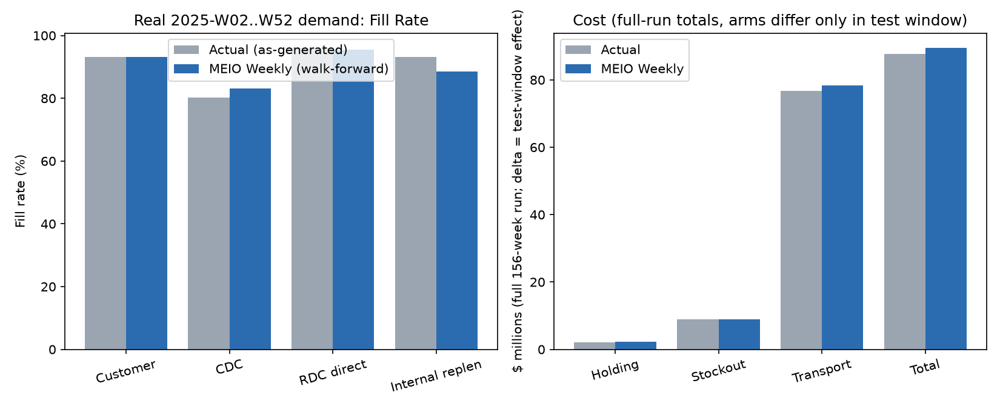
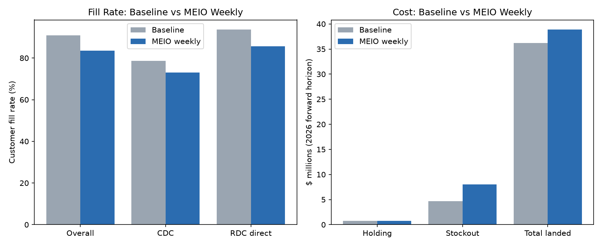
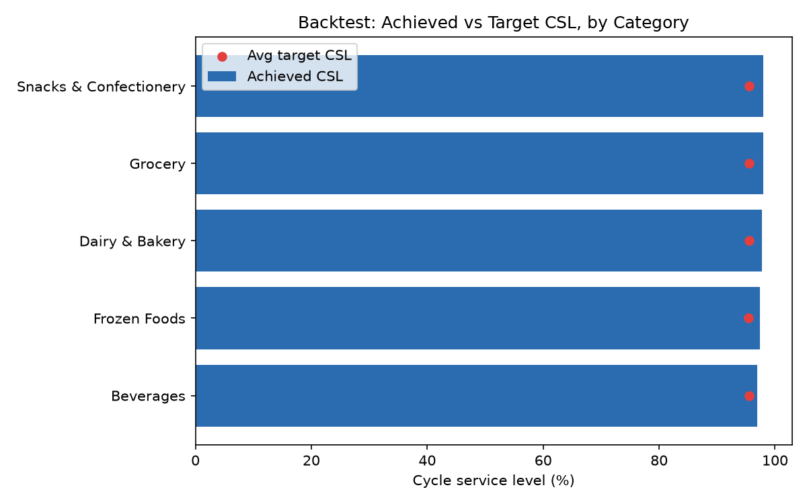
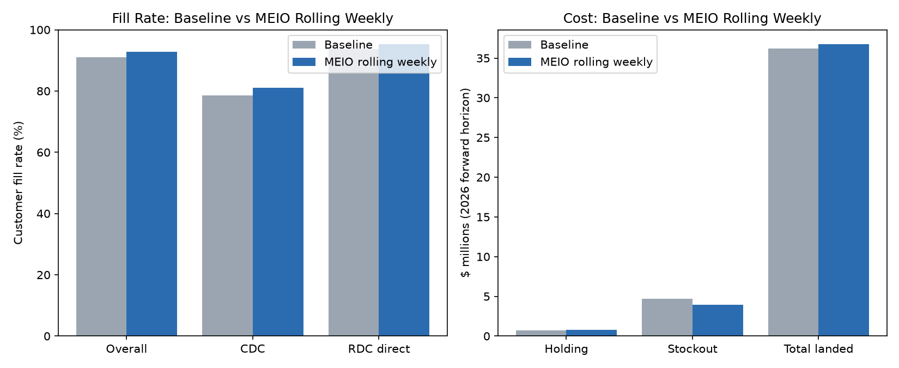
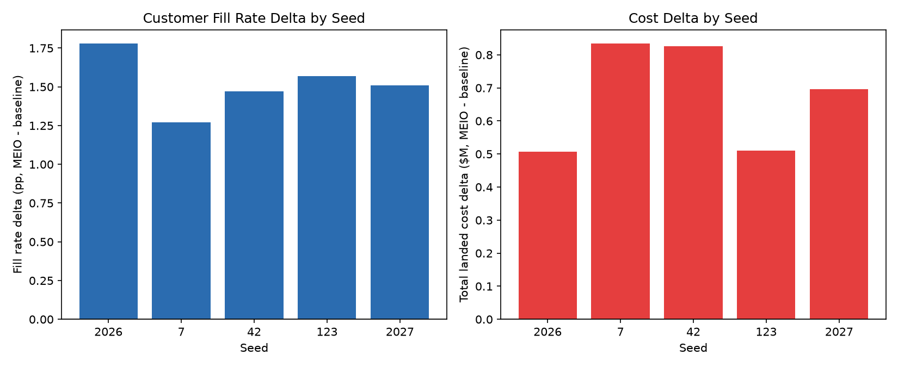
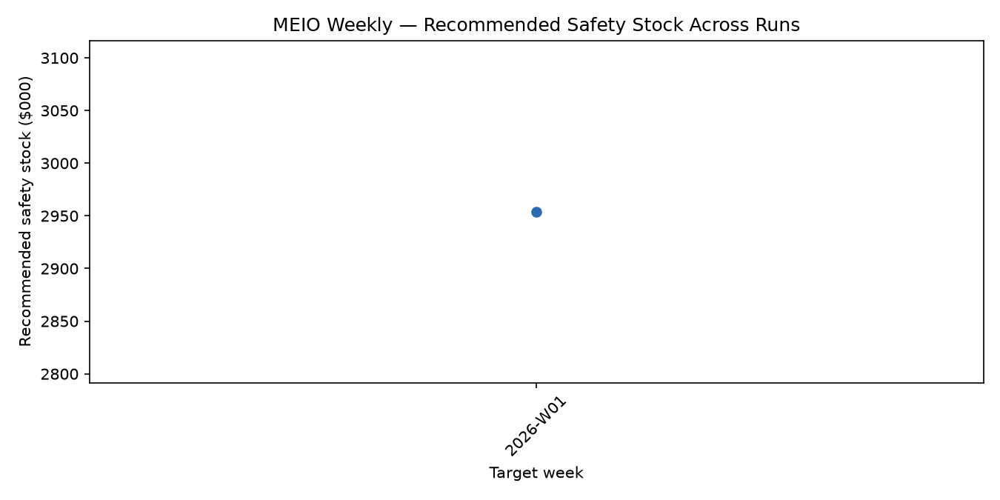

# MEIO Weekly (Baseline Tool)

**Status: superseded.** Chosen as the project's working tool through most of the
capstone, hand-tuned across ten rounds (v1–v10), then retired in favor of **Clark-Scarf
v2** (see `Clark Scarf v2.md`) once real-2025-demand validation showed Clark-Scarf v2
held up better than synthetic-only testing had suggested. Still used throughout the
project as the comparison point every alternative model is measured against, and its
code (`meio_weekly_lib.py`) is still imported by several alternative models (GSM,
Sim-Optimize) as the formula they build on top of.

Source: `models/MEIO/MEIO_Weekly/meio_weekly_lib.py`, `meio_optimizer_weekly.py`,
`roll_forward_policy.py`. README: `models/MEIO/MEIO_Weekly/README.md`.

## Definition

A weekly-cadence, closed-form (R, s, S) periodic-review inventory policy: every week,
for every (DC, SKU) pair, re-estimate next week's demand and lead-time variability, then
size a reorder point *s* and order-up-to level *S* from a z-score safety-stock formula
(newsvendor logic — "how much buffer does a Normal approximation of demand-during-lead-time
need for a target service level"). It is the weekly-cadence sibling of an earlier
annual script (`models/MEIO/meio_optimizer.py`), which produces one flat safety-stock
number for the whole forward horizon; this tool answers the question a planner actually
asks every week — *given everything known up to this week, how much stock should each DC
carry to cover next week?*

This specific implementation is itself a **rebuild**: an earlier version of this tool,
built during a prior session, was lost from the repo and disk before this version
existed. It targets the `digital-twin` branch's v5 dataset-generator schema, which
differs from what the lost version targeted.

## Features (what sizes the policy)

- **(DC, SKU) grain.** `demand_forecast.csv` is really `(period, sku, dc, b2b_customer)`
  grain; every loader aggregates to true `(period, sku, dc)` totals before anything
  else touches it (a grain bug found and fixed during this tool's own backtesting).
- **Forecast-bias correction.** `forecast_qty` was found to persistently under-predict
  `actual_qty`. A z-score safety stock only buffers *random* variance, not a systematic
  bias, so next week's forecast is multiplied by the trailing 13-week actual/forecast
  ratio before anything is sized against it.
- **Blended trailing CV.** Demand uncertainty uses the average of a 13-week and 52-week
  trailing coefficient of variation — a 13-week window alone was found to understate
  full-year volatility.
- **DC-specific cost.** `cost_parameters.csv` is keyed by `(dc_id, subcategory)`, not
  `category` — holding and stockout cost are DC-specific. (The committed annual
  `meio_optimizer.py` was found broken against this exact assumption —
  `KeyError: 'category'` — fixed in the same change that built this tool.)
- **RDC/CDC protection interval matched to the dataset's own baseline convention**
  (review period + lead time, not lead time alone), `ORDER_COVER_WEEKS=1.5` with a 1.2x
  floor on order-up-to cover, per-echelon sigma uplift, segment-based z (not a
  cost-derived one).
- **De-seasonalized demand blend** (v5): target-week demand blends a de-seasonalized
  trailing level with the bias-corrected forecast, replacing a flat trailing-mean
  fallback that silently zeroed ~38% of active SKU-DC pairs' entire policy for any
  single target week with a literal $0 forecast (worst for Seasonal-segment SKUs) —
  the single biggest fill-rate jump of any tuning round.

## Advantages

- Closed-form, fast, fully deterministic given its inputs — no Monte Carlo, no search,
  trivial to audit line by line.
- Shares one library (`meio_weekly_lib.py`) across the live optimizer, the CSL backtest,
  the single-week simulation, the rolling simulation, and the multi-seed robustness
  check — every validation exercises the *exact* estimation logic the live tool uses,
  not a re-implementation.
- Genuinely closes most of the baseline's seasonal-peak blind spot (see "Where the win
  comes from" in `Clark Scarf v2.md` — both this tool and Clark-Scarf v2 recover most of
  a ~14pp seasonal-peak fill-rate gap the static baseline misses entirely).
- Ten rounds of real, falsifiable, documented tuning — each round's regression or gain
  is attributed to a specific, named mechanism, not asserted.

## Disadvantages

- **Never beat the dataset's own baseline policy on full-horizon simulation, across all
  ten tuning rounds.** v5 (the best round) still showed customer fill rate 83.5% vs.
  baseline's 91.0%, and total landed cost delta **+$2.65M worse than baseline** —  a real,
  measured regression versus the status quo it was meant to improve.
- Sizes each DC independently: unlike Clark-Scarf, it never pools an RDC's safety stock
  with its downstream CDCs. The project could not confirm from `demand_forecast.csv`
  alone whether RDC demand rows already include downstream pull, so pooling was
  deliberately left out to avoid risking double-counting — a known, stated limitation,
  not an oversight.
- De-seasonalization (v5) improved one-week-ahead backtest accuracy (CSL 97.0% → 97.6%)
  but caused a small *regression* on the metric that actually matters: full-simulation
  customer fill rate ticked down (84.3% → 83.5%) and cost got slightly worse (+$2.6M →
  +$2.65M) — the backtest and the full simulation disagree because the backtest checks
  accuracy across ~35 *different* as-of weeks, while the full simulation holds one
  as-of-2025-W52 policy *static* across the whole 2026 year, which happens to land on a
  seasonally elevated first week.
- Closed-form z·σ sizing (vs. Clark-Scarf v2's later Monte Carlo DDLT): assumes demand
  is well-approximated by a Normal distribution at the high percentiles (95–99% CSL)
  the project's service levels live at — a right-skewed, non-negative real demand
  distribution is a poor fit there.

## Versions tried (v1 → v5, the tuning history)

| | v1 (bias/CV fixes only) | v2 (formula matched to baseline) | v3 (+ PDC coverage) | v4 (+ mean-blend) | v5 (+ de-seasonalization) |
|---|---|---|---|---|---|
| Mean order-up-to vs. baseline (matched lines) | 132 vs 185 (−29%) | 195 vs 185 (+6%) | 195 vs 185 (+6%, unchanged) | 195 vs 185 (+6%, unchanged) | 195 vs 185 (+6%, unchanged) |
| Backtest achieved CSL vs. target | n/a (99.8% target, cost-derived z) | 88.8% vs 99.8% | 88.8% vs 99.8% (unchanged) | 97.0% vs 95.5% | **97.6% vs 95.5%** |
| Full-sim customer fill rate | 73.4% (baseline 91.0%) | 81.3% | 81.1% (flat) | 84.3% | 83.5% (**−0.8pp**) |
| Full-sim internal replen fill | 65.8% | 53.2% (**worse** than v1) | 83.4% (+30pp vs v2) | 86.5% (near baseline's 89.1%) | 86.3% (flat) |
| Full-sim % weeks at zero stock | — | 32.0% | 32.5% | 16.3% | 17.2% (slightly worse) |
| Full-sim total landed cost delta | +$6.3M | +$3.3M | +$3.5M (flat/slightly worse) | +$2.6M | +$2.65M (slightly worse) |

A genuine diagnostic story runs through this table, not just numbers moving: **v3**
fixed the metric it targeted (internal replenishment fill, +30pp) but didn't move
customer fill rate at all — comparing `service_by_node.csv` between runs showed *every*
node worse, not concentrated, while average on-hand was simultaneously *higher* at 18 of
22 nodes, which ruled out "not enough stock" and pointed at demand-mix misallocation
instead. That diagnosis led directly to **v4**'s fix (the $0-forecast/mean-blend
discovery) — the single biggest jump of any round. **v5** then traded a small amount of
full-simulation performance for a real gain in one-week-ahead accuracy, a tradeoff
stated directly rather than glossed over.

Beyond v5, the tool was further refined into a **v10** configuration (`meio_weekly_v10`
in the later model bake-off — see `Clark Scarf v1.md`'s comparison table), which is the
version actually compared against Clark-Scarf v1 and the other alternative models.

## Why it was phased out

Real-2025-demand validation (not just the synthetic basis this tool was tuned against)
showed Clark-Scarf v2 pulling ahead by a wider margin than synthetic testing suggested:
customer fill rate +0.15pp vs. actual for MEIO Weekly, vs. **+1.75pp** for Clark-Scarf v2
at its adopted configuration (alpha=0.2, netting_discount=0.0) — see `Clark Scarf v2.md`
for the full head-to-head. MEIO Weekly's real-data result is preserved at
`models/MEIO/MEIO_Weekly/final_submission/results/meio_weekly_vs_actual_report.md` and
`.../meio_weekly_vs_actual.csv` for context on why it wasn't chosen; it was not
regenerated under the later cluster-based service-level default, since it wasn't the
model that ended up adopted.

## Comparison snapshots

*+0.15pp customer fill rate vs. actual — the real-data result Clark-Scarf v2's
+1.75pp was measured against, see "Why it was phased out" above.*

*Rolling weekly policy, walk-forward real-demand backtest — the test this tool was
ultimately judged on.*

*Single-week frozen-policy simulation vs. baseline — the comparison every one of the v1–v5
tuning rounds in the table above is tracking.*

*Statistical backtest: does realized demand-during-lead-time actually stay within the
recommended reorder point, replayed with no lookahead across ~35 historical weeks.*

*The "real test" per the tool's own README — a genuinely time-varying weekly policy,
not a single frozen snapshot.*

*Baseline vs. MEIO rolling policy re-run at several random seeds, to check a result
isn't a fluke of one demand/lead-time/production draw.*

*The recommended safety-stock rollup, tracked across successive weekly runs
(`meio_weekly_history.csv`, repo-tracked).*

*MEIO Weekly (`meio_weekly_v10`) placed fourth of six on this single-week synthetic
comparison, behind baseline, sim_optimize and bandit, ahead of clark_scarf (v1) and
GSM — see `Clark Scarf v1.md` for the full table and `compare_models.py`'s design.*

## Files referenced

- `models/MEIO/MEIO_Weekly/meio_weekly_lib.py`, `meio_optimizer_weekly.py`,
  `roll_forward_policy.py`, `README.md`
- `models/MEIO/MEIO_Weekly/chart_backtest_rolling_real.png`,
  `chart_robustness.png`, `chart_fill_rate_comparison.png`, `chart_csl_calibration.png`,
  `chart_rolling_fill_rate.png`
- `models/MEIO/MEIO_Weekly/final_submission/results/meio_weekly_vs_actual_report.md`,
  `meio_weekly_vs_actual.csv`, `meio_weekly_vs_actual_cost.csv`
