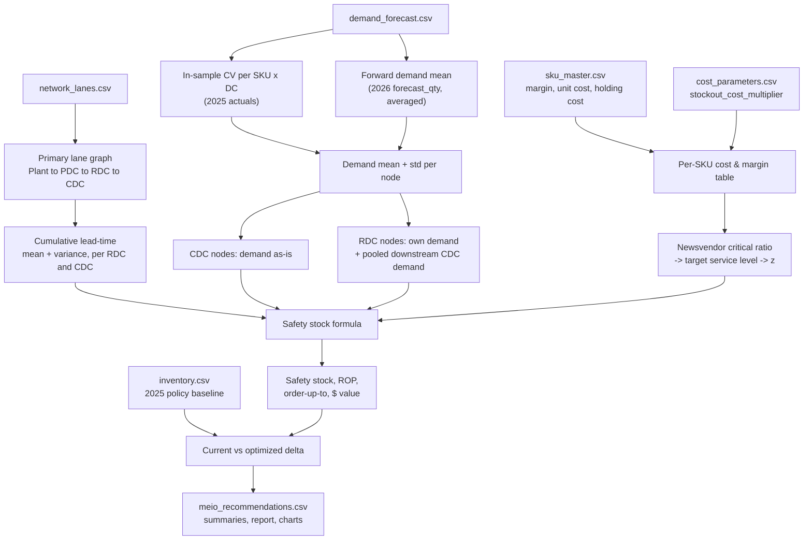

*Code-grounded companion to the atomic concept note **[[Multi-Echelon Inventory Optimization (MEIO)]]** — that note explains what MEIO is and why positioning matters; this note explains exactly what `models/MEIO/meio_optimizer.py` computes, step by step, from raw input file to dollar recommendation, and why each formula is the right one for this problem.*

> [!info] Dataset-schema note — resolved 2026-09-15
> `input datasets/` carries a **staged-but-uncommitted** schema upgrade (3 years of history, 27 DCs, `cost_parameters.csv` re-keyed from `category` to `(dc_id, subcategory)`). `meio_optimizer.py` originally assumed the old `category`-only key and was reproducibly broken (`KeyError: 'category'`) against the new schema; it has since been migrated to the `(dc_id, subcategory)` join described in §7, matching `MEIO_Weekly`. Both scripts now target the same schema and agree on methodology. The migration is applied locally but not yet committed — check `git status` on `models/MEIO/meio_optimizer.py` if you're unsure which version is live.

---

## 1. What problem this is actually solving

Every SKU, at every stocking location, needs a **safety-stock number**: how much buffer inventory to hold above expected demand so that ordinary demand and lead-time variability don't turn into a stockout. Get it wrong in one direction and you tie up working capital in stock that never moves; get it wrong in the other and you lose sales and margin. See **[[Safety Stock]]** for the general concept and **[[Service-Level Target]]** for why a single blanket target across the whole portfolio is the wrong default.

MEIO adds a second dimension on top of that: **where** in the network — Plant DC, Regional DC, or Customer DC — that buffer should sit, because pooling demand across multiple downstream nodes at a shared upstream node changes the variance (and therefore the required buffer) in a way that a node-by-node calculation would miss. That's the piece that makes this a *multi-echelon* problem rather than a repeated single-node safety-stock calculation.

The code's actual output, per SKU × stocking-DC: a safety stock, reorder point, and order-up-to level for the 2026 planning horizon, plus a dollar comparison against the 2025 policy currently in `inventory.csv` — the "should we hold more or less, and where, and is that a good trade" answer.

---

## 2. Pipeline at a glance

---

## 3. Inputs — what each file contributes

| File | Grain | What the code pulls from it | Role in the logic |
|---|---|---|---|
| `sku_master.csv` | SKU | `category`, `subcategory`, `unit_cost_usd`, `margin_usd` | Per-unit economics feeding both sides of the newsvendor ratio. (`holding_cost_per_unit_year_usd` also lives on this file but is no longer read — holding cost now comes from `cost_parameters.csv`, below.) |
| `cost_parameters.csv` | DC × subcategory | `storage_cost_per_unit_year_usd`, `inventory_carrying_pct_annual`, `stockout_cost_multiplier` | Location-specific holding cost (storage + carrying % × unit cost) and the stockout-cost penalty factor |
| `network_lanes.csv` | Lane (edge) | `origin_node_id/type`, `destination_node_id/type`, `lead_time_mean_days`, `lead_time_std_days` | Defines the Plant → Plant DC → Regional DC → Customer DC graph and each hop's lead-time distribution |
| `demand_forecast.csv` | SKU × DC × week | `horizon` (`in_sample`/`forward`), `actual_qty`, `forecast_qty` | 2025 actuals size the demand coefficient of variation; 2026 `forecast_qty` sizes the forward demand mean |
| `inventory.csv` | SKU × DC × week | `safety_stock`, `reorder_point` | 2025 "as-is" policy baseline, for the before/after dollar comparison |

The `active_dc` list (which DCs actually get a recommendation) is derived from `demand_forecast.csv`, not from the master lists — a DC with no demand in the extract is simply not in scope, rather than getting a phantom recommendation.

---

## 4. Step 1 — Network and lead-time construction

**Primary lane selection.** For every stocking node, `primary_upstream()` picks the single inbound lane with the *lowest mean lead time* as that node's replenishment route. This is a deliberate single-sourcing simplification — the dataset doesn't carry an actual sourcing-percentage flag, so "fastest available lane" stands in for it. It means the model is blind to any dual-sourcing or lane-splitting that might exist in reality.

**Cumulative lead time by stacking hops.** Lead time from the Plant all the way to an RDC or CDC is built by walking the graph and stacking each hop's mean and variance:

$$
\text{mean}_{\text{RDC}} = \text{mean}_{\text{Plant}\to\text{PDC}} + \text{mean}_{\text{PDC}\to\text{RDC}}
\qquad
\text{var}_{\text{RDC}} = \text{var}_{\text{Plant}\to\text{PDC}} + \text{var}_{\text{PDC}\to\text{RDC}}
$$

$$
\text{mean}_{\text{CDC}} = \text{mean}_{\text{RDC}} + \text{mean}_{\text{RDC}\to\text{CDC}}
\qquad
\text{var}_{\text{CDC}} = \text{var}_{\text{RDC}} + \text{var}_{\text{RDC}\to\text{CDC}}
$$

Variances add (not standard deviations) — that's the Bienaymé formula for the variance of a sum of *independent* random variables. Treating each hop's lead time as independent of the others is a modeling assumption, not a measured fact; it's standard practice and reasonable here, but it's an assumption worth naming. Everything downstream converts days to weeks (`/7` for the mean, `/7` on the *already-square-rooted* std) to match the weekly review cycle.

---

## 5. Step 2 — Demand estimation

Two different slices of `demand_forecast.csv` do two different jobs:

- **`horizon == "in_sample"` (2025 actuals)** → grouped by `(sku_id, dc_id)` to get `hist_mean`, `hist_std`, then a coefficient of variation: $CV = \text{hist\_std} / \text{hist\_mean}$, clipped at 3 to stop low-volume SKUs (near-zero mean, noisy std) from producing an absurd multiplier.
- **`horizon == "forward"` (2026 forecast)** → averaged across the *entire* forward horizon to get one `fwd_mean` per SKU × DC.

$$
\text{fwd\_std} = \text{fwd\_mean} \times CV
$$

This constant-CV scaling assumes demand uncertainty grows proportionally with the demand level — standard in inventory theory, but worth stating explicitly since it's doing real work: a SKU with a noisy 2025 history keeps that same relative noisiness applied to its 2026 forecast level, high or low.

**This is exactly the "smoothed yearly number" limitation.** Averaging `forecast_qty` across all 52 forward weeks into one `fwd_mean` erases any within-year seasonality or promo lift — a January number and a July number for the same SKU come out identical. That's the specific gap `MEIO_Weekly` (§7) closes by using each week's own `forecast_qty` instead of the annual average.

---

## 6. Step 3 — Echelon demand pooling

This is the actual "multi-echelon" part — CDC and RDC nodes are built differently:

**CDC nodes** take their own demand as-is: `fwd_mean`, `fwd_std` for that SKU × CDC, paired with the CDC's own cumulative lead time.

**RDC nodes are pooled.** An RDC has to hold enough stock to replenish itself *and* every Customer DC that primary-sources from it (§4). So its total demand is:

$$
\text{fwd\_mean}_{\text{RDC}} = \text{own\_mean} + \sum_{\text{served CDCs}} \text{fwd\_mean}_{\text{CDC}}
$$

$$
\text{fwd\_std}_{\text{RDC}} = \sqrt{\text{own\_std}^2 + \sum_{\text{served CDCs}} \text{fwd\_std}_{\text{CDC}}^2}
$$

Means add exactly regardless of correlation; variances add only under an independence assumption across the pooled CDCs — again unmeasured but standard. This is the step that produces genuine **pooling benefit**: several CDCs' independent variability partially cancels when aggregated at the RDC, which is precisely why positioning buffer upstream can need *less* total safety stock than the same coverage held at each CDC individually (see **[[Multi-Echelon Inventory Optimization (MEIO)]]** §"why positioning matters").

---

## 7. Step 4 — Cost and the target service level (newsvendor logic)

Rather than assigning a fixed service-level tier by segment (the policy-table approach described in **[[Service-Level Target]]**), the code *derives* a target cycle service level per SKU × DC from the classic **newsvendor critical ratio** — the cost of being short vs. the cost of holding one extra unit:

$$
C_u = \text{margin\_usd} \times \text{stockout\_cost\_multiplier} \quad\text{(cost of underage — a lost/deferred sale)}
$$

$$
C_o = \text{holding\_cost\_per\_unit\_week} \times \max(\text{lead-time weeks}, 1) \quad\text{(cost of overage — capital tied up over the exposure window)}
$$

where holding cost per unit-year is looked up from `cost_parameters.csv` at `(dc_id, subcategory)` grain — `storage_cost_per_unit_year_usd + unit_cost_usd × inventory_carrying_pct_annual / 100` — so it varies by *stocking location* as well as by product, not just by category.

$$
CR = \frac{C_u}{C_u + C_o}, \quad \text{clipped to } [0.80,\ 0.999]
$$

$$
z = \Phi^{-1}(CR), \quad \text{clipped to } [0.84,\ 3.10]
$$

The clips are a deliberate floor/ceiling: never target below an 80% service level regardless of how cheap holding looks, and never chase a target above 99.9% regardless of how expensive a stockout looks — both directions can produce degenerate answers at the tails of the ratio. Because $C_u$ and $C_o$ vary by SKU (margin, holding cost) and by node (lead time), **the target service level is not a single number for the portfolio — it emerges per line**, which is a more granular version of the differentiated-target idea in **[[Service-Level Target]]**.

---

## 8. Step 5 — The safety stock formula itself

This is the point everything upstream feeds into. Safety stock has to cover uncertainty from **two independent sources**: demand can come in higher than expected, *and* the replenishment can arrive later than expected. The combined-uncertainty formula:

$$
\sigma_{LT,D} = \sqrt{\ \text{LT}_{\text{weeks}} \cdot \sigma_D^2 \;+\; D_{\text{mean}}^2 \cdot \sigma_{LT,\text{weeks}}^2\ }
$$

$$
\text{Safety Stock} = z \times \sigma_{LT,D}
$$

$$
\text{Cycle Stock} = D_{\text{mean}} \times \text{LT}_{\text{weeks}}
$$

$$
\text{Reorder Point} = \text{Cycle Stock} + \text{Safety Stock}
$$

$$
\text{Order-Up-To} = \text{Reorder Point} + D_{\text{mean}} \times \text{Review Period (1 week)}
$$

Reading each term in business language:
- The **first term under the root** ($\text{LT}_{\text{weeks}} \cdot \sigma_D^2$) is the classic "demand variability accumulates over the exposure window" term — if lead time were perfectly deterministic ($\sigma_{LT}=0$), this formula collapses to the textbook $z\sqrt{LT}\,\sigma_D$.
- The **second term** ($D_{\text{mean}}^2 \cdot \sigma_{LT}^2$) is the "lead time itself is uncertain" term — even with rock-steady demand, a lane that sometimes runs long forces extra buffer, scaled by *how much* demand there is to cover during that extra time.
- **Order-up-to** assumes a **periodic review policy with a 1-week review cycle** — it's not a continuous-review (s, Q) system; the model checks and can reorder once per week, so the order-up-to level has to cover the reorder point *plus* one more week of expected demand before the next review.
- The dollar figure planners actually act on, `safety_stock_usd = safety_stock × unit_cost_usd`, is what gets compared category-by-category and DC-by-DC.

---

## 9. Step 6 — Benchmarking against the current (2025) policy

`inventory.csv`'s `safety_stock`/`reorder_point` are constant per `(sku_id, dc_id)` across all weeks in the extract, so averaging across periods just recovers that fixed policy value — not a genuine time-series average. That fixed value, converted to dollars the same way as the optimized figure, is the baseline every summary and chart compares against:

$$
\Delta_{\text{USD}} = \text{safety\_stock\_usd}_{\text{optimized}} - \text{current\_safety\_stock\_usd}
$$

This is the number that answered "MEIO recommends spending more" in the prior discussion of this project — see the note on what to track *instead* of this delta alone in §11.

---

## 10. Outputs — what each artifact means and how to read it

| File | Grain | What it's for |
|---|---|---|
| `meio_recommendations.csv` | SKU × DC | The line-level action list: `safety_stock`, `reorder_point`, `order_up_to`, `safety_stock_usd`, `ss_delta_usd` per SKU per stocking location — this is what a planner would actually load into a replenishment system |
| `meio_summary_by_category.csv` | Category | Rolled-up $ comparison, current vs. optimized, plus `delta_pct` and the average target CSL achieved |
| `meio_summary_by_dc.csv` | DC | Same rollup by stocking node — shows which echelons are absorbing the bulk of the recommended change |
| `meio_report.md` | Portfolio | Narrative + both tables, written for a reader who won't open the CSVs |
| `chart_ss_by_category.png`, `chart_current_vs_optimized.png` | Category / DC | Current-vs-optimized bar comparisons — the at-a-glance version of the summary tables |

**How to read `ss_delta_usd` correctly:** a positive delta is not, by itself, a "cost" the project incurred — it's the model saying the *current* 2025 policy is under-buffered relative to the margin/stockout-cost trade-off it's being measured against. Whether that increased investment is actually worth it can't be read off this file alone — it has to be checked against realized outcomes (§11).

---

## 11. Assumptions and simplifications (named, not buried)

- **Single-sourcing per node** (§4) — no dual-sourcing or lane-splitting is modeled, even where it might exist in reality.
- **Independence assumed at every additive step** — lead-time hops (§4), CDC-to-CDC pooled demand (§6) — variances are summed as if uncorrelated. Real correlation (e.g. a regional weather event hitting several CDCs' lead times at once) would understate the true tail risk.
- **Constant-CV demand uncertainty** (§5) — variability is assumed proportional to the demand level, carried over unchanged from 2025 to 2026.
- **Annual demand averaging** (§5) — the single biggest simplification: one `fwd_mean` per SKU × DC for the whole 2026 horizon, which is exactly what `MEIO_Weekly` (§7 below, and the sibling `MEIO_Weekly/README.md`) replaces with week-specific demand.
- **No joint capacity or budget constraint** — each SKU × DC line is solved independently; there's no check that the *sum* of recommended safety stock fits a warehouse capacity or working-capital ceiling.
- **z and CR are hard-clipped** to [0.84, 3.10] / [80%, 99.9%] — a deliberate guardrail, but it does mean two SKUs with very different underlying economics can get pinned to the same boundary value.
- **Review period is fixed at 1 week** for every node — no attempt to differentiate review cadence by DC or SKU criticality.

---

## 12. Analytical / OR context — naming the actual techniques in play

| Code element | Underlying technique |
|---|---|
| $CR = C_u/(C_u+C_o)$, $z=\Phi^{-1}(CR)$ | The **newsvendor model** — the standard single-period stochastic-inventory result for balancing underage vs. overage cost, repurposed here as a *per-line service-level target* rather than a one-shot order quantity |
| Variance stacking across lane hops and pooled CDCs | **Bienaymé's formula** (variance of a sum of independent variables) |
| $\sigma_{LT,D}=\sqrt{LT\cdot\sigma_D^2 + D^2\cdot\sigma_{LT}^2}$ | The standard **combined demand-and-lead-time-uncertainty safety stock formula** (e.g. Silver/Pyke/Peterson), which nests the textbook $z\sqrt{LT}\,\sigma_D$ deterministic-lead-time case as $\sigma_{LT}\to0$ |
| RDC = own + Σ downstream CDC demand | An **installation-stock / echelon-pooling** approximation — not a full guaranteed-service or stochastic-service multi-echelon optimization (which would jointly optimize buffer placement subject to service constraints across the whole network at once); this is a top-down, one-pass approximation of that idea |
| Fixed review period, order-up-to = ROP + one period of demand | A standard **periodic review (R, S) policy**, not continuous review |

Worth being explicit that this is **not** a joint multi-echelon stochastic optimization in the formal OR sense (e.g. Clark-Scarf or guaranteed-service-time network optimization) — it's a single top-down pass that computes each node's requirement using the pooled demand it faces, which is a reasonable and common practical approximation, but a simpler one than the full literature would use if capacity, correlated risk, and joint cost minimization were all being solved simultaneously.

---

## 13. Business context — why this exists and how it connects

- **[[Safety Stock]]** answers *how much*; this document is the *where* and *how much, where* combined — see **[[Multi-Echelon Inventory Optimization (MEIO)]]** for why that's a distinct problem from single-node sizing.
- **[[Service-Level Target]]** describes the differentiated-tier framing the charter originally imagined; this code implements a more granular version of the same idea by deriving the target endogenously per SKU × DC from cost economics rather than a fixed lookup table.
- **[[Price-Inventory Exchange Rate]]** is the other side of the same coin: this document only ever asks "how much safety stock," never "safety stock vs. a price discount instead" — that trade-off is a separate, already-quantified deliverable (portfolio exchange rate ≈ 0.33×, see `Price Elasticity/`) that this model doesn't touch.
- **On "how do we know the extra spend paid off"** (from the prior discussion in this project): this document's `ss_delta_usd` is a *modeled* prediction, not proof of savings. The metric to actually track is the realized change in `lost_margin_usd` / `unmet_qty` (both already in `inventory.csv`) before vs. after adopting these targets — net benefit = avoided stockout cost − incremental holding cost, not the safety-stock delta by itself.
- **[[Multi-Armed Bandits — Supply Brain Strategy]]** treats MEIO's echelon-positioning decision as one of three arms a bandit layer could continuously re-tune, precisely because this document's method is a one-shot, static calculation — accurate the day it's run, silent about whether it's still right a quarter later.

---

## 14. The weekly variant — `MEIO_Weekly`

`models/MEIO/MEIO_Weekly/meio_optimizer_weekly.py` is the same method (§4–§9, including the `(dc_id, subcategory)` cost join both scripts now share) re-run on a cadence instead of once a year. Two concrete differences from everything above:

1. **§5's annual averaging is removed.** Each run uses `--as-of`'s own `forecast_qty` for a rolling look-ahead window, so seasonality/promo lift shows up week to week instead of being flattened into one number.
2. **§5's CV is refreshed on a rolling trailing window** of realized actuals ending just before `--as-of`, falling back to the same in-sample CV this document describes when too few realized weeks are available (true for every 2026 date today, since this synthetic extract has no realized 2026 outcomes yet — see the script's own docstring).

It also adds a persistent `meio_weekly_history.csv` log and week-over-week delta flags — the mechanism for actually watching whether the recommendation is stable or swinging, run to run. Full usage in `models/MEIO/MEIO_Weekly/README.md`.

---

## See also
[[Multi-Echelon Inventory Optimization (MEIO)]] · [[Safety Stock]] · [[Service-Level Target]] · [[Price-Inventory Exchange Rate]] · [[Supply Brain]] · [[Multi-Armed Bandits — Supply Brain Strategy]]
