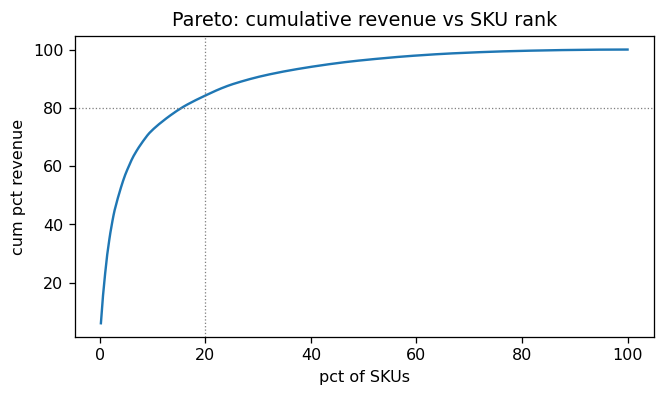
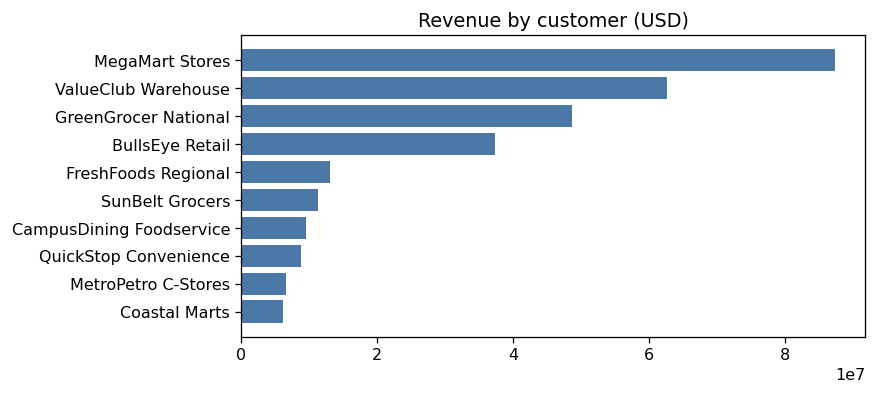
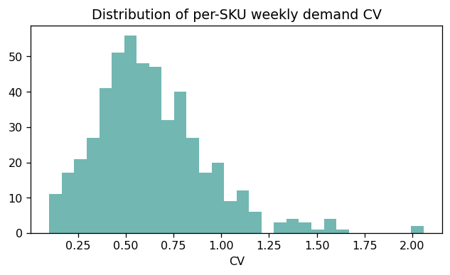
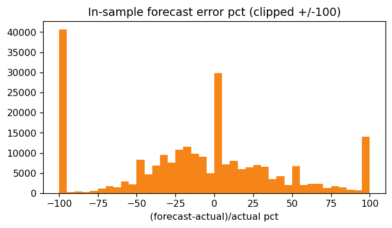
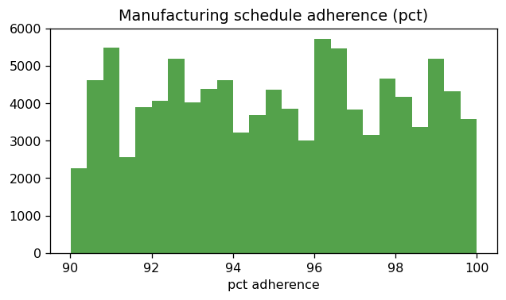
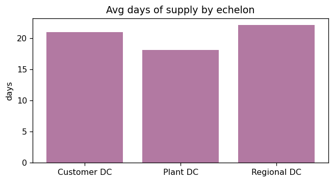
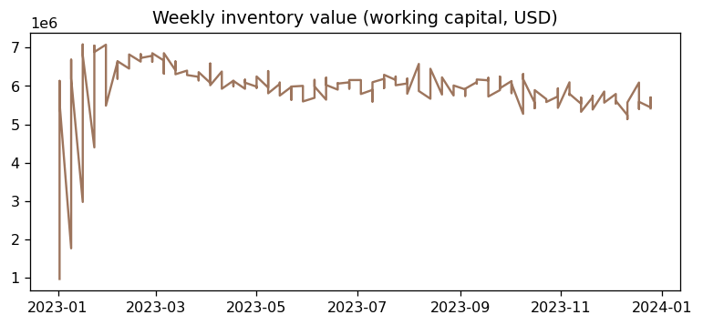
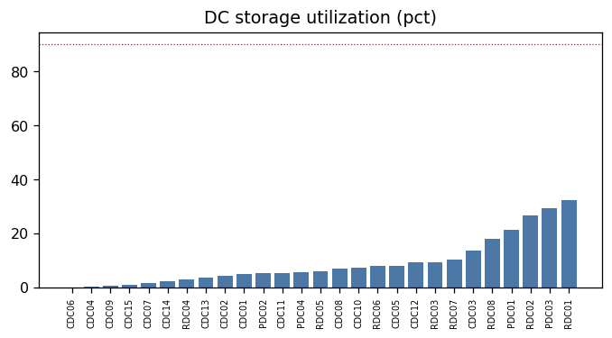

# Supply Brain — Synthetic CPG Supply-Chain Dataset

*Auto-generated 2026-10-08 00:11 by `supply_brain_generator_v5.py`.
This document and the data are produced in the same run, so the figures below always describe the
current instance. It supersedes the separate EDA report, whose content is folded in as Part 6.*

---

## Scope

This document covers **`input datasets/` only** — the given data: the
network, the products and their economics, the commercial history, the
published forecast, the disruption library, and the inventory record of
what happened over the historical span.

It does **not** cover the forward view. The digital twin documents its own
mechanics and every artefact a run produces in
`output datasets/OUTPUT_DOCUMENTATION.md`. `SCHEMA.md` at the project root
explains how the two folders divide.

## How to read this document

| Part | Contents | Read it if you want to… |
|---|---|---|
| **1** | What this dataset represents | Orient yourself in one minute |
| **2** | **Business assumptions, in plain language** | Understand what world this data describes, and what it deliberately does not |
| **3** | Time horizons | Know which years hold what |
| **4** | Table reference and key map | Join the tables correctly |
| **5** | How each layer is generated | Trust, challenge or re-derive a number |
| **6** | Data profile | See the actual shape of this instance |
| **7** | Known limitations | Avoid drawing a conclusion the data cannot support |
| **8** | Reproducing and modifying | Change an assumption and re-run |

**Start with Part 2.** Every number in Parts 5 and 6 is a consequence of an assumption stated there.

---

## Part 1 — What this dataset represents

A complete operating picture of one mid-size **US consumer packaged goods (CPG) food and beverage
manufacturer**, at weekly grain, across three years of history and one year of forward plan.

It is designed to behave like a real client extract: every key resolves, the money adds up, and
the operational tensions a planner would recognise are present — demand that is hard to forecast in
some places and easy in others, replenishment that is sometimes late, stock that sits in the wrong
place, and promotions that move volume at the expense of margin.

| | |
|---|---|
| Portfolio | 500 SKUs across 5 categories and 25 subcategories |
| Network | 4 plants → 4 plant DCs → 8 regional DCs → 15 customer DCs, 27 storage facilities in 20 US metros |
| Customers | 10 B2B retail banners across 3 channel types |
| History | 156 weeks of actual demand (2023-W01 to 2025-W52) |
| Forward plan | 52 weeks |
| Annual revenue | $97M gross (run-rate) |
| Order lines | 738,833 day-level lines in 9,454 baskets |

**It is synthetic.** No real company's data is in here. The value is that the *structure* and the
*tensions* are realistic, so analytics built on it will transfer. Specific figures will not.

---

## Part 2 — Business assumptions, in plain language

This part contains no column names and no code. It is the description of the business you would
give a new planner on their first day.

### 2.1 The company and its portfolio

We are a branded CPG food and beverage manufacturer selling into US grocery, mass, club,
convenience and foodservice. We carry 500 active SKUs in five categories —
Beverages, Snacks & Confectionery, Dairy & Bakery, Frozen Foods and Grocery — subdivided into
25 subcategories such as liquor, wine, energy drinks, candy, popcorn,
flour, sugar, coffee and frozen vegetables.

Each category carries three brands at different price positions — a premium brand, a mainstream
brand and a value brand — and the premium-to-value price gap is large, roughly 2.6x, as it
is in real branded CPG.

Volume is heavily concentrated: a small share of SKUs generates most of the revenue. That
concentration is deliberate and it is the single most important fact for any segmentation or
service-level work.

### 2.2 What we sell it for, and what we actually keep

**List price is national.** We publish one list price per SKU across the whole country. This is
both commercially normal and legally significant: in the US, the Robinson-Patman Act restricts
discriminating on price between competing buyers of the same goods.

**Customer differentiation happens below list, through trade spend.** Each retail banner negotiates
its own package of everyday off-invoice allowances, promotional trade funds, volume rebates and
logistics allowances. What we actually keep after all of that is the **pocket price**, and it
differs by customer by roughly 16 percentage points of list —
from about 80% to 95%.

Three commercial postures are modelled:

- **Everyday-low-cost accounts** (mass and club) take a permanently lower net price with little
  promotional funding.
- **High-low accounts** (conventional grocery) take a higher everyday price with deep, frequent
  temporary reductions.
- **Contract accounts** (foodservice) take a flat negotiated annual price and run no promotions.

Convenience-store accounts take the smallest deductions of any channel, so we realise the highest
pocket price from them — that is the direct-store-delivery service premium.

**Gross margin is set wide enough to absorb trade spend.** List prices are struck at roughly
40-47% gross margin so that promotional depth and trade allowances fit inside it. A small share of
volume still sells below cost on the deepest deals; that is a real loss-leader effect, not an error.

### 2.3 Where the products physically are

Four plants produce, each feeding its own on-site plant distribution centre. Product then moves to
eight regional distribution centres, and from there to fifteen customer-facing distribution
centres. Regional DCs are also cross-connected to each other for rebalancing.

A regional DC does **not** simply buy from its nearest plant DC. Because only some plants are
qualified to make a given item (§2.4), each regional DC buys **each SKU from the nearest plant DC
whose plant can actually make it** — so a Chicago regional DC stocking an Atlanta-only item pays
the Atlanta lane. Every plant DC therefore has a lane to every regional DC, and a plant DC only
ever holds SKUs its own plant produces.

Warehouse-delivered accounts (mass, club, large grocery) are served from regional DCs. Direct-store
-delivery accounts (convenience, smaller grocery, foodservice) are served from customer DCs.

**Every distribution centre can store every subcategory.** We assume one uniform warehouse type — a
plain ambient building. No product is assumed to need a freezer, a chiller, humidity control or a
bonded store. This is a simplifying assumption, and it is the biggest single departure from a real
food and beverage network (see Part 7).

### 2.4 How production is sourced

Plants are not interchangeable. Each is built around particular process technologies — liquid
filling, dry blending, confectionery, coffee roasting, chilled and frozen lines — and a plant can
only make what its lines support.

Within that constraint, each SKU is produced at the plant whose natural service area covers most of
its demand, so freight is minimised. High-volume SKUs are **dual-sourced** across two plants for
resilience, with the secondary plant costing slightly more per unit. Roughly a third of the
portfolio is dual-sourced.

Production plans are set from recent demand plus whatever it takes to restore about a week and a
half of finished-goods cover, and they are **constrained by capacity** — first by the individual
production line for that family, then by the plant as a whole. Around 3% of
SKU-weeks get clipped, at a mean plant utilisation of about 54% and peaks near
99%.

Plans are then not hit perfectly — schedule attainment runs around
95%, and **misses do not silently disappear**. What a plant
actually builds goes into a finished-goods pool, and plant DCs can only draw replenishment from
that pool. Under-build shows up as a plant DC that cannot fill its regional DCs, which in turn
becomes a delay further down the network.

### 2.5 How demand behaves

Demand at a given customer and DC in a given week is the product of several forces:

- **A base rate per SKU**, heavily skewed so a few SKUs dominate.
- **Seasonality driven by consumption occasion**, set at subcategory level rather than category
  level. This matters: hot tea peaks in winter while energy drinks peak in summer, and both are
  "Beverages". Baking staples — flour, yeast, sugar, spices — all peak together in the Oct–Dec
  holiday window even though they sit in different categories.
- **Regional consumption differences.** Sweet tea over-indexes in the Southeast, coffee in the
  Northeast, baking staples in the Midwest, wine on both coasts, and cassava and manioc flour in
  Florida and Texas. Regions are genuinely different markets, not scaled copies of each other.
- **Price response.** Everyday shelf prices drift and step, and demand responds with a
  subcategory-specific elasticity. Promotional discounts get a stronger response than everyday
  price moves, as CPG research consistently finds.
- **A promotional trade calendar** (below).
- **Structural events.** Some SKUs gain or lose distribution mid-history, some take a permanent
  step price change, and a few launch part-way through. These are what make forecasting genuinely
  hard in places rather than uniformly noisy.
- **Order batching.** Customers do not order every SKU every week. Slower items are ordered every
  two or three weeks, so the order pattern is lumpier than the underlying consumption.

### 2.6 Promotions

About 30% of volume moves on promotion — in the normal range for US grocery.

Promotions are **not spread evenly through the year**. They cluster into the national trade windows
a US category manager would recognise: Super Bowl, Easter and spring, Memorial Day, July 4th,
back-to-school, Halloween, Thanksgiving and Christmas, with January as the post-holiday trough.
Promotional volume share swings from roughly 15% in the January trough to about 45% in the
Thanksgiving–Christmas peak.

Promotions are negotiated per account, so an event targets one banner or all of them. Deals are
**planned in advance and then executed imperfectly** — the depth that actually runs differs from the
depth that was planned. Storable categories show a post-promotion dip as customers work through
pantry-loaded stock.

### 2.7 Shelf life — deliberately switched off

**Every SKU is given a three-to-four year shelf life.** That is longer than the entire simulated
period, so nothing can ever expire.

This is intentional. It lets inventory, safety-stock and multi-echelon optimisation work be
developed and debugged without perishability confounding the results. The consequence is that
write-offs are exactly zero and waste is not a measurable outcome in this dataset.

**One knock-on to be aware of:** with no obsolescence cost, holding cost becomes the only cost of
over-stocking. In a newsvendor calculation the economically optimal service level then pins near
100% for almost everything, so any service-level ladder built on this data is driven by strategic
value rather than by economics.

### 2.8 What it costs to hold stock

Holding cost has two parts, and we model them separately:

- **The cost of occupying space**, which depends on where the warehouse is and how bulky the
  product is.
- **The cost of capital tied up in the stock**, which depends on what the stock is worth.

The first part is built up from what a warehouse actually costs to own: construction cost per
square foot in that metro, the local property cap rate, building depreciation, electricity price,
and local labour, maintenance, insurance and property tax. Around two-thirds of a warehouse's
annual cost is the amortised cost of having built it, not the cost of running it.

That means holding cost varies by **location** — a pallet in Boston costs materially more to keep
than the same pallet at the Dallas plant DC — and by **product density**, because a bag of flour
occupies far more space per unit than a sachet of yeast.

### 2.9 How we replenish, and how reliable it is

Each stocking location runs a reorder-point policy. Safety stock is sized from **both** sources of
uncertainty — how variable the demand is and how variable the replenishment lead time is — with a
service factor that differs by SKU segment: fast-moving items get the highest protection, seasonal
items less, intermediate items least.

Replenishment lead times are real network lead times. Each location buffers **its own inbound
lane** — the leg from its immediate supplier — and we also publish the cumulative plant-to-node
lead time for echelon work. Lanes range from about half a day at a co-located plant DC to nearly
eight days at a distant customer DC. **Each individual receipt arrives at its own realised lead
time**, not the average.

Suppliers quote a committed lead time above their average — the 90th percentile — so on-time
delivery runs around 90% with a genuine late tail rather than a coin flip.

**Every receipt is a real shipment from a real parent.** A location can only ship what it has on
hand. When a regional DC cannot cover both its bulk customers and its customer DCs, customer orders
are served first and the remaining stock is split pro-rata across the customer DCs; the unfilled
balance of the internal order is cancelled, and the customer DC simply orders again the following
week. So an upstream stockout becomes a downstream delay: a short inbound receipt makes a
customer-facing stockout at that same location roughly **nine times more likely the week after**.
This is why the dataset distinguishes four demand and shortfall columns — customer versus internal
replenishment — on every inventory row.

When demand cannot be met from stock, the shortfall is recorded rather than discarded. Warehouse
accounts backorder; direct-store-delivery accounts lose the sale. The customer-facing unit fill
rate is about 92.7%, and internal replenishment between echelons fills about
89.6%.

Plant DCs are supplied out of **finished goods that the plant actually produced**, and only for
SKUs that plant is qualified to make. Plants build to a rolling plan — last week's demand signal
plus whatever it takes to restore about a week and a half of finished-goods cover — and that plan is
clipped by production-line and plant-wide capacity. Capacity therefore binds in peak weeks
(roughly 3% of SKU-weeks are clipped, at a mean plant utilisation of about
54%), instead of being a number nobody consumes.

### 2.10 Two demand forecasts

We publish **two** forecasts, not one:

1. **A baseline forecast** — what we would expect to sell with no promotional activity at all. This
   is the trend-and-seasonality view, built on history with promotional weeks stripped out.
2. **A promotion-inclusive forecast** — the baseline plus the expected uplift from the *planned*
   promotional calendar. This is the number to replenish against.

Both are produced **ex ante**: at any week, the forecast uses only information available before
that week. Nothing looks ahead. The forecaster sees the *planned* promotional calendar but not the
depth that actually ran, and its assumed uplift is imperfect — so promotional weeks remain harder
to forecast than normal weeks, which is exactly the real-world condition.

Publishing both separates two different failure modes: a poor baseline means the seasonal model is
wrong, while a poor uplift means the promotional plan is wrong. They need different fixes, and no
amount of safety stock fixes either.

### 2.11 Service-level targets

Three tiers are set by SKU segment — fast-moving, seasonal and intermediate — with cycle service
level targets of 98%, 95% and 90% and matching case fill rate targets. These are the *stated
policy*; whether the network achieves them is an outcome you can measure in the data.

### 2.12 Disruptions

A library of 30 labelled disruption scenarios covers demand surges, forecast misses, lane outages,
lead-time spikes, plant shortfalls and regional events. Every one is dated into the **forward**
year, so they stress the plan rather than replay history, and each carries a numeric magnitude,
time-to-recover, time-to-survive and a probability.

### 2.13 What is deliberately not modelled

Being explicit about the gaps matters more than the inclusions:

- **No special storage requirements.** No freezers, chillers, humidity control or bonded stores.
- **No waste or obsolescence.** Shelf life cannot bind (§2.7).
- **No binding warehouse or lane capacity.** *Production* capacity does bind (§2.9), but storage
  and transport are sized generously; nothing runs out of physical room or truck space.
- **No lateral transshipment and no failover.** `network_lanes` declares 10 regional-DC-to-regional
  -DC lateral lanes and a second, longer inbound lane for every customer DC, but **no flow is
  simulated across either** — 16 of the 76 lanes carry nothing. They are there so a resilience or
  transshipment model has somewhere to route to; they are not exercised in the history.
- **No lot or batch traceability**, and therefore no true first-expiry-first-out testing.
- **No returns, damages or reverse logistics.**
- **No customer-specific list pricing** beyond trade terms (§2.2).
- **Only ten B2B customers**, which is thin for customer-level segmentation.

---

## Part 3 — Time horizons

`period` is `YYYY-Www` and `week_start_date` is that week's Monday. Note that period `2026-W01`
begins in late December of the prior calendar year, as ISO-style week numbering does.

| Horizon | Weeks | What exists |
|---|---|---|
| Burn-in (104 weeks) | 2023–2024 | Actual demand only. Exists so the forecaster has at least two prior seasonal cycles to learn from. |
| Evaluated year (52 weeks) | 2025 | Actual demand **and** both forecasts, so accuracy is measurable. |
| Forward plan (52 weeks) | 2026 | Both forecasts, a promotional calendar, a price plan and an opening inventory position. No actuals. |

`orders`, `production` and `inventory` cover all 156 actual weeks. `demand_forecast`
covers the evaluated year and the forward plan.

## Part 4 — Table reference

### Key map

```
plant_master(plant_id) ─┬─ plant_dc_master(plant_dc_id, plant_id)
                        ├─ plant_capability(plant_id, production_family)
                        └─ sku_plant_sourcing(sku_id, plant_id)
regional_dc_master(regional_dc_id) ─┐
customer_dc_master(customer_dc_id) ─┴─ "stocking DCs"
network_lanes(origin_node_id, destination_node_id)   every endpoint is a plant / plant DC /
                                                     regional DC / customer DC
b2b_customer_master(b2b_customer_id) ─┬─ b2b_customer_terms(b2b_customer_id)
                                      └─ customer_serving_dc(b2b_customer_id, dc_id)
sku_master(sku_id) ─┬─ orders / demand_forecast / production / inventory
                    ├─ promotions(sku_id, b2b_customer_id)
                    └─ price_plan(sku_id, period)
cost_parameters(dc_id, subcategory)          holding-cost rates
seasonality_master(subcategory, month)       demand seasonality
regional_demand_index(region, subcategory)   regional consumption
replenishment_receipts(sku_id, dc_id)        ordered vs received, promised vs actual lead time
write_offs(sku_id, dc_id, period)            empty by design (§2.7)
sku_sourcing_map(dc_id, sku_id)              which parent serves each node, per SKU
baseline_policy(dc_id, sku_id)               the (s,S) that ran the history (Part 5)
```

All foreign keys are validated at generation time.

### Tables

| Table | Grain | Notes |
|---|---|---|
| sku_master | SKU | Catalogue and per-unit economics. `case_price_usd` / `units_per_case` / `list_price_usd` make the case-versus-unit basis explicit. `holding_cost_per_unit_year_usd` is the national average from the facility model; prefer `cost_parameters` for location-aware work. |
| plant_master, plant_dc_master, regional_dc_master, customer_dc_master | node | US network with real cities and coordinates |
| plant_capability | plant × production family | Which process lines each plant has |
| sku_plant_sourcing | SKU × plant | Primary and secondary source, allocation share, per-plant unit cost |
| network_lanes | lane | Truck/train, lead-time mean and standard deviation in days, distance, cost, capacity |
| b2b_customer_master | banner | Channel type, delivery mode, pricing strategy |
| b2b_customer_terms | banner | Off-invoice, trade fund, volume rebate, logistics allowance, promo frequency and depth multipliers |
| customer_serving_dc | banner × DC | Which DC serves each banner, and its demand share |
| cost_parameters | **DC × subcategory** (full cross product) | Storage cost per unit-year, inventory carrying %, stockout multiplier. Derivation in Part 5. |
| seasonality_master | subcategory × month | Occasion-driven seasonal index plus the shared macro calendar |
| regional_demand_index | region × subcategory | Regional consumption multiplier |
| orders | SKU × DC × customer × **day** | Order lines grouped into baskets by `order_id`. Full price waterfall: list → base → invoice → net (pocket), plus `net_margin_usd`. |
| promotions | promo event | Trade calendar. `planned_discount_pct` versus executed `discount_pct`; `plan_status` marks forward-year plans. |
| price_plan | SKU × forward period | Forward shelf-price path for the execution year |
| demand_forecast | SKU × DC × customer × week | **Two forecasts** (§2.10) plus the lift bridge. Complete panel: every cell exists, including explicit zero-demand rows. |
| production | SKU × plant × week | The uncapped ask (`plan_uncapped_qty`), the capacity-clipped plan, actual output, schedule attainment and a `capacity_limited_flag`, by production family |
| inventory | SKU × DC × week | Opening, receipts, demand, shipments, unmet, lost margin, closing, safety stock, reorder point, order-up-to, and lead time. Demand and shortfall are **split into customer versus internal replenishment** — `demand_customer_qty` sums exactly to `orders`, while `demand_qty` is an echelon total and counts a unit once per tier it passes through. Lead time appears twice: `lead_time_mean_days` is the node's own inbound lane (what its safety stock covers) and `cum_lead_time_mean_days` is the plant-to-node total (for echelon work). |
| replenishment_receipts | receipt | Promised versus actual lead time, an on-time flag, and `qty_ordered` versus `qty_received` with the `short_qty` balance — every line is a real shipment from a real parent, so internal fill rate is measurable |
| write_offs | SKU × DC × period | Empty by design (§2.7) |
| sku_sourcing_map | DC × SKU | The routing the twin executes: which parent serves each node for each SKU, and the `rule` that assigned it. Network structure, so it is an input — never recovered from simulated receipts |
| baseline_policy | DC × SKU | Safety stock, reorder point and order-up-to level that ran the historical simulation, with the segment and service factor behind them. Full dictionary in Part 5 |
| scenarios | scenario | 30 labelled disruptions in the forward year |

### Currency

All monetary fields are USD and suffixed `_usd`. `inventory_carrying_pct_annual`,
`stockout_cost_multiplier`, `cap_rate_pct` and the trade-term percentages are rates, not currency.
`storage_cost_per_unit_year_usd` is USD per unit per year.


---

## Part 5 — The policy table, in plain words

`baseline_policy.csv` is one row per **(stocking location, SKU)** carrying three
numbers: how much cushion to hold, when to reorder, and how far to top back up.
That is the whole inventory decision, and it is the only thing an optimizer
changes.

The same shape appears three times in the project. Only the first is part of
this dataset; the other two are forward artefacts and are described in
`output datasets/OUTPUT_DOCUMENTATION.md`.

| File | Rows | Sized on | Role |
|---|---|---|---|
| `baseline_policy.csv` (here) | 7,768 | the **order history** | ran the past, so it is part of the record |
| `forward_policy.csv` | — | the **forecast** | runs forward scenarios |
| `policy.csv` (inside a run) | — | whatever was fed in | audit trail of what a run executed |

### Column by column

**`dc_id`** — where the stock sits. The prefix tells you which kind of place:

| Prefix | What it is | Policy rows |
|---|---|---|
| `PDC` | Plant DC — the warehouse at a factory | 658 |
| `RDC` | Regional DC — serves big customers directly *and* restocks the customer DCs | 3,452 |
| `CDC` | Customer DC — the last stop before the retailer | 3,658 |

**`sku_id`** — which product. With `dc_id` this is the unique key; there are no
duplicate pairs.

**`safety_stock`** — the cushion. Stock held purely to absorb surprises: demand
arriving higher than expected, or a delivery turning up late. In a perfectly
predictable world it would be zero. Median 18 units, largest
4,477 — the spread is wide because it scales with how much of a
product a location sells. 158 rows are **zero**, 151 of them at
customer DCs: products selling a unit or two a year there, where the arithmetic
honestly says hold nothing.

**`reorder_point`** — the trigger, often written `s`. When stock on hand plus
anything already in transit falls to this number, order. It has to cover demand
across the whole exposed window, which is *not* just the delivery time: reviews
happen weekly, so a location that has just missed this week's review waits up to
seven days before it can even order, and then still waits out transit. Median
31 units. Always at least `safety_stock`, because it is the
cushion plus expected demand over that window.

**`order_up_to_level`** — the target, often written `S`. When you order, order
enough to bring the position up to this; the order size is `S` minus what you
have. Median 50 units, and always at least
`reorder_point`.

The gap `S - s` is the **order batch** — how much you buy at a time — and it
differs by echelon on purpose:

| Echelon | median `S - s` | median `S / s` |
|---|---|---|
| CDC | 5 u | 1.50 |
| RDC | 26 u | 1.33 |
| PDC | 632 u | 10.5 |

Plant DCs look like outliers because they work differently — see below.

**`production_family`** — which factory line makes it: `BEVERAGE_DRY`, `CHILLED`, `CONFECTIONERY`, `DRY_BLEND`, `FROZEN`, `LIQUID_FILL`. Carried for
reference; lines have their own capacity limits, so this is how a shortage is
traced back to a bottleneck.

**`segment`** — how the product behaves, and the reason two SKUs at the same
site get different protection:

| Segment | Rows | Behaviour |
|---|---|---|
| `Fast-Moving` | 3,960 | sells steadily, high volume |
| `Seasonal` | 2,320 | predictable peaks and troughs |
| `Intermediate` | 1,488 | sporadic and lumpy, hard to forecast |

**`z`** — how hard the product is protected: the service factor. Higher means a
bigger cushion, fewer stockouts, and more cash tied up. It is set once per
segment, which makes this single column the differentiated-service policy:

| Segment | `z` | Protection a single-site formula implies |
|---|---|---|
| `Fast-Moving` | **2.05** | ~98% |
| `Seasonal` | **1.64** | ~95% |
| `Intermediate` | **1.28** | ~90% |

Read "implies" carefully. Those are the targets a textbook single-location
formula produces. Realised fill lands lower, because that formula cannot see
shortfall arriving from upstream or the timing of demand inside a week.

### How the three numbers are computed

```
protection window   P  = 1 week (the review) + lead time of the lane this SKU travels
safety_stock           = z x sqrt( P x sigma_demand^2 + mu_demand^2 x sigma_leadtime^2 )
reorder_point    s     = mu_demand x P + safety_stock
order_up_to_level S    = s + mu_demand x 1.5 weeks
```

`mu` and `sigma` are that location's weekly demand mean and standard deviation
for that SKU. The lane lead time comes from `sku_sourcing_map.csv` — the route
the SKU actually travels, which matters a great deal: one plant-DC-to-regional-DC
lane runs half a day and another nearly thirteen.

Sigma is also uplifted upstream (PDC x1.45, RDC x1.25, CDC x1.0),
because a parent absorbs its children's order lumpiness on top of its own demand.

**Plant DCs are the exception.** They are not *pulled* by a reorder point —
production *pushes* finished goods into them. Their `S` is therefore a holding
ceiling sized on throughput (about 4.5 weeks of it), not a trigger,
which is what the 10.5x `S / s` ratio above is showing.

### Worked example — `SKU0167`, fast-moving, CONFECTIONERY

One product, 25 locations, 25 different policies:

| dc_id | safety_stock | reorder_point | order_up_to_level | z |
|---|---|---|---|---|
| PDC01 | 583 | 688 | 7,192 | 2.05 |
| RDC01 | 2,122 | 3,260 | 4,196 | 2.05 |
| PDC04 | 234 | 277 | 2,890 | 2.05 |
| RDC02 | 1,352 | 2,058 | 2,745 | 2.05 |
| RDC08 | 929 | 1,337 | 1,666 | 2.05 |
| RDC06 | 569 | 874 | 1,155 | 2.05 |
| RDC07 | 508 | 704 | 979 | 2.05 |
| RDC03 | 453 | 696 | 951 | 2.05 |
| RDC05 | 414 | 625 | 825 | 2.05 |
| RDC04 | 297 | 417 | 542 | 2.05 |
| CDC12 | 238 | 364 | 541 | 2.05 |
| CDC08 | 214 | 346 | 485 | 2.05 |
| CDC03 | 163 | 267 | 384 | 2.05 |
| CDC01 | 168 | 260 | 354 | 2.05 |
| CDC11 | 149 | 234 | 334 | 2.05 |
| CDC10 | 139 | 224 | 321 | 2.05 |
| CDC05 | 138 | 223 | 314 | 2.05 |
| CDC02 | 95 | 152 | 217 | 2.05 |
| CDC13 | 53 | 82 | 122 | 2.05 |
| CDC07 | 46 | 73 | 103 | 2.05 |
| CDC14 | 39 | 66 | 95 | 2.05 |
| CDC15 | 15 | 24 | 37 | 2.05 |
| CDC09 | 12 | 18 | 25 | 2.05 |
| CDC04 | 9 | 15 | 21 | 2.05 |
| CDC06 | 0 | 0 | 0 | 2.05 |

`z` is identical everywhere, because it is a property of the product. Everything
else varies with **local demand** and **lane length**. The largest regional DC
carries orders of magnitude more than the smallest customer DC, because it serves
big customers directly *and* restocks the customer DCs beneath it. A row of
zeros, if one appears above, is a location that barely sells this product at all
— it is stocked on paper but the arithmetic says hold nothing and never reorder.

### What consumes it

The digital twin reads exactly five columns — `dc_id`, `sku_id`,
`safety_stock`, `reorder_point`, `order_up_to_level` — and ignores everything
else, including `production_family`, `segment`, `z` and any extra columns an
optimizer chooses to emit. A missing required column raises an error rather than
quietly defaulting to zero.

Echelon positioning needs no extra input either: "push buffer to the customer
DCs" is simply higher CDC `S` and lower RDC `S` in this same table.

---

## Part 6 — How each layer is generated

### 5.1 Price elasticity — how to estimate it from `orders`

The data carries TWO distinct price responses, and no elasticity column is shipped -- you estimate both
from `orders`, exactly as you would on a real client extract:
* **base (regular) elasticity** -- response of demand to the everyday **shelf** price
    (`base_price_usd`, which drifts with mild inflation and steps at 1-3 revisions/yr).
* **promotional (deal) elasticity** -- response to a temporary **discount** (`discount_pct`,
    ~30% of VOLUME; v3's documentation claimed ~30% of SKU-weeks but the shipped data reached
    only 11.6% of volume); larger in magnitude than base (grounded at ~1.75x; CPG research
    puts promo ~1.5-2x regular). Promotions are followed by a **forward-buy dip** in the next
    1-2 weeks for storable categories (pantry-loading payback), which is the signature that
    separates a deal response from a base response.
* Estimate at **`subcategory`** level (22-25 groups), not `category` (5). The subcategory IS
    the real product group each SKU's elasticity was drawn from; pooling to category mixes
    genuinely different responses together.
* `off_invoice_pct` and the other trade-term columns give **cross-sectional** price variation
    on top of the time-series variation in `base_price_usd`; both are needed to separate base
    from promotional response.

### 5.2 The two forecasts — how `demand_forecast` is built

v3 set `forecast_qty = actual_qty * (1 + noise)`, which made the forecast a relabelled copy of
the actual: `corr(forecast, actual) = 0.981`, and 97.6% of the WMAPE variance was explained by
the `segment` column alone. It also meant promo weeks were **no harder** than normal weeks,
directly contradicting v3's own documentation.

v4 forecasts **ex ante** in three layers:
* **Layer 0 -- de-batch.** Forecast at SKU x DC x week, then disaggregate to customer by
  historical share. 62% of the apparent volatility at customer grain is order batching, not
  demand.
* **Layer 1 -- baseline.** De-promote the history, then seasonal-naive from t-52 rescaled by
  the trailing 13-week level ratio. Only weeks strictly before t are ever used. This is why
  2023-24 exist: a seasonal model needs at least two prior cycles.
* **Layer 2 -- lift.** Uplift per series estimated from PRIOR promo weeks, applied to the
  PLANNED promo calendar with ~35% planner misestimation. Applying the true lift would rebuild
  the leak.
#### The two published series

`demand_forecast` publishes **two usable forecasts** on the same rows, plus the bridge between
them:

| Column | What it is | Use it for |
|---|---|---|
| `forecast_baseline_qty` | **Forecast 1 -- baseline.** Trend + seasonality on the de-promoted
  history. Contains no promotional uplift at all. | Base demand planning, capacity, trend and
  seasonality diagnostics, and as the denominator when sizing promotional lift |
| `forecast_promo_lift_qty` | The incremental uplift attributed to the **planned** promo
  calendar | Trade-spend planning; isolating promo-planning quality from baseline quality |
| `forecast_qty` | **Forecast 2 -- promo-inclusive.** `baseline + lift`. This is the number to
  replenish against | Safety stock, MEIO, service-level and fill-rate work |

They are genuinely different series, not a cosmetic split. On the national weekly total for the
evaluated year:

| Series | Weekly CV |
|---|---|
| `forecast_baseline_qty` | ~0.16 -- deliberately smooth |
| `forecast_qty` | ~0.19 |
| **actual demand** | **~0.19** |

The promo-inclusive forecast tracks the lumpiness of actual demand; the baseline does not,
because promotional weeks have been stripped out of it. On promotional weeks specifically,
applying the promo calendar cuts WMAPE by roughly a third (about 0.57 baseline-only versus
0.39 with promotions).

**If the two look nearly identical in your own test, check what you aggregated.** Promotional
lift is only about 15% of total volume (roughly 30% of volume on deal at about 2x lift), so it
cannot move a portfolio-level CV by a large multiple. It shows up clearly in three places: the
week-of-year promo profile (promo volume share swings from about 15% in the January trough to
about 45% in the Thanksgiving/Christmas window), promo-week accuracy, and any single SKU-DC
series. It will look muted if you aggregate across the whole portfolio and the whole year at
once.

Both panels are **complete**: every (SKU, DC, customer, week) cell exists, with explicit
zero-demand rows. v3's in-sample panel was 66% filled with no zero-demand rows at all, while
its forward panel was 100% dense.

Recommended method -- one regression with BOTH price terms and SKU + week fixed effects:

    ln(order_qty)_{i,t} = alpha_i + gamma_t
                        + beta_base  * ln(base_price_usd)_{i,t}
                        + beta_promo * ln(1 - discount_pct)_{i,t} + e

* `alpha_i` (SKU FE) absorbs baseline volume/price; `gamma_t` (week FE) absorbs common seasonality.
* `beta_base` is identified from shelf-price drift/revisions; `beta_promo` from discount depth.
* Expect |beta_promo| > |beta_base|. Estimate per category (pool SKUs) for stable numbers.

Minimal snippet (statsmodels):

    import pandas as pd, numpy as np, statsmodels.formula.api as smf
    o = pd.read_csv("orders.csv").merge(pd.read_csv("sku_master.csv")[["sku_id","category"]], on="sku_id")
    o = o[(o.order_qty>0) & (o.base_price_usd>0)].copy()
    o["ln_q"]=np.log(o.order_qty); o["ln_base"]=np.log(o.base_price_usd); o["ln_promo"]=np.log(1-o.discount_pct)
    for cat, g in o.groupby("category"):
        m = smf.ols("ln_q ~ ln_base + ln_promo + C(sku_id) + C(period)", data=g).fit()
        print(cat, "base=", round(m.params["ln_base"],2), " promo=", round(m.params["ln_promo"],2))

Pure-numpy alternative: two-way demean ln_q, ln_base, ln_promo by sku_id and period, then OLS of
demeaned ln_q on [demeaned ln_base, demeaned ln_promo].

Caveats: (1) to isolate the forward-buy effect, add lagged-promo controls or expect the post-promo dip;
(2) always include the week FE; (3) both elasticities are negative for most groups, a few real groups
are near-zero/positive and kept verbatim, so a pooled category value can be pulled toward zero.

"""
doc += _facility_cost_doc_section()

### 5.3 Holding cost — how `cost_parameters.csv` is derived

`cost_parameters.csv` has **675 rows** on a **dc_id x subcategory** key (27 storage facilities x 25 subcategories) and ships 5 columns:

| Column | Meaning |
|---|---|
| `dc_id` | Storage facility (plant DC, regional DC or customer DC) |
| `subcategory` | Product subcategory; joins to `sku_master.subcategory` |
| `storage_cost_per_unit_year_usd` | Cost of occupying space, per unit per year |
| `inventory_carrying_pct_annual` | Cost of capital + shrink/insurance, % of unit cost |
| `stockout_cost_multiplier` | Category-level penalty on lost margin |

Holding cost for a SKU at a DC is the sum of the two legs:

```
holding_cost_per_unit_year = storage_cost_per_unit_year_usd
                           + unit_cost_usd * inventory_carrying_pct_annual / 100
```

The first leg scales with **cube and storage class**, the second with **value**. A single
percentage-of-cost rate (which is what earlier versions of this table held) models only the
second and implicitly assumes a pallet of frozen vegetables and a pallet of flour cost the
same to keep. `sku_master.holding_cost_per_unit_year_usd` is the national average of this
calculation and exists for convenience; prefer the DC-specific value for anything
location-aware.

#### The model

```
all-in capex $/sqft   = class base capex x metro construction index x facility size factor
capital charge $/sqft = all-in capex x (market cap rate + building depreciation)
energy $/sqft/yr      = class kWh/sqft/yr x metro electricity rate
other opex $/sqft/yr  = class base opex x metro opex index
                        (labour, maintenance, insurance, property tax, compliance)
storage $/unit/yr     = (capital charge + energy + other opex)
                        / (units per sqft x class density factor)
carrying % per year   = corporate cost of capital + class shrink/insurance
```

The **capital charge is 64% of annual facility cost** on average (range 57%-70%), so holding cost is dominated by the amortised
cost of having built the building rather than by running it -- energy is only 5.1% of the annual total.

#### Assumption: one warehouse type, no special storage

Every facility is modelled as the same plain ambient distribution warehouse. No product is
assumed to need a freezer, chiller, humidity control or a bonded store, and **every DC can
hold every subcategory** -- which is why the table is the full cross product rather than a
capability-filtered subset.

The single warehouse specification, applied everywhere: **$110/sqft** base capex, **6 kWh/sqft/yr** energy, **$4.50/sqft/yr** other opex, and a flat **10.2%** carrying rate (9.0% cost of capital + 1.2% shrink/insurance).

Cost therefore varies on exactly two axes:

1. **Where the facility is** -- construction cost index, cap rate, power price, labour and
   tax index, and building size (a plant DC builds cheaper per sqft than a small last-mile shed).
2. **How dense the product is** -- units per square foot, driven purely by unit cube. A bag
   of flour occupies far more space per unit than a sachet of yeast.

Units per sqft by subcategory (pallet-racked, incl. aisles / dock / staging):

| Units/sqft | Subcategories |
|---|---|
| 420 | Yeasts |
| 380 | Spices |
| 300 | Coffee in Capsules, Tea |
| 260 | Canned Sweet |
| 240 | Candy, Powdered Milk |
| 220 | Ground Coffee |
| 200 | Popcorn, Tomato Sauce |
| 190 | Energy Drink |
| 170 | Fresh Dairy |
| 160 | Frozen Dessert, Oil |
| 150 | Dry Wine, Frozen Vegetable, Red Wine, Sugar |
| 140 | Cassava starch, Imported Wine, Liquor |
| 130 | Flour, Manioc Flour, Wheat Flour |
| 120 | Bakery |


#### Facility demographics and location cost drivers

Facilities sit in **20 metros across 5 regions**. Population is the MSA resident estimate in millions.

| Metro | Region | Facilities | Pop (M) | Constr. index | Cap rate | Elec $/kWh | Market role |
|---|---|---|---|---|---|---|---|
| Newark, NJ | Northeast | 1 | 20.1 | 1.20 | 5.0% | 0.163 | NY-NJ port and Northeast consumption gateway; scarcest infill land |
| Los Angeles, CA | West | 3 | 13.3 | 1.22 | 5.0% | 0.235 | San Pedro Bay import gateway; highest power cost of any node |
| Chicago, IL | Midwest | 2 | 9.5 | 1.06 | 5.8% | 0.102 | Class-I rail interchange; national inland crossdock |
| Dallas, TX | Southwest | 2 | 8.4 | 0.88 | 5.6% | 0.092 | Cheapest large-market build in the network; central road reach |
| Houston, TX | Southwest | 1 | 7.8 | 0.90 | 6.0% | 0.092 | Gulf port and Texas triangle demand |
| Atlanta, GA | Southeast | 2 | 6.4 | 0.96 | 5.7% | 0.115 | Southeast rail/road hub; overnight to a third of the US population |
| Philadelphia, PA | Northeast | 1 | 6.3 | 1.08 | 5.9% | 0.118 | I-95 corridor; Northeast overflow to Newark |
| Miami, FL | Southeast | 1 | 6.2 | 1.05 | 5.5% | 0.122 | LatAm/Caribbean trade gateway; land-constrained, hurricane-exposed |
| Phoenix, AZ | Southwest | 1 | 5.2 | 0.92 | 5.8% | 0.108 | Fast-growing Southwest; cheap land, high summer cooling load |
| Boston, MA | Northeast | 1 | 5.0 | 1.22 | 5.4% | 0.225 | Dense New England demand; expensive land, power and labour |
| Detroit, MI | Midwest | 1 | 4.3 | 1.00 | 6.9% | 0.128 | Widest cap rate in the network; soft industrial investment demand |
| Seattle, WA | West | 2 | 4.1 | 1.28 | 5.3% | 0.108 | Dearest build in the network (seismic code, unionised trades); cheap hydro power |
| Minneapolis, MN | Midwest | 1 | 3.7 | 1.03 | 6.4% | 0.115 | Upper-Midwest reach; long inbound lanes |
| Tampa, FL | Southeast | 1 | 3.4 | 0.97 | 5.9% | 0.122 | Florida west-coast distribution; hurricane hardening premium |
| Denver, CO | West | 2 | 3.0 | 1.04 | 6.0% | 0.108 | Mountain-West hub; long thin lanes, high inbound freight |
| Charlotte, NC | Southeast | 1 | 2.8 | 0.94 | 5.9% | 0.090 | Cheapest power in the network; Carolinas growth corridor |
| St. Louis, MO | Midwest | 1 | 2.8 | 0.94 | 6.8% | 0.092 | Low-cost Midwest node; barge and rail access |
| Orlando, FL | Southeast | 1 | 2.8 | 0.97 | 6.0% | 0.120 | Central Florida; foodservice and tourism demand skew |
| Sacramento, CA | West | 1 | 2.4 | 1.15 | 5.7% | 0.212 | Northern California inland alternative to the LA basin |
| Nashville, TN | Southeast | 1 | 2.1 | 0.95 | 6.1% | 0.112 | Fast-growing Southeast secondary; strong road reach |

Facility scale matters as much as metro: larger sites build cheaper per square foot.

| Tier | Facilities | Size factor | Sourced size band |
|---|---|---|---|
| PDC | 4 | 0.88 | 100k+ sqft, tilt-up: $70-110/sqft |
| RDC | 8 | 0.94 | 25k-100k sqft: $90-150/sqft |
| CDC | 15 | 1.15 | 5k-25k sqft, no economies of scale: $125-220/sqft |

#### Resulting spread

| Measure | Range |
|---|---|
| All-in capex per sqft | $85 - $162 (1.9x) |
| Annual facility cost per sqft | $11.59 - $18.85 |
| Storage cost per unit-year | $0.0276 - $0.1571 (6x) |
| Dearest cell | Bakery @ CDC01 (Boston) -- $0.1571/unit/yr |
| Cheapest cell | Yeasts @ PDC02 (Dallas) -- $0.0276/unit/yr |
| Location axis (same product, site to site) | 1.63x -- dearest CDC01, cheapest PDC02 |
| Density axis (same site, product to product) | 3.50x -- bulkiest Bakery, densest Yeasts |

Annual facility cost per sqft by site -- the location axis in full:

| DC | Tier | Metro | Capex $/sqft | Capital charge | Energy | Other opex | Total $/sqft/yr |
|---|---|---|---|---|---|---|---|
| CDC01 | CDC | Boston | 154 | 12.19 | 1.35 | 5.31 | **18.85** |
| CDC15 | CDC | Seattle | 162 | 12.63 | 0.65 | 5.17 | **18.45** |
| CDC13 | CDC | Los Angeles | 154 | 11.57 | 1.41 | 5.40 | **18.39** |
| CDC14 | CDC | Sacramento | 145 | 11.93 | 1.27 | 5.04 | **18.24** |
| CDC09 | CDC | Detroit | 126 | 11.89 | 0.77 | 4.59 | **17.25** |
| CDC02 | CDC | Philadelphia | 137 | 11.48 | 0.71 | 4.77 | **16.95** |
| CDC07 | CDC | Minneapolis | 130 | 11.60 | 0.69 | 4.63 | **16.92** |
| CDC12 | CDC | Denver | 132 | 11.18 | 0.65 | 4.59 | **16.42** |
| RDC07 | RDC | Los Angeles | 126 | 9.46 | 1.41 | 5.40 | **16.27** |
| RDC08 | RDC | Seattle | 132 | 10.32 | 0.65 | 5.17 | **16.15** |
| CDC05 | CDC | Miami | 133 | 10.63 | 0.73 | 4.59 | **15.95** |
| CDC08 | CDC | St. Louis | 119 | 11.06 | 0.55 | 4.28 | **15.89** |
| PDC04 | PDC | Los Angeles | 118 | 8.86 | 1.41 | 5.40 | **15.67** |
| RDC01 | RDC | Newark | 124 | 9.31 | 0.98 | 5.31 | **15.59** |
| CDC06 | CDC | Orlando | 123 | 10.43 | 0.72 | 4.32 | **15.47** |
| CDC04 | CDC | Nashville | 120 | 10.34 | 0.67 | 4.23 | **15.24** |
| CDC03 | CDC | Atlanta | 121 | 9.96 | 0.69 | 4.28 | **14.92** |
| CDC11 | CDC | Phoenix | 116 | 9.66 | 0.65 | 4.23 | **14.54** |
| RDC04 | RDC | Chicago | 110 | 9.10 | 0.61 | 4.72 | **14.43** |
| RDC06 | RDC | Denver | 108 | 9.14 | 0.65 | 4.59 | **14.38** |
| CDC10 | CDC | Houston | 114 | 9.68 | 0.55 | 4.14 | **14.37** |
| PDC03 | PDC | Chicago | 103 | 8.52 | 0.61 | 4.72 | **13.85** |
| RDC03 | RDC | Tampa | 100 | 8.43 | 0.73 | 4.32 | **13.48** |
| RDC02 | RDC | Charlotte | 97 | 8.16 | 0.54 | 4.18 | **12.89** |
| PDC01 | PDC | Atlanta | 93 | 7.62 | 0.69 | 4.28 | **12.59** |
| RDC05 | RDC | Dallas | 91 | 7.37 | 0.55 | 4.14 | **12.06** |
| PDC02 | PDC | Dallas | 85 | 6.90 | 0.55 | 4.14 | **11.59** |

#### Cost basis: what is sourced and what is assumed

**Sourced** (published 2025/2026 construction-cost guides and Census estimates):

| Input | Value | Source |
|---|---|---|
| Dry / ambient turnkey warehouse | $85-150 /sqft | Brown Integrated Logistics, 2026 |
| Size bands | 100k+ $70-110 - 25-100k $90-150 - 5-25k $125-220 /sqft | Brown Integrated Logistics, 2026 |
| Regional spread | Pacific NW $200-285 - Midwest $100-145 - Southwest $90-120; location indices +/-20% of national | Red Stag Fulfillment |
| City ranking | Portland dearest, then Honolulu, Seattle; Dallas and Austin cheapest | Rider Levett Bucknall Q1 2026 (via Statista) |
| Site work share | 20-25% of construction budget | Brown Integrated Logistics, 2026 |
| Metro populations | MSA resident estimates | US Census Bureau, Vintage 2025 |

The Seattle / Dallas construction-index spread is anchored on the Rider Levett Bucknall
city ranking plus the published regional bands. RLB's per-city dollar figures sit behind a
paywall, so only the ranking was available.

**Benchmark assumptions** -- not fetched, documented so they can be challenged:

| Input | Basis |
|---|---|
| Market cap rates (5.0-6.9%) | Stabilised industrial cap rates; tighter prime coastal, wider secondary Midwest |
| Commercial electricity $/kWh | State-level commercial averages |
| Energy intensity (6 kWh/sqft/yr) | Ambient warehouse lighting, ventilation, dock equipment |
| Other opex ($4.50/sqft/yr national base) | Labour, maintenance, insurance, property tax |
| Metro opex index (0.92-1.20) | Relative metro labour and tax cost |
| Units per sqft (120-420) | Unit cube, pallet-racked, incl. aisles / dock / staging -- the only product-side driver |
| Building depreciation | 2.5% per year, straight line on shell |
| Corporate cost of capital | 9.0% WACC on inventory value |
| Shrink + insurance (1.2%) | Damage, loss and stock insurance as a share of unit cost |

**Two cautions on this dataset.** Shelf life is deliberately 3-4 years, so obsolescence
cost is zero everywhere and holding cost is the *only* overstock cost in a newsvendor
calculation -- which makes this model more influential here than on a perishable catalogue.
And because no product is assumed to need special storage, the spread understates a real
multi-temperature network, where refrigerated space costs roughly 2-3x ambient to build.


---

## Part 7 — Data profile

*Computed from this instance in the same run. This replaces the separate EDA report.*


### 6.0 Data snapshot

| Field | Value |
| --- | --- |
| SKUs | 500 |
| Network | 4 plants, 4 plant DCs, 8 regional DCs, 15 customer DCs, 76 lanes |
| B2B customers (banners) | 10 |
| Order lines (day-level, full 2023-2025 span) | 738,833 |
| Distinct orders (baskets) | 9,454 |
| Total demand (units, full span) | 34,122,245 |
| Total demand (units, 2025 only) | 12,148,919 |
| Total revenue (full span) | $291,618,560 |
| Total revenue (2025 only) | $104,528,965 |
| Gross margin | $122,377,029 (42.0 pct) |
| Forecast horizon | 104 weeks (2025 in-sample + 2026 forward) |


---

# Part 1 - Parameters and Assumptions

Synthetic CPG Food and Beverage supply chain, USD, grounded in an external real F&B sales dataset (per-unit prices, per-group elasticity, 2020-shape seasonality, ~80/20 concentration; 2020 COVID spike excluded). 5 categories x 100 SKUs, segmented ~50/30/20 Fast-Moving/Seasonal/Intermediate. Two price elasticities per SKU (base shelf-price and promotional). Demand is day-level orders on a dual-sourced US network (Plant -> Plant DC -> Regional DC -> Customer DC) with lateral RDC-to-RDC rebalancing lanes. Supply-side parameters (cost/margin, holding, lead time, capacities) are modelled assumptions; demand-side is grounded.


---

# Part 2 - Exploratory Data Analysis

### 6.1 Dataset overview and data quality

| table | rows | cols | null_cells |
| --- | --- | --- | --- |
| sku_master | 500 | 16 | 0 |
| orders | 738,833 | 23 | 601,889 |
| promotions | 19,036 | 9 | 4,629 |
| demand_forecast | 777,088 | 11 | 916,667 |
| production | 102,648 | 11 | 0 |
| inventory | 1,211,808 | 25 | 0 |
| scenarios | 30 | 17 | 85 |
| sku_customer_service_targets | 3 | 3 | 0 |
| network_lanes | 76 | 11 | 0 |
| b2b_customer_master | 10 | 5 | 0 |
| customer_serving_dc | 24 | 4 | 0 |
| cost_parameters | 675 | 5 | 0 |
| plant_master | 4 | 6 | 0 |
| plant_dc_master | 4 | 5 | 0 |
| regional_dc_master | 8 | 6 | 0 |
| customer_dc_master | 15 | 6 | 0 |


**Data-quality checks:** orders order_qty > 0 = PASS; orders unit_price_usd > 0 = PASS; sku margins positive = PASS; inventory closing_stock >= 0 = PASS; delivery_date >= order_date = PASS; sku_id unique = PASS.

### 6.2 Referential integrity

| check | result |
| --- | --- |
| orders.sku_id in sku_master | PASS |
| orders.dc_id in stocking DCs | PASS |
| orders.b2b_customer_id in banners | PASS |
| orders.promo_id in promotions | PASS |
| forecast keys in masters | PASS |
| production.plant_id in plants | PASS |
| inventory.dc_id in stocking + plant DCs | PASS |
| lane endpoints in nodes | PASS |
| serving map dc in stocking DCs | PASS |
| forward forecast has no actuals | PASS |

### 6.3 Product catalog and economics (USD, per-unit)

| category | skus | median_price | min_price | max_price | avg_margin_pct | median_shelf_life_d |
| --- | --- | --- | --- | --- | --- | --- |
| Beverages | 100 | 7.07 | 0.82 | 252.16 | 44.90 | 1,283.00 |
| Dairy & Bakery | 100 | 3.10 | 0.44 | 62.67 | 42.20 | 1,260.00 |
| Frozen Foods | 100 | 6.42 | 1.23 | 27.81 | 43.00 | 1,290.50 |
| Grocery | 100 | 3.24 | 0.40 | 30.35 | 45.80 | 1,275.50 |
| Snacks & Confectionery | 100 | 2.49 | 0.96 | 7.06 | 47.00 | 1,284.00 |


Price tiers: Premium 170, Mainstream 165, Value 165. Seasonal segment SKUs: 150/500. Brands: 15 (category-owned). Production families: 6.


### 6.4 SKU segmentation and ABC classification

| segment | sku_count | sku_pct | revenue_pct |
| --- | --- | --- | --- |
| Fast-Moving | 250 | 50.00 | 76.40 |
| Seasonal | 150 | 30.00 | 13.50 |
| Intermediate | 100 | 20.00 | 10.10 |


**ABC by revenue (A=top 80pct, B=next 15pct, C=last 5pct):**
| cls | skus | sku_pct | rev_pct |
| --- | --- | --- | --- |
| A | 77 | 15.40 | 79.90 |
| B | 140 | 28.00 | 15.10 |
| C | 283 | 56.60 | 5.00 |


Concentration: top 20 pct of SKUs = 84.2 pct of revenue (steep, ~80/20).




### 6.5 Demand analysis

**By category:**
| category | units | revenue | rev_pct |
| --- | --- | --- | --- |
| Beverages | 5,155,179 | 149,068,213.03 | 51.10 |
| Frozen Foods | 7,348,960 | 53,446,147.76 | 18.30 |
| Grocery | 6,996,924 | 36,409,981.38 | 12.50 |
| Dairy & Bakery | 6,198,410 | 29,769,332.84 | 10.20 |
| Snacks & Confectionery | 8,422,772 | 22,924,885.18 | 7.90 |


**By fulfilment mode:**
| delivery_mode | units | revenue | lines |
| --- | --- | --- | --- |
| BULK | 27,729,911 | 236,231,115.53 | 388,933 |
| DSD | 6,392,334 | 55,387,444.66 | 349,900 |


**By customer (banner):**
| customer_name | revenue_usd |
| --- | --- |
| MegaMart Stores | 87,432,421.66 |
| ValueClub Warehouse | 62,661,293.97 |
| GreenGrocer National | 48,744,919.50 |
| BullsEye Retail | 37,392,480.40 |
| FreshFoods Regional | 13,033,251.91 |
| SunBelt Grocers | 11,270,381.99 |
| CampusDining Foodservice | 9,513,831.91 |
| QuickStop Convenience | 8,791,324.14 |
| MetroPetro C-Stores | 6,627,322.18 |
| Coastal Marts | 6,151,332.53 |





### 6.6 Demand variability and intermittency

Weekly demand coefficient of variation (CV) and intermittency by segment - the inputs safety-stock sizing keys off:

| segment | avg_cv | avg_zero_week_pct |
| --- | --- | --- |
| Fast-Moving | 0.60 | 2.60 |
| Intermediate | 0.68 | 10.30 |
| Seasonal | 0.67 | 4.00 |




### 6.7 Promotions and daily-order structure

| Field | Value |
| --- | --- |
| Promo events | 19,036 |
| Customer-specific vs ALL | 50 pct / 50 pct |
| Avg discount depth | 17.4 pct |
| Order lines on promo | 18.5 pct |
| Avg lines/order | 78.2 |
| Avg delivery lead (days) | 3.1 |


**Promo lift (avg line qty on-promo / off-promo), by category:**
| category | base_qty | on_promo_qty | promo_lift_x |
| --- | --- | --- | --- |
| Beverages | 34.25 | 46.10 | 1.35 |
| Dairy & Bakery | 35.64 | 71.91 | 2.02 |
| Frozen Foods | 44.27 | 93.94 | 2.12 |
| Grocery | 37.93 | 66.76 | 1.76 |
| Snacks & Confectionery | 45.16 | 100.23 | 2.22 |


### 6.8 Price variation and elasticity (base vs promotional)

Two-elasticity recovery from orders (no elasticity shipped): regress ln(order_qty) on ln(base_price_usd) and ln(1-discount) with SKU and week fixed effects. Base = shelf-price response; promo = deal response.

| category | base_elasticity | promo_elasticity | promo_over_base | n_obs |
| --- | --- | --- | --- | --- |
| Beverages | -1.12 | -1.35 | 1.20 | 141,530 |
| Dairy & Bakery | -1.99 | -2.45 | 1.23 | 146,778 |
| Frozen Foods | -3.77 | -3.18 | 0.85 | 136,778 |
| Grocery | -1.99 | -2.56 | 1.28 | 161,666 |
| Snacks & Confectionery | -3.56 | -3.32 | 0.93 | 152,081 |

### 6.9 Forecast accuracy and forward horizon

**By segment:**
| segment | MAPE_pct | WAPE_pct | bias_pct |
| --- | --- | --- | --- |
| Fast-Moving | 42.10 | 34.50 | -7.70 |
| Intermediate | 54.00 | 38.60 | -16.30 |
| Seasonal | 51.90 | 40.80 | -15.00 |


**By category:**
| category | MAPE_pct | WAPE_pct | bias_pct |
| --- | --- | --- | --- |
| Beverages | 42.70 | 30.10 | -6.30 |
| Dairy & Bakery | 45.00 | 31.90 | -6.00 |
| Frozen Foods | 51.40 | 40.90 | -17.30 |
| Grocery | 38.80 | 30.60 | -4.10 |
| Snacks & Confectionery | 55.00 | 41.30 | -11.10 |


Forward 2026 total forecast units 13,242,327 vs 2025 actual 34,122,245, YoY -61.2 pct.





### 6.10 Production (planned vs actual)

| Field | Value |
| --- | --- |
| Planned units | 35,908,338.0 |
| Actual units | 34,108,978.0 |
| Mean schedule adherence | 95.1 pct |
| Weeks below 90 pct adherence | 0.0 pct |


| plant_id | planned | actual | adherence |
| --- | --- | --- | --- |
| PLANT01 | 11,165,019.00 | 10,624,767.00 | 95.20 |
| PLANT02 | 4,498,249.00 | 4,261,309.00 | 95.00 |
| PLANT03 | 13,642,819.00 | 12,954,068.00 | 95.10 |
| PLANT04 | 6,602,251.00 | 6,268,834.00 | 95.00 |




### 6.11 Inventory, service and working capital

| ech | avg_closing | avg_safety | days_of_supply | stockout_wk_pct | avg_inv_value_usd |
| --- | --- | --- | --- | --- | --- |
| Customer DC | 26.80 | 17.40 | 21.00 | 21.70 | 123.60 |
| Plant DC | 841.60 | 99.90 | 18.10 | 0.00 | 3,909.10 |
| Regional DC | 185.90 | 117.00 | 22.10 | 3.40 | 850.50 |


Network-wide: avg inventory value ~ **$5,960,329** (working capital) against ~**$52,731,384** of annual COGS, so ~ **8.8x** turns -- the same unit is held at up to three echelons, so network turns sit well below the per-echelon figure above.

Availability: **92.7 pct** customer-facing unit fill rate. On a raw DC-SKU-week basis 88.3 pct of cells hold stock, but that mixes customer service with internal replenishment -- use `unmet_customer_qty` for a service number.







### 6.12 Network structure and cardinality

| Field | Value |
| --- | --- |
| Plants | 4 |
| Plant DCs | 4 |
| Regional DCs | 8 |
| Customer DCs | 15 |
| Lanes | 76 |
| Transport modes | Train, Truck |


**Cardinality per hop (fan-out per upstream, fan-in per downstream):**
| hop | lanes | fan_out | fan_in |
| --- | --- | --- | --- |
| PLANT -> PLANT_DC | 4 | 1-1 | 1-1 |
| PLANT_DC -> REGIONAL_DC | 32 | 8-8 | 4-4 |
| REGIONAL_DC -> CUSTOMER_DC | 30 | 2-6 | 2-2 |
| REGIONAL_DC -> REGIONAL_DC | 10 | 1-2 | 1-2 |


Dual-sourcing: 15/15 Customer DCs have >=2 inbound Regional DCs (failover); lateral RDC-to-RDC lanes: 10.


**Lanes by tier and mode:**
| origin_node_type | destination_node_type | transport_mode | lanes | avg_lead_d | avg_mi | avg_cost |
| --- | --- | --- | --- | --- | --- | --- |
| PLANT | PLANT_DC | Truck | 4 | 0.50 | 0.00 | 0.71 |
| PLANT_DC | REGIONAL_DC | Train | 19 | 8.92 | 1,475.19 | 3.45 |
| PLANT_DC | REGIONAL_DC | Truck | 13 | 3.62 | 503.08 | 1.74 |
| REGIONAL_DC | CUSTOMER_DC | Train | 3 | 6.31 | 681.27 | 1.82 |
| REGIONAL_DC | CUSTOMER_DC | Truck | 27 | 3.02 | 375.94 | 1.44 |
| REGIONAL_DC | REGIONAL_DC | Truck | 10 | 5.19 | 752.13 | 2.09 |

### 6.13 Capacity utilization

DC storage utilization (whole-site on-hand / capacity, averaged over weeks): mean 9.1 pct, max 32.3 pct. Storage is not a binding constraint in this dataset.


Last-mile lane utilization (CDC weekly flow / primary inbound lane capacity): mean 0.6 pct, max 1.7 pct (approx).


**Plant production utilization (avg weekly output / capacity):**
| plant_id | actual_qty | production_capacity_units_per_week | util_pct |
| --- | --- | --- | --- |
| PLANT01 | 68,107.48 | 121,327 | 56.10 |
| PLANT02 | 27,316.08 | 50,007 | 54.60 |
| PLANT03 | 83,038.90 | 156,616 | 53.00 |
| PLANT04 | 40,184.83 | 77,184 | 52.10 |




### 6.14 Financial summary (full 2023-2025 actuals span)

| Field | Value |
| --- | --- |
| Revenue | $291,618,560 |
| COGS (units x unit cost) | $169,241,531 |
| Gross margin | $122,377,029 (42.0 pct) |
| Avg working capital (inventory value) | $5,960,329 |
| Inventory turns (annualized) | 8.8x |
| Est. last-mile logistics cost (approx/yr) | $1,980,940 |

### 6.15 Disruption scenario library (digital-twin / bandit input)

A labeled library of demand-side and supply-side disruptions with Time-to-Recover (TTR) and Time-to-Survive (TTS) estimates - the what-if inputs the digital twin, bandit reward, and agentic layer consume. Each row names the affected node/SKU/region and window.

| scenario_type | count | avg_ttr_days | avg_tts_days |
| --- | --- | --- | --- |
| demand_surge | 6 | 0.00 | 20.80 |
| forecast_miss | 5 | 0.00 | 0.00 |
| geographic_disruption | 4 | 16.00 | 0.00 |
| lane_outage | 6 | 5.20 | 21.50 |
| leadtime_spike | 5 | 0.00 | 22.20 |
| plant_shortfall | 4 | 10.50 | 0.00 |


Total scenarios: 30 across 6 classes (supplier, geographic, systemic, market-driven).

### 6.16 Key findings

- Revenue is led by Beverages (51.1 pct of sales); demand is steeply concentrated (top 20 pct SKUs ~ 84 pct of revenue).
- Most price-elastic category (base): Frozen Foods (-3.77); least: Beverages (-1.12). Promo elasticity exceeds base in 3/5 categories.
- Forecast accuracy degrades from fast-movers to seasonal SKUs (see 2.9); forward year grows ~-61 pct YoY.
- Network is fully dual-sourced (15/15 Customer DCs with failover) with 10 lateral lanes, but failover and lateral lanes carry no simulated flow; whole-site storage utilization averages 9 pct.
- Customer-facing unit fill rate ~ 92.7 pct at $5,960,329 avg working capital and 8.8x annual turns; 12 pct of DC-SKU-weeks close at zero.
- No-gap coverage: every Customer DC has demand, inventory is modelled at all echelons (Plant DC, Regional DC, Customer DC), and a 30-scenario disruption library covers demand- and supply-side stresses.


---

## Part 8 — Known limitations

Read these before drawing a conclusion the data cannot support.

| Limitation | Consequence |
|---|---|
| **Synthetic data.** No real company's figures are in here. | The pipeline and the structure transfer; the specific numbers do not. Re-derive on live sell-through before committing to targets. |
| **Shelf life cannot bind** (§2.7). | Zero write-offs. Waste is not measurable, and newsvendor service levels pin near 100%. |
| **No special storage** (§2.3). | Holding-cost spread understates a real multi-temperature network, where refrigerated space costs roughly 2–3x ambient to build. |
| **Production capacity binds, but only lightly.** It clips about 5.1% of the volume plants ask for, and the plan recovers most of it the following week. | Capacity is a real constraint you can model, but it is not yet the dominant driver of lost sales. Tighten `plant_master.production_capacity_units_per_week` if you want it to dominate. |
| **Warehouse and lane capacity never bind.** | Storage and transport impose no physical trade-off; add those limits before claiming a network plan is feasible. |
| **Replenishment policy is static.** One safety stock, reorder point and order-up-to level per SKU-DC for all 156 weeks, fitted on the whole span. | The 2023 position already reflects 2025 demand. Refit on a rolling window before backtesting a policy. |
| **Week 1 starts every location at its order-up-to level.** | The first weeks of 2023 are a warm-up artefact. The 104-week burn-in absorbs it; evaluate on 2025. |
| **On-time delivery is roughly constant** across SKUs, because every node's promised lead time is set to its own 90th percentile. | Do not use OTD as a discriminating feature. A fixed contractual promise by transport mode would fix this. |
| **Order batching inflates apparent demand variability** at customer grain. | Measure variability and intermittency on aggregated DC-week or national-week series, not on the customer order calendar. |
| **Ten B2B customers.** | Too few for meaningful customer segmentation. |
| **Elasticities are subcategory-level**, drawn from a small number of source groups. | Fine for portfolio work; do not read a single SKU's elasticity as an estimate. |
| **One actuals path.** Fixed seeds mean one realisation of history. | For distributional questions, re-run with a different seed rather than treating this path as the mean. |

---

## Part 9 — Reproducing and modifying

```bash
python supply_brain_generator_v5.py        # writes every table plus this document
```

Seeds are fixed, so output is byte-identical run to run. Set `SUPPLY_BRAIN_OUTPUT` to write
elsewhere.

The assumptions in Part 2 map to named constants at the top of the generator, so any one of them
can be changed and the effect traced through:

| To change… | Edit |
|---|---|
| Shelf life (turn perishability back on) | `SHELF_LIFE_DAYS` |
| Portfolio size or category mix | `SKUS_PER_CATEGORY`, `CATEGORY_GROUP_MAP` |
| Brand price positions | `CATEGORY_BRANDS` |
| Seasonality by subcategory | `SUBCATEGORY_SEASONALITY_MONTHLY`, `MACRO_CALENDAR_MONTHLY` |
| Regional consumption | `REGION_DEMAND_INDEX` |
| Promotional intensity and depth | promo event count, `PROMO_MULT` |
| Promotional timing | `PROMO_CALENDAR_WEIGHT` |
| Customer trade terms | `CUSTOMER_TERMS` |
| Plant process lines and sourcing | `PRODUCTION_FAMILY`, `PLANT_CAPABILITY` |
| Warehouse cost basis and metro drivers | `AMBIENT_CAPEX_PER_SQFT`, `METRO`, `SIZE_FACTOR` |
| Product storage density | `UNITS_PER_SQFT` |
| Service-level tiers | `Z_BY_SEGMENT` and the segment target table |
| Forecast horizon and burn-in | `BURN_WEEKS`, `HIST_WEEKS`, `FWD_WEEKS` |
| Forecast uplift misestimation | `LIFT_MISEST` |

Every generated table is checked at build time — referential integrity, no-gap coverage, and a set
of behavioural assertions that fail loudly if an assumption in Part 2 stops holding.

---

*End of document.*
