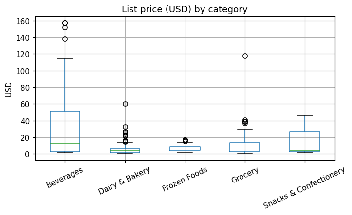
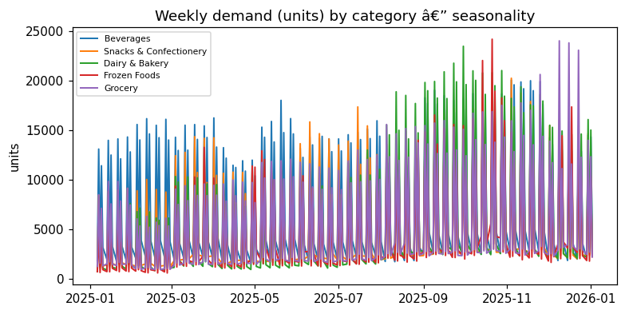
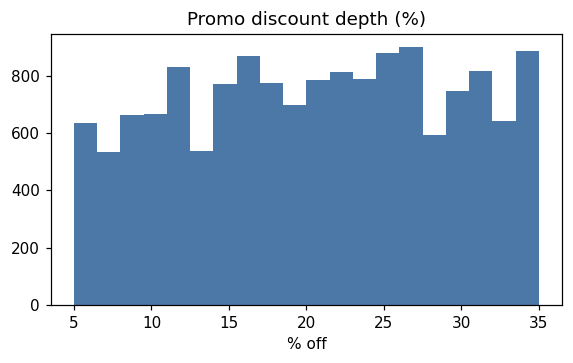
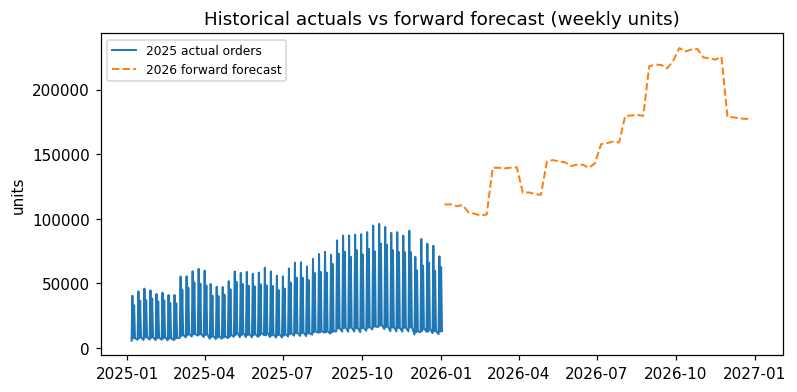

# Supply Brain Synthetic Dataset — EDA Report

*Auto-generated 2026-08-12 00:52 from data in `.`. The dataset is randomly generated, so figures differ between generation runs; this report reflects the current instance on disk.*

## Instance fingerprint

| Field | Value |
| --- | --- |
| SKUs | 500 |
| Order rows (historical) | 260,770 |
| Forecast rows (in-sample + forward) | 659,506 |
| Total historical revenue (USD) | $127,986,762 |
| Historical week span | 2025-W01 → 2025-W52 (52 weeks) |
| Forecast week span | 2025-W01 → 2026-W52 (104 weeks) |

---

# Part 1 — Parameters, Assumptions & Interpretation

This dataset is a fully-synthetic CPG (packaged food & beverage) supply chain, built to behave like a real client extract. Every table below is generated from an explicit business model; the parameters and assumptions that shape it are documented here, each checked against the realized data in this instance.

## 1.1 Scope & grain

- **Product scope:** 5 categories × 100 SKUs = 500 SKUs. **Realized:** 500 SKUs across 5 categories.
- **Time scope:** 52 weeks of historical actuals (2025) + 52 weeks of forward forecast (2026). The forward year is the execution horizon for MEIO / buffer optimization and has no actuals.
- **Grain:** orders & forecast at SKU × DC × Customer × Week; production at SKU × Plant × Week; inventory at SKU × DC × Week.
- **Currency:** all monetary values USD (columns suffixed `_usd`).

## 1.2 Product catalog & economics (USD)

SKUs are split across 3 demand **segments** with a target mix of **50% Fast-Moving / 30% Seasonal / 20% Intermediate**, and a **price tier** (Premium vs Value) within each category. Prices are realistic CPG case-level USD values; margin is designed at ~30–34% (cost ratio ~0.66–0.70).

| segment | target_% | realized_% |
| --- | --- | --- |
| Fast-Moving | 50.00 | 50.00 |
| Seasonal | 30.00 | 30.00 |
| Intermediate | 20.00 | 20.00 |


**List price & shelf life — design intent vs realized, by category:**

| category | intended_price_range | intended_median | realized_price_range | realized_median | realized_avg_margin | intended_shelf_life | realized_shelf_life |
| --- | --- | --- | --- | --- | --- | --- | --- |
| Beverages | $6–$32 | $14 | $1.33–$157.60 | $12.96 | 31.9% | 120–365d | 127–365d |
| Snacks & Confectionery | $8–$42 | $18 | $2.00–$46.78 | $3.87 | 34.0% | 90–300d | 94–300d |
| Dairy & Bakery | $9–$48 | $22 | $0.41–$60.11 | $3.70 | 30.1% | 5–21d | 5–21d |
| Frozen Foods | $12–$60 | $28 | $2.09–$17.38 | $6.12 | 30.9% | 180–540d | 184–537d |
| Grocery | $6–$38 | $16 | $0.33–$118.09 | $5.83 | 32.9% | 180–540d | 186–538d |

## 1.3 Network (modelled on the Coca-Cola US bottling system)

Tiered **Production Plant → Plant DC → Regional DC → Customer/Sales DC**, at roughly the real Coca-Cola ratio (~1 plant per 5–6 DCs). Plants are production-only (hold no inventory); the Plant DC is the first stock-holding echelon. Two real delivery patterns are modelled:
- **Warehouse / bulk** national accounts are served from **Regional DCs**.
- **DSD** (direct-store-delivery) small-format / convenience / foodservice banners are served from local **Customer DCs**.
This dual pattern is why orders legitimately reference *any* stocking DC (regional or customer).

| Field | Value |
| --- | --- |
| Production plants | 4 |
| Plant DCs | 4 |
| Regional DCs | 6 |
| Customer/Sales DCs | 12 |
| Plant : DC ratio | 1 : 5.5 |
| B2B customer banners | 10 |
| Delivery modes | BULK, DSD |
| Transport modes | Train, Truck |
| Lanes | 28 |

## 1.4 Demand model, seasonality & promotions

Weekly orders are drawn from an explicit **log-linear demand model**:

```
log(qty) = log(base * customer_scale * dc_share) + elasticity * log(price_week / list_price) + log(seasonal_index[week]) + noise
```

- **Seasonality** is category-specific: Beverages & Frozen peak in summer; Dairy & Bakery and Snacks peak around the holidays; Grocery is flatter. The `Seasonal` segment has the largest amplitude, `Intermediate` the smallest.
- **Promotions** create genuine price variation: ~30% of SKU-weeks are discounted 5–35%. **Realized:** 5.7% of order rows on promo, avg depth 20.5%.
- **Elasticity** is embedded per SKU (by category × price tier) so that demand genuinely responds to price. It is deliberately **not** shipped as a column — Part 2 recovers it from the orders using the documented method.

**Internal elasticity targets by category (for reference; recovered in Part 2):**

| category | internal_elasticity_target |
| --- | --- |
| Beverages | -2.00 |
| Snacks & Confectionery | -2.10 |
| Dairy & Bakery | -0.55 |
| Frozen Foods | -1.30 |
| Grocery | -0.60 |

## 1.5 Forecast horizons

`demand_forecast` spans **104 weeks** with a `horizon` flag:
- **in_sample (2025):** forecast + actual + error — for forecast-accuracy analysis. Forecasts deliberately miss promo spikes and under-call the holiday peak for Seasonal SKUs.
- **forward (2026):** forecast only, **no actuals** — the MEIO execution horizon. Built by projecting each SKU-DC-customer level forward with ~5% YoY growth and the same seasonal shape.

| Field | Value |
| --- | --- |
| `forward` rows | 398,736 |
| `in_sample` rows | 260,770 |

## 1.6 Cost & economic parameters (USD)

- **Holding cost:** annual carrying cost as a % of unit cost, by category (perishables higher). Also expressed per-unit-per-year in USD on `sku_master`.
- **Cost of capital & stockout multiplier:** in `cost_parameters`.
- **Logistics cost:** USD per unit per lane on `network_lanes`, scaling with distance.

| category | holding_cost_pct_annual | cost_of_capital_pct | stockout_cost_multiplier |
| --- | --- | --- | --- |
| Beverages | 0.22 | 0.09 | 1.56 |
| Snacks & Confectionery | 0.21 | 0.08 | 2.38 |
| Dairy & Bakery | 0.34 | 0.09 | 1.61 |
| Frozen Foods | 0.33 | 0.09 | 2.20 |
| Grocery | 0.20 | 0.10 | 1.69 |

## 1.7 Key assumptions & caveats

- Prices, costs, capacities, lead times and cost rates are realistic **assumptions**, not client facts — validate before using in a hard optimization.
- Inventory is a single-echelon (s,S) flow simulation per DC driven by its outbound orders; plant-DC replenishment coupling is simplified.
- Network geography is US (Coca-Cola-modelled) and self-contained; it does not reference any external/real dataset.
- Elasticity is embedded to make demand price-responsive but is **not** provided as ground truth; the estimate in Part 2 is what a modeller would compute from orders alone.


---

# Part 2 — Exploratory Data Analysis

## 2.1 Dataset overview

| table | rows | cols |
| --- | --- | --- |
| sku_master | 500 | 14 |
| orders | 260,770 | 16 |
| demand_forecast | 659,506 | 10 |
| production | 24,725 | 8 |
| inventory | 295,256 | 11 |
| network_lanes | 28 | 11 |
| b2b_customer_master | 10 | 4 |
| customer_serving_dc | 25 | 4 |
| cost_parameters | 5 | 4 |
| plant_master | 4 | 6 |
| plant_dc_master | 4 | 5 |
| regional_dc_master | 6 | 6 |
| customer_dc_master | 12 | 6 |

## 2.2 Referential integrity

| check | result |
| --- | --- |
| orders.sku_id ⊆ sku_master | PASS |
| orders.b2b_customer_id ⊆ banners | PASS |
| orders.dc_id ⊆ stocking DCs | PASS |
| forecast keys ⊆ masters | PASS |
| production.plant_id ⊆ plants | PASS |
| inventory.dc_id ⊆ stocking DCs | PASS |
| lane endpoints ⊆ nodes | PASS |
| forward forecast has no actuals | PASS |
| in_sample forecast has actuals | PASS |

## 2.3 Product & economics

| category | skus | avg_list_usd | avg_cost_usd | avg_margin_pct | avg_shelf_life_d |
| --- | --- | --- | --- | --- | --- |
| Beverages | 100 | 33.92 | 23.14 | 31.90 | 253.90 |
| Dairy & Bakery | 100 | 6.33 | 4.42 | 30.10 | 12.30 |
| Frozen Foods | 100 | 7.26 | 5.01 | 30.90 | 366.43 |
| Grocery | 100 | 10.68 | 7.14 | 32.90 | 365.81 |
| Snacks & Confectionery | 100 | 14.38 | 9.51 | 34.00 | 188.24 |


Price-tier split: Premium 262, Value 238. Seasonal-flagged SKUs: 150 of 500.




## 2.4 Orders & demand

| Field | Value |
| --- | --- |
| Total units ordered | 8,079,328 |
| Total revenue (USD) | $127,986,762 |
| Avg order line (units) | 31.0 |
| Avg selling price (USD) | $15.05 |


**By category:**
| category | units | revenue_usd | revenue_% |
| --- | --- | --- | --- |
| Beverages | 2,015,716 | 72,638,905 | 56.80 |
| Snacks & Confectionery | 1,549,159 | 23,673,553 | 18.50 |
| Grocery | 1,538,626 | 14,925,191 | 11.70 |
| Dairy & Bakery | 1,609,211 | 8,601,762 | 6.70 |
| Frozen Foods | 1,366,616 | 8,147,352 | 6.40 |


**By demand segment:**
| segment | units | revenue_usd |
| --- | --- | --- |
| Fast-Moving | 5,033,151 | 86,180,012 |
| Intermediate | 742,535 | 7,748,717 |
| Seasonal | 2,303,642 | 34,058,033 |


**By delivery mode (BULK = warehouse via RDC, DSD = via customer DC):**
| delivery_mode | units | revenue_usd | orders |
| --- | --- | --- | --- |
| BULK | 6,325,925 | 98,950,514 | 143,147 |
| DSD | 1,753,403 | 29,036,248 | 117,623 |


**Concentration (Pareto):** top 20% of SKUs (100) drive 84.7% of revenue.







## 2.5 Price variation & measured elasticity

Elasticity is estimated from the historical orders using the documented method — a two-way (SKU + week) fixed-effects regression of `log(order_qty)` on `log(unit_price_usd)`, pooled per category (pure-numpy iterative demeaning; no `statsmodels` needed). The SKU effect absorbs baseline volume/list price so the slope is identified from within-SKU promo price changes; the week effect absorbs common seasonality. The `internal_target` column is the value baked into the generator, shown only to gauge recovery — a real client dataset would not include it.

| category | measured_elasticity | internal_target | gap_vs_target | n_obs |
| --- | --- | --- | --- | --- |
| Beverages | -1.26 | -2.00 | 0.74 | 52,480 |
| Dairy & Bakery | -2.08 | -0.55 | -1.53 | 52,125 |
| Frozen Foods | -3.38 | -1.30 | -2.08 | 47,797 |
| Grocery | -1.95 | -0.60 | -1.35 | 54,354 |
| Snacks & Confectionery | -3.43 | -2.10 | -1.33 | 54,014 |


*Recovery: 0/5 categories within 0.5 of the embedded target; all elasticities negative as expected. Interpretation: Beverages & Snacks are the most price-elastic, Dairy & Bakery and Grocery the most inelastic — consistent with staple vs. discretionary demand.*

## 2.6 Forecast accuracy & forward horizon

**In-sample forecast accuracy (2025) — MAPE by segment:**
| segment | MAPE_% |
| --- | --- |
| Fast-Moving | 6.20 |
| Intermediate | 11.60 |
| Seasonal | 21.30 |


Overall in-sample forecast bias: -0.5% (negative = under-forecast, e.g. missed promo/holiday peaks).


**Forward horizon (2026):** total forecast units 8,479,248 vs historical actual 8,079,328 → implied YoY change +4.9% (design target ~5%).




## 2.7 Production (planned vs actual)

| Field | Value |
| --- | --- |
| Planned units (total) | 8,079,328 |
| Actual units (total) | 7,538,220 |
| Mean schedule adherence | 93.3% |
| Weeks below 90% adherence | 10.8% |

| plant_id | planned | actual | adherence |
| --- | --- | --- | --- |
| PLANT01 | 1,258,224 | 1,176,573 | 93.30 |
| PLANT02 | 1,936,260 | 1,809,123 | 93.30 |
| PLANT03 | 3,127,277 | 2,912,513 | 93.30 |
| PLANT04 | 1,757,567 | 1,640,011 | 93.30 |

## 2.8 Inventory & service

| Field | Value |
| --- | --- |
| Avg closing stock (units) | 79 |
| Avg safety stock (units) | 31 |
| DC-SKU-weeks at zero stock | 5.7% |
| Total shipments (units) | 8,045,958 |

| echelon | avg_closing | avg_safety | zero_stock_pct |
| --- | --- | --- | --- |
| Customer DC | 33.00 | 12.70 | 7.90 |
| Regional DC | 128.90 | 49.60 | 3.30 |

## 2.9 Network & lanes

| transport_mode | lanes | avg_lead_days | avg_dist_mi | avg_logi_usd |
| --- | --- | --- | --- | --- |
| Train | 4 | 4.93 | 803.15 | 2.24 |
| Truck | 24 | 2.88 | 299.39 | 1.32 |


**Lead time by lane tier (origin node type):**
| origin_node_type | lanes | avg_lead_days |
| --- | --- | --- |
| PLANT | 4 | 0.50 |
| PLANT_DC | 12 | 4.14 |
| REGIONAL_DC | 12 | 3.09 |


---
*End of report. Regenerate any time with `python eda.py` after re-running the data generator.*

